# Count 盘点

**Status: proposal for the owner (2026-11-02). Nothing is built and no prototype changes.** A product round, not a build. The old system's screens are in [old-system/](old-system/) ([NOTES.md](old-system/NOTES.md)), today's prototype in [now/](now/), the mockups of the recommendation in [mock/](mock/) (rendered by [mock/mock.mjs](mock/mock.mjs) inside the real Inspection and Home prototypes). The blind pass from another model family (OpenAI, collab `--mode blind`, requirements and evidence only) is in [codex-blind-pass.md](codex-blind-pass.md).

The owner's words (2026-11-02): *"count is not only for piglets but we do counts and calibration checks for sows as well, this is more of a generic global feature … When you are not sure anymore how many pigs are here … rescanning all pigs would be really dumb if you just moved like 3 pigs into it … we also need to map out how the conditions transfer (for no-ID pigs …) … you see 3 pigs in the system but there are 5, you can recount … some pigs might be in other crates and they get moved here once you do scanning; in this room you can open scan and it will batch scan all the pigs."*

## Recommendation in one paragraph

**Count is a place's action, one page for every place.** It sits on the pen page (beside Note, Feed, Observe, Fault, Tick all), never in a pig's Actions: you count a place, not a pig. Home never reminds anyone to count (owner, 2026-11-02): a recount of a room is asked for **inside the task whose number disagrees**, as in the old app (receiving pigs in Transfer: 28 arrived where 30 were sent). The page is the Inspection list you already know, in counting mode, and the order is the barn's (owner, 2026-11-02): **first count every pig in the pen**, one number, which is easy; **then scan the ear tags** (or type one), the reader always listening, a pig read twice counted once because pigs move about. Pigs without ear tags are never counted on their own, which is hard: they are worked out, all pigs − pigs with ear tags. A pig the record places somewhere else is ticked here with *Moves here*. **Save count** writes one observation: what was seen, what the record expected, who and when. Scanned pigs from elsewhere move here. Pigs with ear tags that were not seen **stay where they are recorded**: the receipt lists them, and opening one is the way to Report missing. A difference in pigs without ear tags is saved as **unaccounted** on their batch (Round 9), never as a pen status, never a birth or a death. No reason is asked. The few pigs you just moved in are not a count: **Transfer records the arrivals** (scan them at the new pen, or type how many), so nobody rescans 30 pigs for 3. And conditions on pigs without ear tags **follow the pigs you pick**: picking 5 of 14 asks, for each condition the group has, how many of the 5 have it.

## Owner review, 2026-11-02 (supersedes the room count and the first Count saved below)

Reviewed on the Claude Design canvas ([canvas.md](canvas.md)). Ruled and redrawn:

- **One pen at a time.** There is no room count: a farm never counts a whole room in one go. A task that asks for a recount names its pens, and each pen is counted on its own page. The room screens and the per-room questions below are withdrawn.
- **Count every pig first, then add the ear tags.** The pen's number is one count of all pigs, which is easy; pigs without ear tags are worked out (all − ear tags), never counted alone, which is hard.
- **The ear tags go in through the shared search-and-scan field** (the same control as search elsewhere), because some farms have no reader: type a tag, or tap scan. Each added pig lands in the list below it as a ticked row; unticking one read by mistake (a pig in the next pen through the bars) takes it out of the count. A tag added twice counts once (pigs move about while you scan).
- **A pig recorded in another pen says so quietly** on its second line: *Currently in Unit 9 · C3* in amber text, no chip. Saving moves it here.
- **Pigs recorded here and not added** are named under the list (*Recorded here, not added yet: 000803*). They stay recorded here and are counted as tagged when working out the pigs without ear tags.
- **Pigs not added are settled at Save, on the spot.** Save count with a tagged pig recorded here but not added opens a short drawer, *1 pig not added*: for each, *Here · add her*, *Not here · report her missing* or *Not sure · leave her in D4*, then Save count. Nothing is left to decide after saving.
- **Then a full page, the count summary, says plainly what the count did** (a drawer of tiles and a drawer of lines were both rejected as too much to read). *In D4 now*: 16 pigs, 5 with ear tags, 11 without. *2 pigs moved here*: each by ear tag, from where (*000512 · From Unit 9 · C3 · C3 → D4*). *2 pigs unaccounted for*: without ear tags 13 → 11, and one plain sentence on what happens: they go on batch 25's **balancing sheet**; a later count, a death or a move can balance them; still open when batch 25 ends, they are recorded as an unaccounted loss. A count that matches says *Matches the record* and nothing else. Done.
- **The balancing sheet** (owner, 2026-11-02) is Round 9's batch-level "N unaccounted" made explicit: open gains and losses per batch, balanced by later events, closed into an unaccounted loss when the batch ends (Q, batch end = weaning, transfer out or sale).
- Withdrawn with the room count: owner questions 2 (as worded), 5 and the room scenarios 17 to 19; scenario 18 (a pig from another pen) now happens inside a pen count.

---

## 1. The old system, and what is complex about it

From [old-system/NOTES.md](old-system/NOTES.md) (Figma frames by id) and [ux/research/checkin/pen-count.md](../../ux/research/checkin/pen-count.md).

| | Old system | What is complex |
|---|---|---|
| **Count / calibration** 猪只数量校准 | One door: an unlabelled pencil glyph beside `猪只列表（N）` on a pen card. A two-step wizard: (1) confirm identified pigs, scan or exact-search to add one found here, a `?` pin per row to report one missing; (2) one pen total `− n +` that cannot go below the identified pigs, then every un-identified pig allocated to (production line, batch) rows until Σ = un-identified exactly, else Submit is blocked. A confirm dialog `22 → 25 头`, then a toast. ~14 frames for one number. | Arithmetic ceremony around one observation; batch allocation is the real payload; under and over both blocked; the floor forces a missing report per named pig before the number can drop; no reason, no stamp, no expected-vs-counted; nothing tells you a count is due.  |
| **Transfer** 转移 / 转舍 | Two versions: Inspection (tree → wheels → confirm dialog if all identified, else a full page where each pen health record is ticked Move / Copy / Stays); a task version for one pig (sheet → tree → wheels). The web treats 转舍 as a planned task with `已转入 / 已转出 n / N` per batch; the phone never links to it. | Three ideas of the destination (pen, unit, unit × pen wheels); a whole page because pen-level health records can't know which head moved; Copy doubles case counts; nothing for an occupied pen.  |
| **Sale / transfer out** 出栏 / 转出 | Not on mobile. The web 不在场猪只 table keeps exit reason (售出 · 转出 · 死亡) and dates per pig. | No-ID exits not drawn; exit reasons only implied. |
| **Missing** 上报失踪 | A confirm dialog, nothing captured; the pig is parked in a 失踪列表 designed nowhere. Reachable from the 记录 drawer and the calibration `?` pin, with inverted buttons. | Parked, never resolved; no found-again flow. |
| **Pigs without ear tags** 无ID | `No ID Pigs × N` rows; ticking one row asks how many; their conditions belong to the pen, so every move asks stay / move / copy. | Two models side by side (pigs vs head counts per batch); every verb must say how it treats each. |

**What the new design must keep** (NOTES, last section): claim a pig found here and show where she was recorded; the floor (a count can't silently delete a named pig); batch membership of anonymous pigs; old → new kept as a record with who and when; heads move by count; missing parks, never deletes; exit reasons; litter counts that never touch births.

## 2. Today's prototype (main at 98485aca)

| | |
|---|---|
| 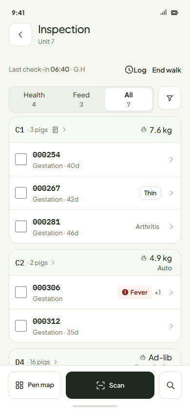 | 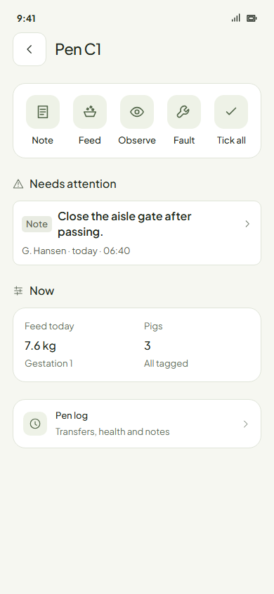 |
| **Inspection walk** (`inspection.walk`): pen cards, tagged pigs ticked, a group row per pen for pigs without ear tags (`14 pigs`, conditions with counts, a number field). | **Pen page** (`inspection.pen`): the pen's own actions (Note, Feed, Observe, Fault, Tick all), Now, Pen log. No count. |
| 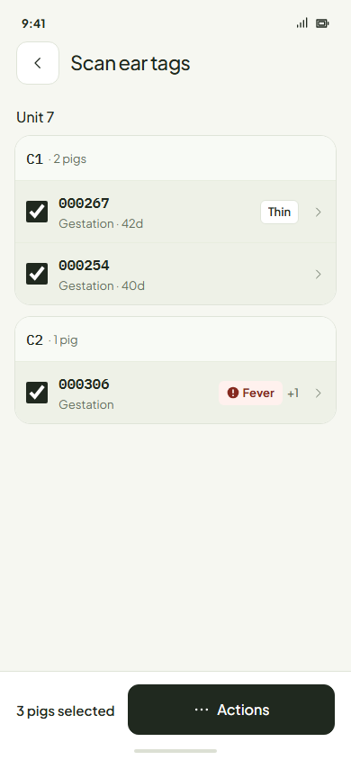 | 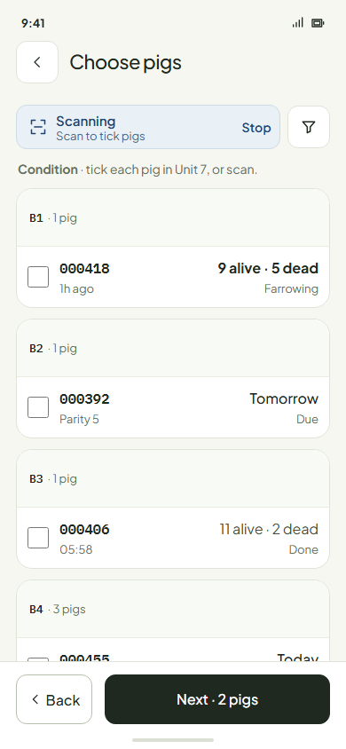 |
| **Scan ear tags** (`inspection.scan-list`): always listening, reads collect into pen cards, `3 pigs selected · Actions`. | **Choose pigs** (`farrowing.batch-scanning`): the Lookup scan bar over pen cards, footer `Next · 2 pigs`. The closest sibling of a count page. |
| 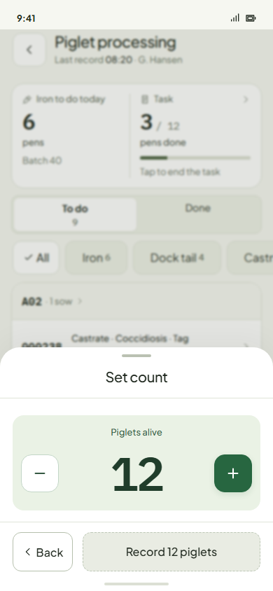 | 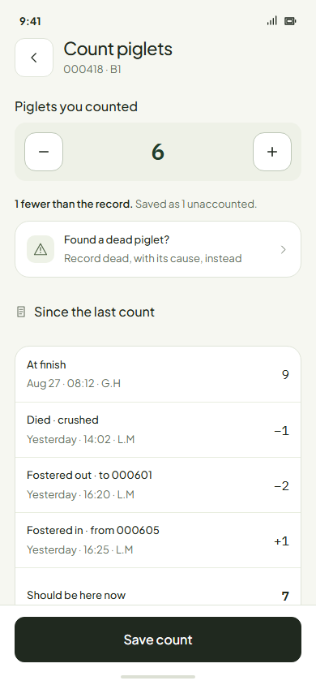 |
| **Set count** (`piglet-processing.set-count`): one stepper well, `Record 12 piglets`. Round 9's rule. | **Count piglets** from the Edit record round (a proposal, not built): baseline, deaths and fosters since, `Should be here now`. |

The archived Set count (`inspection.set-count-batches`, [now/](now/inspection.set-count-batches.png)) and Transfer (`move.mixed`) decks are earlier designs: per-batch steppers, a reason Choice(4), commit on every tap; Stays / Goes / Both per pen record.

## 3. Scenarios: what the worker actually knows at the pen

| # | Scenario | What the worker knows | What the app does |
|---|---|---|---|
| 1 | **After a recorded transfer, into an empty pen** | The pigs they just walked in | Nothing to count. Transfer recorded the arrivals (scan or number); the pen's record is them. |
| 2 | **After a recorded transfer, a few into an occupied group pen** (3 into 27) | The 3 arrivals, not the 27 | Nothing to count. Transfer recorded the 3; the pen is 30 by the record. A full Count stays available if they doubt the 27. |
| 3 | **Many in, or a messy day of moves** (a whole batch weaned into nursery pens) | Roughly what went where | Transfer's batched process: per destination pen, scan the tagged arrivals or type how many. Then Count any pen that still looks wrong. |
| 4 | **An unrecorded move** (pigs were moved, nobody recorded it) | What is in front of them now | Count the pens involved. Tagged pigs scanned at the new pen move there. Untagged: the new pen gains, the old pen loses, both as unaccounted (the batch nets to zero). A worker who knows the source records a Transfer instead. |
| 5 | **The record says 3, there are 5** (untagged) | 5 | Count: type 5. +2 unaccounted on the batch. Never "more born". |
| 6 | **The record says 5, there are 3** (untagged) | 3 | Count: type 3. −2 unaccounted. No reason, no "missing" on the pen (Round 9). |
| 7 | **Tagged pigs, all there** | Each tag | Count: scan each; `3 of 3`; Save writes the observation and the stamp. |
| 8 | **A tagged pig scanned here that the record places elsewhere** | She is here | Ticked here with *Moves here · was Unit 9 · C3*. Save moves her (one placement, logged in both pens). |
| 9 | **A tagged pig recorded here, not seen** | Only that they didn't read her | She stays recorded here. The receipt lists her; opening her is the way to Report missing or Transfer. A count never removes a named pig. |
| 10 | **A pig reported missing is scanned** | She is here | Ticked with *Found · was missing*; Save returns her here and closes the missing report. |
| 11 | **A tag the farm doesn't know** | A tag number | The scan toast `No pig with this tag · 000999 · Left out of the count`. Nothing is created. (Q10: offer Assign identity when the place has pigs without ear tags.) |
| 12 | **A tag of a pig recorded dead or sold** | A tag number | Toast `000777 · Recorded dead Oct 3 · Left out of the count`. Count never resurrects. |
| 13 | **Sows in individual crates** | Each sow by tag; the litter by number | Count the crate: the sow by scan, the litter by number (after Finish; while she farrows the farrowing screen owns the count). |
| 14 | **Sows in group housing** | Each sow by tag | Count the pen (scan every sow) or the room. |
| 15 | **Piglets and growers without ear tags** | How many pigs are in the pen | Count every pig; the pigs without ear tags are worked out (all pigs − ear tags read). |
| 16 | **A mixed pen** (2 tagged + 14 untagged) | All the pigs, then each tag | Count all 16, scan the 2 tags: 14 without ear tags, worked out. |
| 17 | **A whole room** | Pen by pen as they walk | Opened from the task that asks for it (Q2). Count the unit: pen cards in walking order; pens they skip stay as they are (`3 of 4 pens`). |
| 18 | **A room scan finds a pig from another room** | She is in this room | She joins the pen scanned just before her, shown on her row (*Moves to C2 ›*, changeable), and on the receipt. |
| 19 | **A pig in the wrong pen of the same room** | Only if they count that pen | A room count proves the room, not the pen; a pen count proves the pen (Q5). |
| 20 | **Death** | A body, often its cause | Report death (its own record). It lowers what the next count expects. |
| 21 | **A body found after a count already took it** | A body | Report death as usual. The pen drops one more; the next count finds one more than expected and books +1, so the batch nets to zero unaccounted and one death (Q8). |
| 22 | **Sold / transferred off the farm** | Which pigs or how many left | An exit record of its own (not designed yet), with a reason (sold, off farm). It lowers what the next count expects. Count never writes a sale. |
| 23 | **Missing** | A tagged pig can't be found | Report missing (tagged only). An untagged pig that can't be found is a lower count. |
| 24 | **Offline, one phone** | — | Saved on the phone; the difference is worked out against the record as it syncs (a death recorded earlier on another phone shrinks the unaccounted). |
| 25 | **Two phones count the same pen** | — | Two observations; the later count (by count time, not sync time) stands as the pen's figure; differences are never summed (Round 2). Both stay in the log. |
| 26 | **Two phones, one counts, one moves pigs out at the same time** | — | Event time orders them: a move recorded before the count time is in the expected figure, one after it is not. |

## 4. The model

**A count is an observation of a place at a moment.** It writes, per pen counted:

| Field | Notes |
|---|---|
| Place, scope | The pen, or the unit with the pens that were counted (pens skipped are not part of it) |
| Who, when, device | Count time is the observation time; sync time is kept apart |
| Pigs with ear tags | Seen (by scan or tick) · expected here · moved here (with where from) · not seen |
| Pigs without ear tags | Worked out, never typed: all pigs counted − pigs with ear tags here (read, or recorded here and not read: they stay recorded) · expected (the record at count time) · difference = unaccounted gain or loss, on the pen's batch |
| Baseline | The last count, or the first record of the pen's pigs since (shown as *Since the last count*) |

**What a count changes:** the pen's figure for pigs without ear tags (to what was counted); the placement of tagged pigs scanned here; a missing pig scanned here returns. **What it never changes:** births, Total born, death causes, treatments, earlier counts, earlier moves, batch membership of tagged pigs, any sale or exit. A count is never edited; a later count is a new observation.

**Expected (what should be here)** = the last count + every recorded event since: moved in, moved out, died, sold or off farm, born (litters), weaned. The page shows that as *Since the last count* down to *Should be here now*, so the worker sees why the record says what it says.

**Unaccounted** lives on the batch, never on the pen (Round 9): the batch's figure is the sum of its pens' differences, gains and losses netted, shown where the task's or batch's progress is (`2 unaccounted`). A litter's ledger takes it as its *± Unexplained* term: `Alive = Born − Dead − Moved out + Moved in ± Unexplained − Weaned`.

**Counting order and reads** (owner, 2026-11-02). One number per pen, all pigs, first; it cannot go below the ear tags read. Then the reads: the reader collects every tag it hears, and a tag read again changes nothing (one quiet line, `000802 read twice · counted once`). *Type an ear tag* opens the number pad for a tag the reader misses. The pen's tally (`12 without ear tags · 2 unaccounted`) sits in the footer beside Save count and moves as the number and the reads change.

**Identities.** A tagged pig has one place. A count's scan moves her here on Save (scenario 8), never away (scenario 9). The floor stays: a number never deletes a named pig, because tagged pigs are never counted by number.

**One batch per pen for pigs without ear tags** (restricting rule, Q6). Untagged pigs moved into a pen holding another batch's untagged pigs join that pen's batch, shown on the move. So a pen always has one group row and one number; the old batch-allocation step disappears.

**Conditions on pigs without ear tags follow the selection** (Q7). A group's conditions are counts (`Coughing · 3` of 14). Any action on some of a group (Transfer, Report death, an exit) asks, for each condition the group has, how many of the picked pigs have it: one stepper per condition, default 0, at most the smaller of the two. Picking the whole group takes every condition, no question. The source keeps the rest (`Coughing · 1`), the destination gets the picked (`Coughing · 2`). A count lowers no condition unless the group drops below it, then the condition is capped at the group size (logged). Nothing is copied, so no case is ever counted twice. 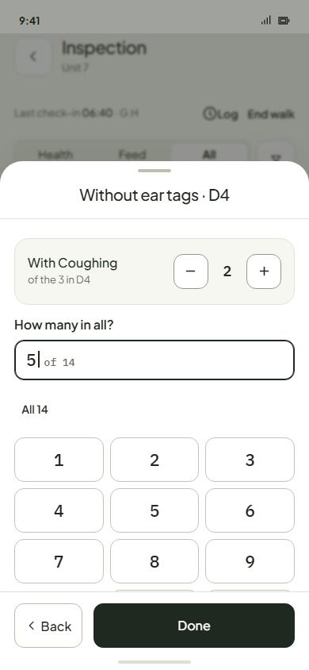

**Ties to the neighbours**

| Feature | Its job | Its tie to Count |
|---|---|---|
| **Transfer / Move** (not designed) | Records arrivals: scan the tagged pigs at the new pen, or type how many untagged and from which pen. The batched transfer task does this per destination pen against the plan (the web's `已转入 / 已转出`). | A recorded transfer is in *Since the last count*; no recount after it. The same tally page (pen cards, scan, number fields) serves both, against the plan instead of the record. |
| **Report death** | Body and cause | Lowers the expected figure. Never rewritten by a count. |
| **Exit: sold, off farm** (not designed) | Who left, why, when | Lowers the expected figure. |
| **Report missing** | Parks a tagged pig | Reached from a not-seen pig on the receipt. A missing pig scanned in a count is found. |
| **Assign identity** | One untagged pig gets a tag | Untagged −1, tagged +1; the pen total is unchanged. |
| **Farrowing** | Owns the litter count while she farrows; no Edit record after (2026-11-02) | Count is the only way to adjust a finished litter's live figure; it never touches Total born or causes. *Reconcile piglet count* becomes Count. |
| **Piglet processing** | Set count (Round 9) | Becomes Count. |
| **Task / batch progress** | `N unaccounted` | The sum of the counts' differences for the batch. |

## 5. Options

| | (A) Set count everywhere | **(B) Count is a place's tally page (recommended)** | (C) Two jobs: Count all / Confirm here (the blind pass) |
|---|---|---|---|
| **What it is** | Round 9's stepper for any pen: one number | One page per pen or room: tagged by scan, untagged by number; scan moves here on Save | A choice at the door between a full count and a partial identity check |
| **Sows** | Not countable by tag; identity fixed only by Transfer and Missing | Roll call by scan; strays move here; not seen listed | Confirm here moves scanned pigs; Count all for numbers |
| **3 pigs moved into 27** | Not covered | Transfer records the 3 | Confirm here with the 3 |
| **Room** | Pen by pen | One page, pen cards, partial allowed | A list of pens, one count each |
| **Screens** | 1 | 4 (page, pen variant, receipt, log line) + 1 selection drawer for conditions | 6+ (chooser, form, confirm, review, identity verdicts, observation-only form) |
| **Risk** | The owner's sow and scanning cases are left out | A room scan can't prove the pen inside the room (Q5) | A decision at the door every time; partial checks overlap Transfer |

**What the blind pass changed.** It reached the same core independently: a count is an observation, never a birth or death; no reason; unaccounted on the batch; nothing disappears because it wasn't scanned; Count on the pen page, not pig Actions; one batch per pen; a later count stands by observation time. It differed in three places, and changed this proposal in four:
- **A room scan does not prove the pen.** It wanted a room count to be a list of pens, one count each. I keep the one room page (the owner asked for it) and state the limit as Q5: a room scan proves the room; within-room pen fixes need a pen count. A pig from another room joins the pen scanned just before her, visibly, changeable (scenario 18).
- **Two jobs** (Count all / Confirm here) for the "3 pigs moved in" case. I give that case to Transfer instead: one job per door, and the arrivals are a move, not a count.
- **Condition split with "Cannot tell".** It refused a default of 0 (zero asserts the sick ones stayed) and offered *Cannot tell*, which leaves no current count on either group. I keep default 0 with a visible stepper: the worker is looking at the pigs, a third answer is a new mechanism, and *Cannot tell* would lose the condition entirely. Put as Q7.
- **Changed here:** a missing pig scanned is found (10); a pig recorded dead or sold is never resurrected (12); event time, not sync time, orders offline counts (24–26); a sow found in another crate raises whether her litter moves with her (Q11).
- **Body found after a count** (21): it proposed a *Pigs here now* field on the death drawer. That re-asks Round 9's "one of the missing?" in other words. I keep Round 9: the next count heals it and the batch nets to zero (Q8).

## 6. The recommendation, drawn (390, real prototype parts)

**House-pattern match.** Same job elsewhere: *Choose pigs* (`farrowing.batch-scanning`: scan bar over pen cards, footer with the tally), *Scan ear tags* (`inspection.scan-list`: reads collect into pen cards), the group row's number field (Conditions), *Set count*'s stepper well (`piglet-processing.set-count`), the pen page's tile grid, the unit card's door rows (Inspect unit, Environment & devices). Count adds no component; the tally glyph is a proposed icon-registry addition.

**Attention budget (the count page).** 1 · the number of all pigs (top, the first act). 2 · the ear tags as they are read, `2 of 2`, with *Type an ear tag*. 3 · the outcome, in the footer: pigs without ear tags and the difference. 4 · the evidence, *Since the last count*, below. Cut from the old flow: the wizard, batch allocation, before/after cards, the reason, the confirm dialog, the toast, the green "balanced" banner; and from the first draft, typing the untagged pigs. The receipt says only what is different or not seen.

| | |
|---|---|
| 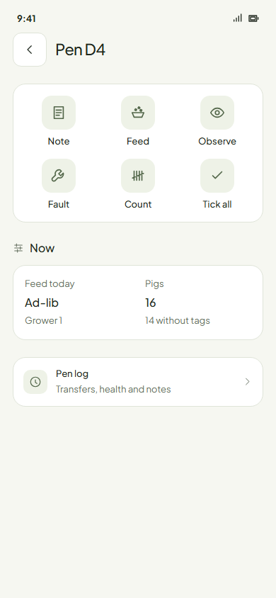 | 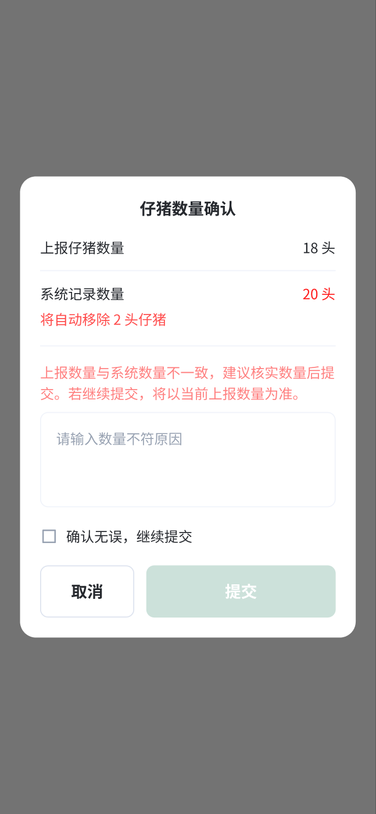 |
| **Entry, one pen.** Count joins the pen's tiles (six: 3 + 3, the row grid rule). | **A recount, in the old app** (TASK `971:15991`, reached from the piglet task's More actions › 数量异常 `1567:20878`): the task's own number (18) against the record (20), inside the task. No reminder anywhere. The proposal keeps that: a room recount opens from the task whose number disagrees. (The Home *Last counted* row of the first draft is dropped, owner 2026-11-02.) |
| 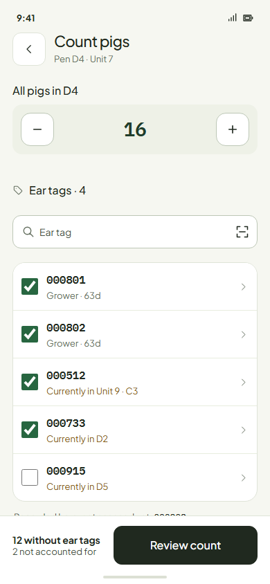 | 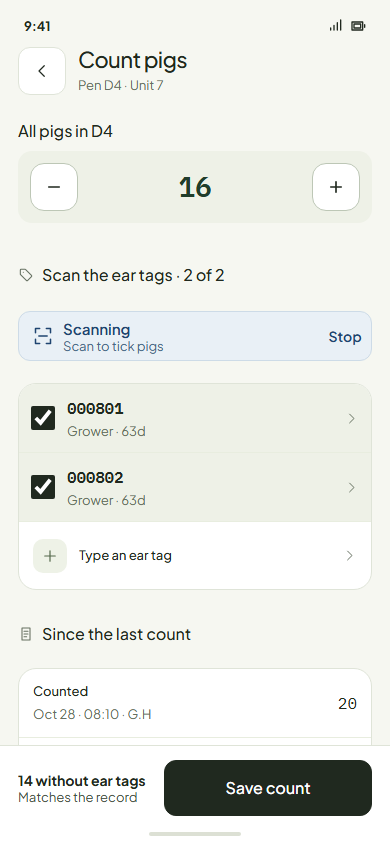 |
| **Count one pen (D4).** First *All pigs in D4*: 14. Then *Scan the ear tags · 2 of 2*, the reader listening, *Type an ear tag* for a missed one, `000802 read twice · counted once`. The footer works it out: *12 without ear tags · 2 unaccounted* · Save count. *Since the last count* below explains the record's 16. | **Matches.** 16 counted, both tags read: *14 without ear tags · Matches the record*. Saving still writes the count. |
| 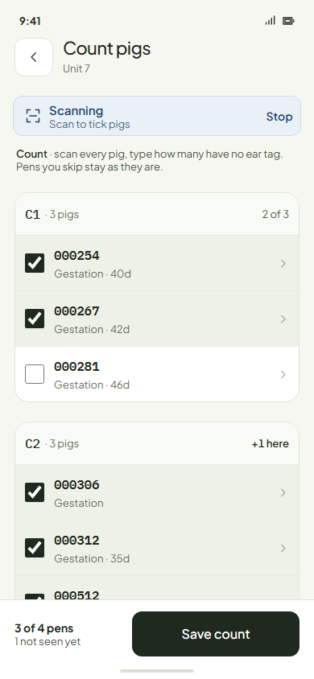 | 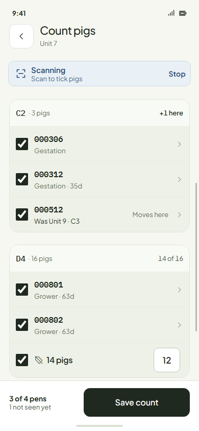 |
| **Count a room (Unit 7).** At each pen: type how many pigs are in it (the field on the pen card), then scan. C1 counted 3, 2 read: *1 not seen*. Footer: `3 of 4 pens · 1 not seen yet` · Save count. | **The same, scrolled.** 000512, recorded in Unit 9 · C3, is read among C2's sows: *Moves here*, `+1 here`. D4: 14 counted, 2 tags read, *Without ear tags 12*, worked out. D5 untouched: not counted. |
| 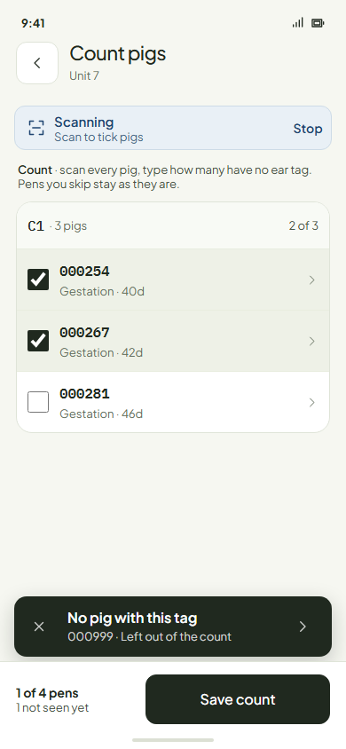 | 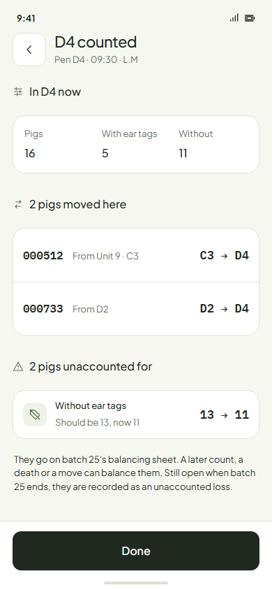 |
| **An unknown tag.** The shared scan toast; the count goes on. | **Count saved, at a glance** (redrawn after owner review: "I don't even want to read it"). One tile per pen: ✓ matches, amber differs (*+1* a pig moved in, *−2* unaccounted, *!* a tagged pig not seen), grey skipped. Under the tiles only the tagged pig not seen, which opens her (Report missing). Done. |
| 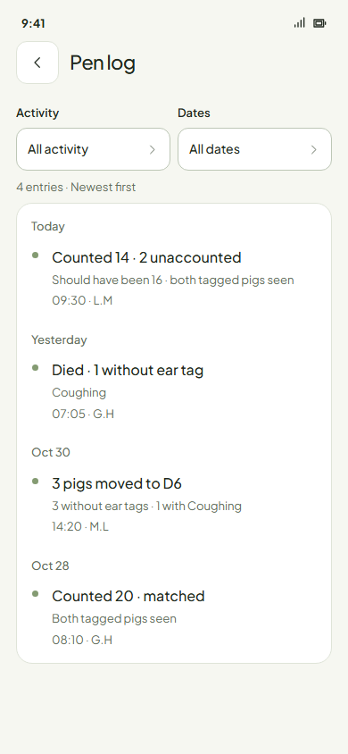 |  |
| **The pen log.** `Counted 14 · 2 unaccounted / Should have been 16 · both tagged pigs seen`; the move and death since are their own lines. | **Conditions follow the pick** (any action on some untagged pigs): *How many in all? 5 of 14* and *With Coughing · of the 3 in D4 · 2*. |

Mock notes: these are drawn by swapping content into the real pages (`mock.mjs`); the pen log's filter header and the unit card's styling are the live ones. Not drawn: the Transfer arrivals page (Transfer is not designed), the batch's `N unaccounted` line on the task card, a litter count on a crate (it is mock 3 with *Piglets* and the sow's tag).

## 7. Rulings this changes

| Ruling | Now | Proposed |
|---|---|---|
| Piglet processing Round 9: "Set count just adjusts the pen's record … no reason … N piglets unaccounted" | Piglet processing only | **Extended** to every place and every pig: Count. Set count becomes Count. |
| Edit record round (proposal): Count as a verb tile in the sow's Actions | Proposed | **Moved** to the pen page and the unit card. A place's action, not a pig's (Conditions PRD: "Actions page holds pig actions only"). |
| Farrowing *Reconcile piglet count* (required reason; can raise frozen Total born) | Built | **Replaced** by Count on the crate. |
| Archived Set count (pen-ops §2.3): commit on every tap, reason Choice(4), per-batch rows | Archived design | **Superseded**: Save count, no reason, one batch per pen. SYNTHESIS open question 7 (set-count reason) closes as *none*. |
| Move PRD: open group records get *Stays / Goes / Both*; multi-batch moves name which batches shrink | Draft | **Replaced** by conditions following the selection (counts, no copy) and one batch per pen. |
| Missing PRD: "a head that cannot be found is a wrong count, fixed by the pen's Count sheet" | Draft | **Kept**; plus a missing pig scanned in a count is found. |
| RULINGS Round 2: "unexplained lines close only by a death or a confirmed Move … the dead picker asks one of the 2 missing?" | Superseded in part by Round 9 | Round 9 wins everywhere: no pairing question; the next count heals (Q8). |

## 8. Questions only the owner can answer

1. **The name.** *Count* (盘点) for the tile, the page and the log. *Recommend: Count.*
2. **Where it lives.** The pen page (one pen, crate or group); a whole room only from the task that asks for a recount (receiving pigs). Do you also want a whole-room count outside tasks, and where? *Recommend: no; the pen's own Count covers the rest.*
3. **Tagged pigs not seen.** They stay recorded where they were; the receipt lists them and opening one is the way to Report missing. Or should a count report them missing itself? *Recommend: stay recorded; missing is always a person's call.*
4. **Scan here moves here.** A tagged pig read in a count that the record places elsewhere moves here when the count is saved (shown on her row and the receipt). *Recommend: yes.*
5. **A room count proves the room, not the pen.** Pigs read in the room tick in the pen the record has them in; a pen in the wrong place inside the room is fixed by counting that pen. A pig from another room joins the pen scanned just before her (changeable). *Recommend: yes; the alternative, one pen at a time, loses the room scan you asked for.*
6. **One batch per pen for pigs without ear tags.** Untagged pigs moved into a pen holding another batch's untagged pigs join that pen's batch. *Recommend: yes. It removes the old batch allocation; falling-behind pigs moved back a batch join it, as on the farm.*
7. **Conditions on pigs without ear tags follow the pick.** Picking some of a group asks how many of them have each of the group's conditions (default 0); the whole group takes them all; a count below a condition caps it. *Recommend: yes. The other model wanted a "Cannot tell" answer that drops the condition from both groups.*
8. **A body found after a count already booked it as unaccounted.** Record the death as usual; the pen shows one fewer until the next count books +1, and the batch nets to zero unaccounted with one death. Or ask in the death drawer how many are here now? *Recommend: no question (Round 9); the next count heals it.*
9. **The number starts at the record.** The stepper and group fields start at what should be there (fast when it matches; a worker could save without counting). Or start empty? *Recommend: start at the record; the matching count is the common case.*
10. **Unknown tags.** Left out with the scan toast. Should the receipt offer *Give this tag to one of the 14 pigs without ear tags* (Assign identity)? *Recommend: later, with Assign identity.*
11. **A sow found in another crate in farrowing.** Does her litter move with her? *Recommend: yes, the litter is hers until weaning; the crate's count checks the number.*
12. **Scheduled counts.** None in v1: no reminder, no *Last counted* (owner, 2026-11-02). A recount is asked for only by a task whose number disagrees. *Recommend: yes.*

## 9. Next steps after a ruling

1. Transfer's product round, using this page as its arrivals tally (scenarios 1–4).
2. Build Count on the pen page in the prototypes; retire Set count and Reconcile piglet count.
3. Exits (sold, off farm) as their own record, so *Since the last count* is complete.
