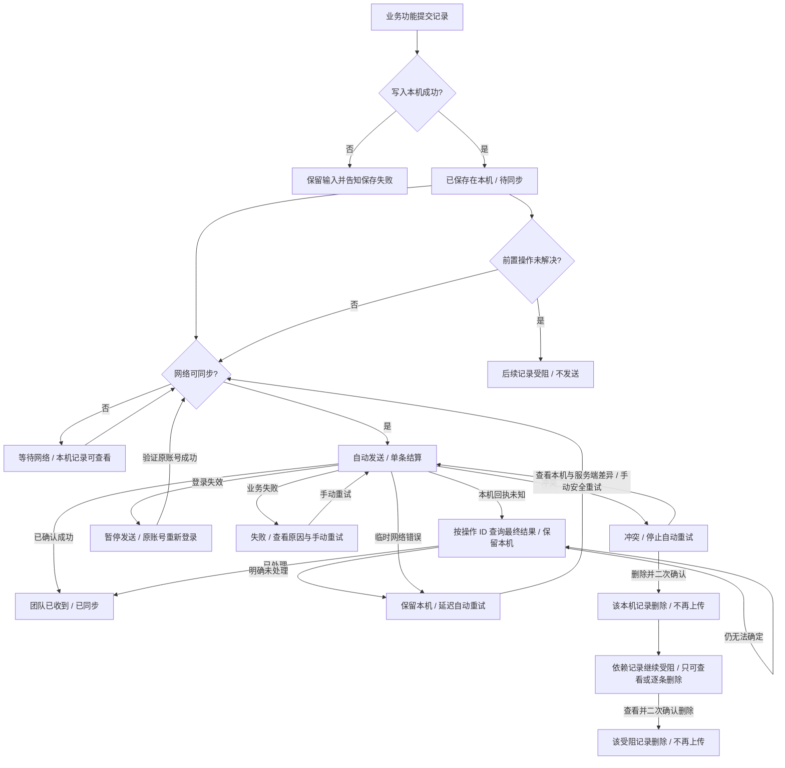

# 离线处理流程与界面交接

> 取舍说明（2026-10-20）：本文件保留 Zhaoxu 2026-10-16 版本。被 2026-10-18 至 2026-10-20 用户裁决改变或取消的条目，以 [PRD](PRD.md) 和 [consolidation.md](consolidation.md) 为准。

本稿是待评审设计。产品裁决来自 2026-10-12 至 2026-10-16 的用户答复；旧版 mobile_webapp 提供状态与依赖机制参考。凡标 Q 的分支不得作为实现默认值。

## 记录生命周期

每条记录独立结算。多个记录同时存在时，“2 条已同步、1 条失败”是合法结果。队列的本机数不等于服务器或整个猪场的记录总数。失败、冲突、受阻的记录不能计作团队已收到。

总览只把未完成记录呈现为三类：**待同步**（含等待前置记录）、**同步中**（含核对回执）、**冲突或错误**（含失败与冲突）。括号内仍是内部处理分支，行内说明或详情必须交代原因；合并展示不能改变自动重试、依赖和去重规则。**已同步**不参与未完成计数，作为底部次级入口查看这台手机最近 30 天保留的确认记录。

## 关键界面

| 位置 | 第一眼要回答 | 主动作 | 次级事实 |
|---|---|---|---|
| 业务提交反馈 | 本机保存成功了吗？ | 保存失败时回输入；成功无需再点上传 | 联网后自动上传 |
| 应用壳（首页与非任务页） | 这台手机有记录待发、正在上传或需要我处理吗？ | 点页眉右侧全机徽标进入总览 | 始终统计本机全部未上传记录，不按当前账号或猪场缩小；空队列隐藏 |
| 任务页眉（任务总览、单元/栏位、对象记录） | 本次任务有几条记录还在这台手机上？ | 点右侧“本任务 N”先看本任务记录 | 凭稳定任务实例 ID 归属；面板可转“本机全部 M”；本任务为零而全机仍有记录时改为明确的“全机 M”入口 |
| 首页 | 今天做什么；是否有本机记录需处理？ | 异常徽标展开“异常 N”并可进入总览 | 不另占一张同步卡 |
| 本机记录总览 | 哪些需要处理、正在同步、等待同步？ | 冲突或错误直达；大量普通待同步记录按类别进入 | 三类未完成状态；进入时决定是否分类，查看过程中不因自动同步突然换布局；底部提供最近30天已同步入口 |
| 已同步记录 | 哪些操作已由服务端确认？ | 从底部次级入口查看近期逐条记录，再进入详情 | 只显示这台手机近30天保留的记录及确认时间，不代表服务端全部历史 |
| 失败详情 | 为什么没上传？ | 安全重试 | 原操作、保存时间、位置 |
| 冲突详情 | 本机与服务端哪一项不同？ | 核对差异后手动重试；可进入删除确认 | 冲突不会自动重试，重试不得覆盖服务端 |
| 删除确认 | 删除会失去什么？ | 明确确认删除 | 取消后记录原样保留 |
| 已删除前置记录的受阻详情 | 为什么仍受阻？ | 查看后逐条删除，二次确认 | 不提供重试或自动发送 |
| 账号/猪场切换拦截 | 为什么不能切换？ | 查看本机记录 | 当前身份不变 |
| 登录失效 | 为什么上传暂停？ | 返回原账号登录；验证成功后自动续传 | 本机记录和原猪场绑定保持不变 |

## 工程验证点

- 本机事务写入成功才给“已保存在本机”；进程被系统结束后再次打开仍能看到同一条记录。
- 首次保存成功的界面给一次短暂、明确的“已保存在本机，联网后自动上传”反馈；随后由页眉徽标持续呈现队列状态。普通自动上传不逐条弹成功提示；需要人工处理时通过异常徽标进入详情。这一提交瞬间与全局入口的衔接须在首个 Android 离线业务操作中验证。
- 自动发送按对象和显式依赖顺序；前置失败时后续不发送，不把它显示为“上传失败”。
- 短暂断网、服务端 5xx、双击和未知回执不会让工人看到虚假的“已同步”。服务端已由产品确认保证同一操作 ID 去重并可查询最终结果；原生端应先查询未知回执，明确未处理才沿用同一 ID 重试，已处理才更新为已上传。旧版靠错误文本推断重复请求成功，原生端需使用结构化回执。
- 冲突不进入自动轮询；手动重试须用条件写入或同等机制保证不覆盖服务端。删除冲突前置记录后，直接与间接依赖记录继续受阻、留在本机，只能查看或经二次确认逐条删除。删除所有未上传记录后，离线队列不再阻止身份切换。
- 未上传记录拦截账号/猪场切换；登录过期时暂停发送，由账号流程对原账号重新认证，成功后恢复自动同步。
- 原生应用壳应订阅这台手机的持久队列汇总；首页与非任务页的全机数不能因当前账号或猪场筛选而变化。任务页眉订阅同一队列，再以账号 ID、猪场 ID、稳定任务实例 ID 的组合得到本任务数，避免不同猪场或不同轮次的任务编号碰撞；同一任务跨单元、栏位、对象页维持此数，不受当前栏位筛选影响。计数包含待传、上传中、核对回执、失败、冲突和受阻；服务端确认结果前不减一。状态优先级为异常 > 核对回执/上传中 > 待网。页眉将徽标放入尾部动作区共同排版，保持垂直居中和右边距；任务范围列表可一键查看全机列表。身份不明的记录只进入全机列表，不能用全机数冒充本任务数。切页与应用重启后仍可见正确汇总。
- 全机列表在首次进入时根据当时待传量与类别数选定直列或分类，本次查看期间保留布局；再次进入时重新判定。任务列表少量记录直接列出，任务内大量记录按单元/栏位组织，异常总是优先直达。
- 确认同步后在本机保留 30 × 24 小时；总览底部以此范围显示“最近30天 N 条”入口，次页可逐条查看及进入详情。超过期限时清理不再被任何未同步操作依赖的已同步本机记录与本机日志。未确认、失败、冲突、受阻和回执未明者永不按已同步期限清理；服务端业务记录不受影响。旧版按最近 200 条清理，原生实现要迁移为期限规则并验证依赖关系。
- Android 系统状态栏和开孔由系统管理。应用内页眉悬浮徽标位于安全区内；顶部中置胶囊是可比较的应用内探索，但会使任务下移。符合系统 Live Update 条件时可研究额外的系统通知 chip，特别是活跃上传；它不替代应用内待网/异常入口。
- 中英文 360/390 宽度、完整耳号/任务名、读屏顺序、底部动作和删除二次确认都须用原生 Android 验证。

## 样稿与证据

- 交互样稿：ux/system/home-astra-prototype.html 展示全机入口；ux/system/farrowing-astra-concept.html?layout=focus&taskSync=offline 展示分娩任务页眉的本任务入口；ux/system/data-sync-astra-prototype.html?scenario=offline&taskId=farrow28 展示任务范围与“本机全部”跳转。原型使用固定样例，不连接真实业务操作、队列或服务器。
- 页面与状态注册：feature.json。PRD、operations.md、scenario-tree.md、scenarios.json 分别给规则、范围、完整场景和可执行叶子。
- 旧版参考代码：Sentri/mobile_webapp/src/lib/offline、src/components/offlineRecords 与 src/providers/OfflineProvider.tsx。其队列与 IndexedDB 细节不能直接等同于原生 Android 实现。
