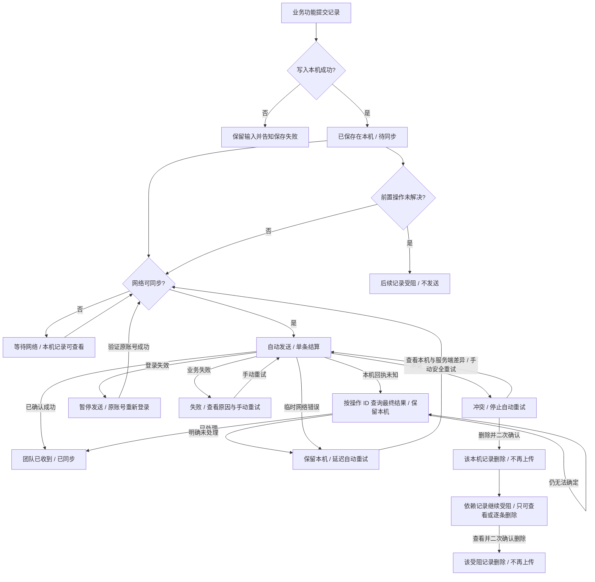

# 离线处理流程与界面交接

本稿是待评审设计。产品裁决来自 2026-10-12 的用户答复；旧版 mobile_webapp 提供状态与依赖机制参考。凡标 Q 的分支不得作为实现默认值。

## 记录生命周期

每条记录独立结算。多个记录同时存在时，“2 条已同步、1 条失败”是合法结果。队列的本机数不等于服务器或整个猪场的记录总数。失败、冲突、受阻的记录不能计作团队已收到。

## 关键界面

| 位置 | 第一眼要回答 | 主动作 | 次级事实 |
|---|---|---|---|
| 业务提交反馈 | 本机保存成功了吗？ | 保存失败时回输入；成功无需再点上传 | 联网后自动上传 |
| 首页 | 今天做什么；是否有本机记录需处理？ | 异常打开详情；普通待上传为紧凑入口 | 网络状态和本机数量 |
| 本机记录总览 | 哪些需要我处理？哪些正在等待？ | 打开单条记录 | 已上传历史安静呈现 |
| 失败详情 | 为什么没上传？ | 安全重试 | 原操作、保存时间、位置 |
| 冲突详情 | 本机与服务端哪一项不同？ | 核对差异后手动重试；可进入删除确认 | 冲突不会自动重试，重试不得覆盖服务端 |
| 删除确认 | 删除会失去什么？ | 明确确认删除 | 取消后记录原样保留 |
| 已删除前置记录的受阻详情 | 为什么仍受阻？ | 查看后逐条删除，二次确认 | 不提供重试或自动发送 |
| 账号/猪场切换拦截 | 为什么不能切换？ | 查看本机记录 | 当前身份不变 |
| 登录失效 | 为什么上传暂停？ | 返回原账号登录；验证成功后自动续传 | 本机记录和原猪场绑定保持不变 |

## 工程验证点

- 本机事务写入成功才给“已保存在本机”；进程被系统结束后再次打开仍能看到同一条记录。
- 自动发送按对象和显式依赖顺序；前置失败时后续不发送，不把它显示为“上传失败”。
- 短暂断网、服务端 5xx、双击和未知回执不会让工人看到虚假的“已同步”。服务端已由产品确认保证同一操作 ID 去重并可查询最终结果；原生端应先查询未知回执，明确未处理才沿用同一 ID 重试，已处理才更新为已上传。旧版靠错误文本推断重复请求成功，原生端需使用结构化回执。
- 冲突不进入自动轮询；手动重试须用条件写入或同等机制保证不覆盖服务端。删除冲突前置记录后，直接与间接依赖记录继续受阻、留在本机，只能查看或经二次确认逐条删除。删除所有未上传记录后，离线队列不再阻止身份切换。
- 未上传记录拦截账号/猪场切换；登录过期时暂停发送，由账号流程对原账号重新认证，成功后恢复自动同步。
- 中英文 360/390 宽度、完整耳号/任务名、读屏顺序、底部动作和删除二次确认都须用原生 Android 验证。

## 样稿与证据

- 交互样稿：ux/system/data-sync-astra-prototype.html，外部下拉框切换离线、同步中、部分成功、冲突、受阻、完成和身份切换场景；浏览器断网后恢复也能触发离线 → 同步中的演示状态。本机数据为固定样例，不发送服务器请求。
- 页面与状态注册：feature.json。PRD、operations.md、scenario-tree.md、scenarios.json 分别给规则、范围、完整场景和可执行叶子。
- 旧版参考代码：Sentri/mobile_webapp/src/lib/offline、src/components/offlineRecords 与 src/providers/OfflineProvider.tsx。其队列与 IndexedDB 细节不能直接等同于原生 Android 实现。
