# 本机记录：多任务、多操作列表方案（待评审）

这份是列表设计提案，不改变已确认的同步安全规则。原型使用虚构数据：**10 项任务、97 条本机操作**，其中 65 条尚未同步、32 条最近 30 天已同步。可对照 [原来的平铺方案](../../ux/system/data-sync-astra-prototype.html?scenario=volume&variant=tabs&lang=zh) 与 [增加操作链的方案](../../ux/system/data-sync-astra-prototype.html?scenario=volume&variant=chains&lang=zh&task=preg31&expand=preg31-0)；都能切换 Tab、进入任务、筛选和搜索。

## 先认清一条记录是什么

| 旧版依据 | 对列表的影响 |
| --- | --- |
| `Sentri/mobile_webapp/src/lib/offline/types.ts` 的 `OfflineCommand` 含 `id`、`operationId`、`taskId`、业务类别、对象、`groupKey/groupKeys`、`dependsOn`、状态、操作摘要、创建和确认时间。 | **一行是一条离线命令**，不是“一项任务”或“一头猪”。任务只能作为上一级聚合。 |
| 同文件的 `OfflineCommandLog` 以 `commandId` 记录一次命令的状态变化；`syncCoordinator.ts` 会写这些日志。 | 一条操作可能有多次发送/失败/重试日志。这些日志不能拆成多条待同步业务记录。 |
| `commandGrouping.ts` 对部分批量命令按猪拆分；其他批量提交仍是一条含多目标的命令。 | 按真实命令 ID 计数。示例“提交免疫结果 · 12 头”是一条操作，不擅自画成 12 行。 |
| 旧 `OfflineRecordsView.tsx` 先走业务类别 → 操作类型 → 任务，再按五个底层状态筛选；`recordUtils.ts` 以 `groupKey` 把当前筛选结果内的操作串起来，历史分页为 30 条。 | 旧结构证明存在高数据量和任务内多操作，但按状态筛选后，一条链可能被拆开；只按 `groupKey` 也会漏掉跨分组键的显式依赖。新版不能把任务当成同步顺序组。 |
| `commandDependencies.ts` 和 `syncCoordinator.ts` 用 `groupKey/groupKeys`、`dependsOn` 以及创建顺序决定阻塞与发送批次。孕检的单元提交会等待该单元未解决的检查；不同对象在无依赖时可并行。 | 任务内应先识别**操作链**，在链内显示先后或多项前置；同任务但无关联的操作独立展示。 |

Android 当前 `offline/` 已有命令 ID、操作 ID、任务 ID（在 `CommandInput` 中）、依赖、`QUEUED / IN_FLIGHT / UNCERTAIN / SYNCED / FAILED / CONFLICTED` 等内部状态，但尚未接真实发送 worker。其 SQLite 命令表没有旧 Web 那套完整的展示摘要，也没有直接供列表读取的 `syncedAt` 字段。落地前需设计稳定的列表读取模型，保存任务名、业务位置、对象标识、可读操作摘要和服务端确认时间；不能为了画列表反复解析大 payload 或在线补查名称。

## 用户需要先看什么

| 位置 | 第一眼 | 点入后 | 留到详情 |
| --- | --- | --- | --- |
| 全机 | 未同步总数、需处理的任务、每项任务剩余几条 | 某项任务的操作列表 | 操作 ID、重试次数、完整 payload |
| 一项任务 | 哪组操作受阻，卡在哪一步；耳号/对象和单元 | 展开链看每一步，再打开需处理的那条记录 | 服务端差异、重试轨迹和完整技术信息 |
| 已同步 | 最近 30 天有哪些任务和已确认操作 | 对应操作的确认时间及详情 | 技术回执和内部日志 |

## 建议的展示规则

1. 顶部始终有两个固定视图：**未同步 N**、**已同步 N**。使用现有 `Segment` 的双选项样式；后者未选中时低强调，但不会因为前面有 100 条记录而沉到页尾。两个数字随当前范围变化：全机看全机，进任务后看该任务。已同步只统计这台手机最近 30 天保留的服务端确认记录。
2. 全机的“未同步”页以**任务为行**，一项任务只出现一次，行内给出需处理、同步中、待同步的数量。需处理任务排前，后面的任务仍全部可滚动到，不设“只显示前 N 项”。没有可靠 `taskId` 的操作进“其他记录”；实现时任务身份应组合环境、账号、猪场和稳定任务 ID，不能跨身份合并同名任务。
3. 点进任务后，**有关联的操作先合成一组**，组头给对象/单元、共几步、未同步与已同步数、最需要处理的状态。点开后按保存顺序看每一步；失败步骤与等待它的后续步骤必须同时可见。无关联的操作仍是一条普通记录。`全部 / 需处理 / 同步中 / 待同步` 筛的是**含相应状态的组**，不把组内其他步骤藏掉；顶部数字仍按命令数统计。搜索命中任一步时也展示整组，便于看上下文。异常原因、前置受阻和核对回执在行内或详情说明，不另造状态。
4. “已同步”页沿用同一层级：全机先看任务，进任务后看逐条操作，按服务端确认时间倒序。它不占未同步页的篇幅；无记录时 Tab 仍可进入并显示空态。切换 Tab 时留在同一任务范围，返回全机再看其他任务。
5. 网络情况只在“未同步”视图说明；断网不是记录状态。同步进行时数字可更新，但不自动切换 Tab、筛选或任务，也不在用户正查看时突然重排任务行。从某条记录返回时保留原列表位置和筛选；从任务返回全机时也保留任务行位置。原生长列表按可见行惰性加载，不能用“只画前 N 条”掩盖其余记录。

## 同一任务里的操作链

“任务”负责把业务工作归在一起；**操作链**才表达同步顺序。旧版的 `groupKey/groupKeys` 让共享对象的较早操作先走，`dependsOn` 还可连接不同分组键的操作。转群例子仅凭同一个 `groupKey` 排队：第一条失败，后两条都等待它。孕检中，先前检查、单元提交、后续检查可以形成显式依赖的串行链；一项单元提交也可能同时依赖几头猪的检查。后一种不是一根严格的直线：检查可并行，提交须等前置操作全完成。任务内无关联的操作不应因这组失败而被整项任务锁住。

旧版列表只按 `groupKey` 对**当前状态筛选出来的记录**分组。它可能把“第 1 步已同步、第 2 步失败、第 3 步受阻”拆到不同筛选结果，还看不到跨 `groupKey` 的显式 `dependsOn`。本提案从完整本机队列求同组关系，再做状态筛选。未同步 Tab 里的链可低强调显示已同步的前置步骤；已同步 Tab 仍可查到该条确认记录，但计数不重复。历史清理不能丢掉仍被未解决操作引用的前置摘要；旧版 `syncedCommandHistory.ts` 已保留被引用的已同步命令，原生端需实现同等可读性。如果前置记录确实不在本机，就显示“前置记录已确认/不可查看”的事实，不虚构步骤。

**组的呈现规则**：多步组默认只显示对象、单元、状态和数量；点开才显示完整步骤，多个组可以同时展开。图示链接用 `expand` 参数预先打开一组，便于评审。最需要处理的组排前。组内按依赖和保存时间排序，不能按“需处理/待同步”重新排步骤；正式实现要沿用旧版 `isOfflineCommandBefore` 对同一时间的业务先后判定。有多项前置时明确写“提交等待全部完成”。一组几十条也不截断为“前 N 条”，用可滚动列表承载。用户打开错误记录，返回仍在原组与原位置。

## Log 组件用在哪里

现有 [Log 组件](../../ux/design-system/components/Log/README.md) 的**竖线和节点**很适合让人一眼看出同组步骤，原型就借了这层视觉语法。但现有 `SentriUI.log` 的契约是按日期、最新在前、只读、条目无动作；未同步链恰好要前置在前、显示等待关系，并能打开失败步骤处理。因此这张图是**Log 风格的操作链模式**，还不是直接调用现有 Log 组件。确认后可评估给 Log 增加明确的 `sequence` 变体，或将竖线抽为共享样式；不能让同一个 `day log` 变体同时承担历史与待办。纯只读的已同步业务经过仍可直接用现有 Log。

旧版 `OfflineCommandLog` 是同一命令的发送/重试**技术轨迹**，不是 Log 组件所说的一条业务记录。若需要追查一条异常，技术轨迹只在该记录详情中按时间呈现，不放入全机列表，也不计入任务记录数。任务或猪只真正的业务记录历史仍可在所属功能里使用 Log。

## 高数据量图示

### 全机：10 项任务，65 条未同步操作

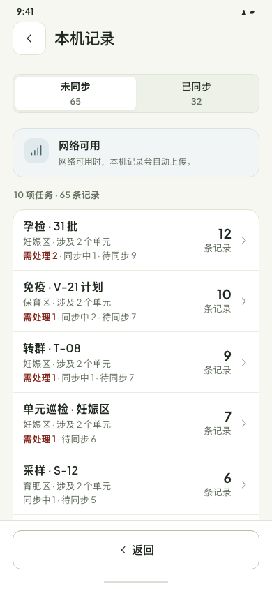

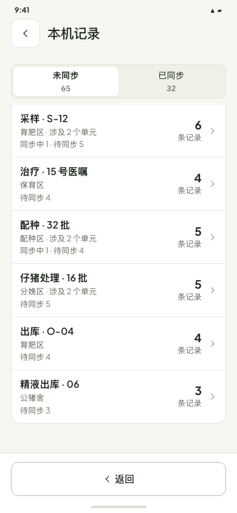

### 全机：已同步始终在顶部 Tab 可达

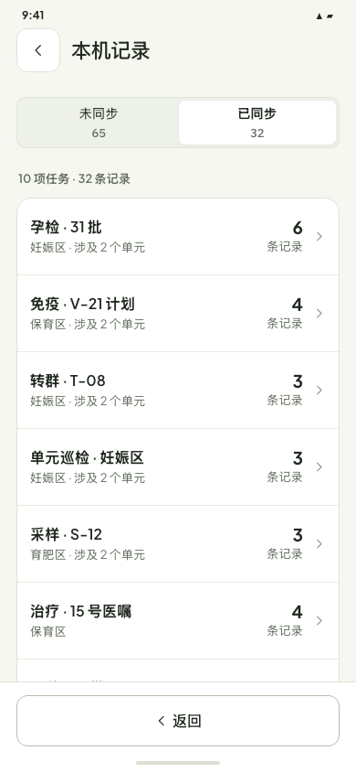

### 单项任务：18 条操作，其中 12 条未同步、6 条已同步

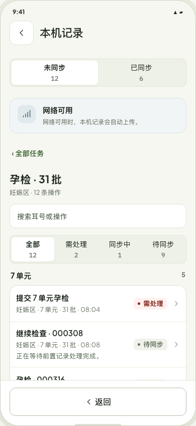

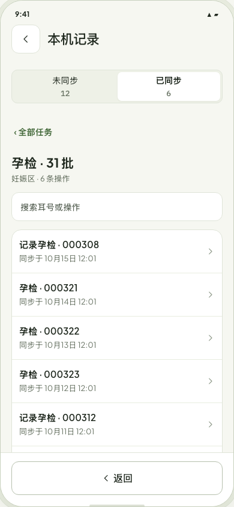

### 同一任务里的关联操作

这两组都在同一项孕检任务中。第一组是串行链：第 1 步已同步，第 2 步失败，第 3 步等第 2 步；第二组的两条检查可以并行，同组提交要等两条都完成。旁边还存在独立的冲突记录，筛选“需处理”时不会把关联链里的已同步前置步骤藏掉。

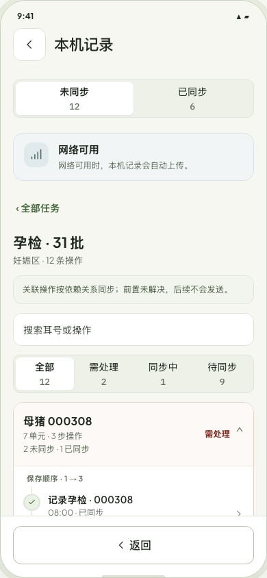

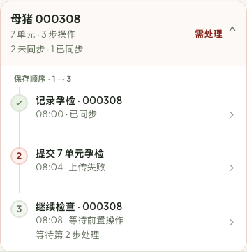

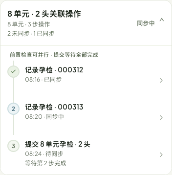

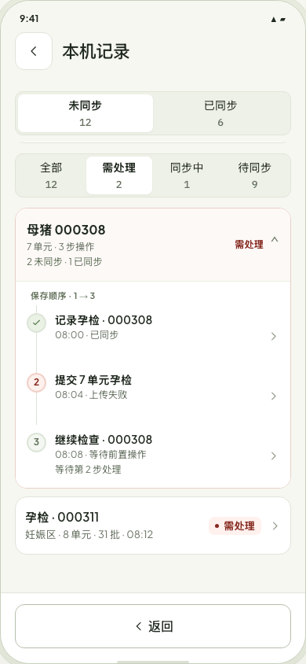

### 同一分组键的转群操作

转群任务中，三条操作共享 `transferTask:T-08A`，没有逐条填写 `dependsOn`。旧版仍会按创建顺序同步：第一条失败，后两条留在本机等待。这组之外的转群操作可以继续各自同步。

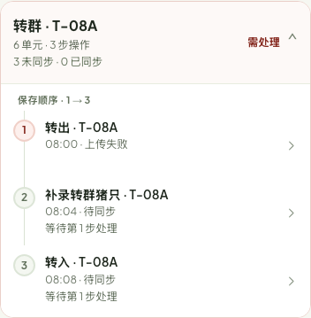

### 批量命令仍是一条记录

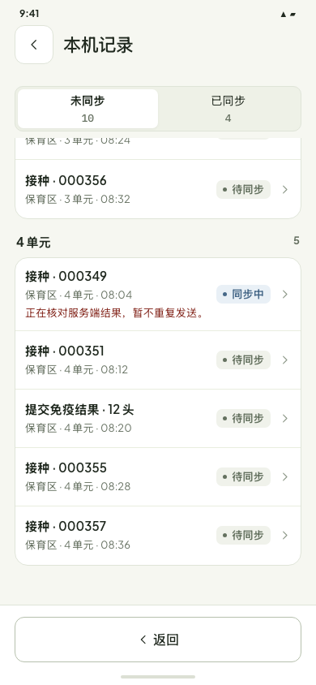

## 与上一版的取舍

上一版按状态往下堆记录，再把已同步入口放在列表末尾；数据多时，已同步入口几乎不可见，同一任务也可能散落在几个状态区。新方案把**记录是否已确认**放在固定的顶层视图，把**任务**作为高数据量的第一层，状态留给任务行摘要和任务内筛选。它多一次进入任务的动作，换来全机列表稳定且可扫读。此取舍仍需在真实 Android 数据和 360/390 宽度上复核；目前只是设计原型，不代表真实队列已接入。
