# Farrowing · Edit record: product round (2026-11-02)

**Status: proposal for the owner. Nothing is built.** The shots and mockups are in [edit-record-round/](edit-record-round/). The blind pass from another model family (OpenAI, through collab `--mode blind`) is in [edit-record-round/codex-blind-pass.md](edit-record-round/codex-blind-pass.md).

The owner's words (2026-11-02): *"edit record right now is way too confusing … once farrow has finished we dont allow for changes here, users wouldnt be able to recall or right that pig was not crushed it was starved … for example born how would users know there are more or less born? … maybe this feature should just be removed, and let users adjust count [inside actions a generic one … with supporting evidence here like when pigs were moved in if fostering has happened]."*

## Recommendation in one paragraph

**Fix while she farrows, count after she finishes.** Edit record stays only while she is farrowing, as the one correction screen it is today (Alive and the six causes). The worker is at the crate, the events are hours old, and a mistyped cause can honestly be fixed. Finish farrowing locks the record: Total born, the born-dead and died-after-birth causes, and the finish details. After Finish there is no Edit, no Correct born and no Edit finish details on the phone. A new generic action, **Count**, is added to the shared verb tiles in Actions. It works for any group of pigs: a litter after Finish, a pen, a group. The worker enters the number they counted, and the page shows what should be there and why: the last count, then the deaths and fosterings since. A difference is saved as **unaccounted**. It never changes Total born or a cause, and no reason is asked. When the count is lower, the page offers Record dead, so a body that is found gets its cause instead of an unaccounted loss. The existing *Reconcile piglet count* action becomes Count. Today it can raise the frozen Total born, which an existing ruling forbids.

---

## 1. The current state (walked at 390, main at 98485aca)

| | |
|---|---|
| 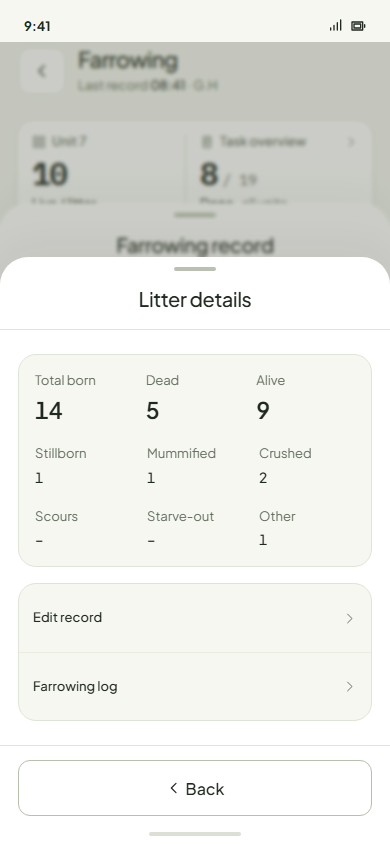 | 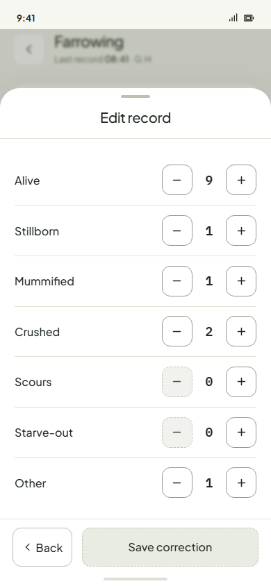 |
| **Litter details** (`farrowing.litter`): tap the Alive card; *Edit record ›* and *Farrowing log ›*. | **Edit record, farrowing** (`farrowing.edit`): Alive and the six causes as steppers; Back · Save correction. |
| 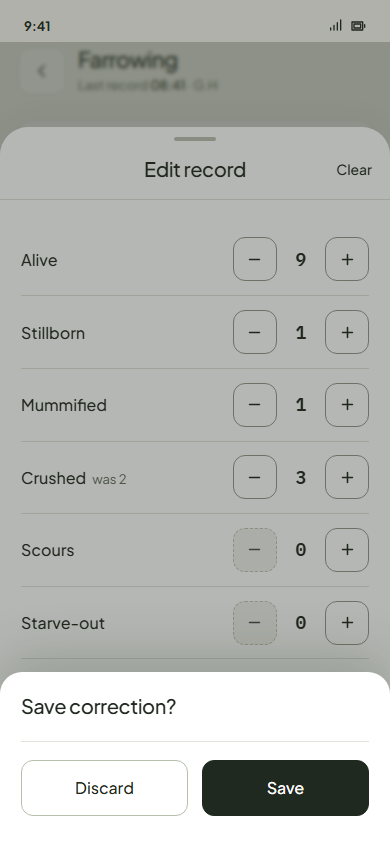 | 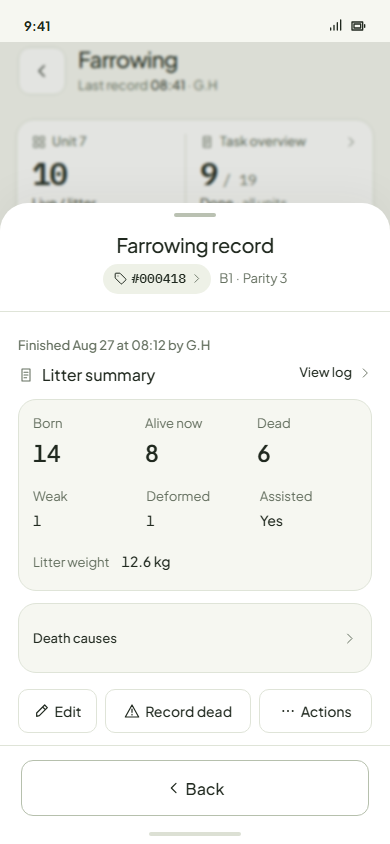 |
| **Leave with changes** (`farrowing.leave-edit`): *Save correction?* Discard / Save. | **Finished record** (`farrowing.locked`): toolbar *Edit · Record dead · Actions*. |
| 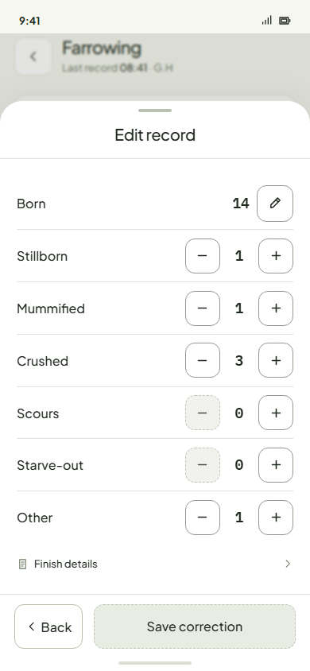 | 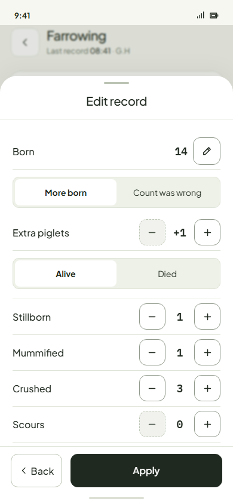 |
| **Edit record, finished** (`farrowing.edit-finished`): Born with a ✎ key, the six causes, *Finish details ›*. | **Correct born** (`farrowing.born`): *More born / Count was wrong*, *Extra piglets +1*, *Alive / Died* (Died then asks the cause), Back · Apply. |
| 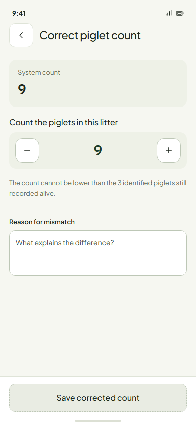 | 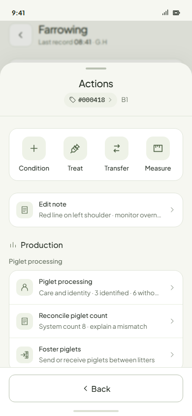 |
| **Reconcile piglet count** (`farrowing.reconcile`, Actions › Production): system count, a stepper, a required *Reason for mismatch*. | **The sow's Actions** after Finish: verb tiles (Condition, Treat, Transfer, Measure), then Production rows incl. *Reconcile piglet count*. |

### Every correction supported today, and where it is reached

| # | Correction | When | Reached from | What it does to the record |
|---|---|---|---|---|
| 1 | Alive up / down | Farrowing | Litter details › Edit record; Actions › Edit litter record | Sets Alive; **Total born moves with it** (derived) |
| 2 | A cause up / down (stillborn, mummified, crushed, scours, starve-out, other) | Farrowing | same | Sets that cause; Total born moves with it |
| 3 | Wrong cause (−1 here, +1 there) | Farrowing and finished | same; finished record › Edit | Moves one death between causes |
| 4 | A cause up / down | Finished | Finished record › Edit; Actions › Edit litter record | Born is frozen, so **Alive now moves instead** (−1 crushed = +1 alive) |
| 5 | More born (+N, alive or died with a cause) | Finished | Edit › Born ✎ › More born | Raises Total born |
| 6 | Count was wrong (Born should be N) | Finished | Edit › Born ✎ › Count was wrong | Sets Total born; Alive follows |
| 7 | Weak, deformed, assisted, litter weight | Finished | Edit › Finish details › Edit finish details | Replaces the finish facts |
| 8 | Reconcile piglet count (a recount) | Any, once something is recorded | Actions › Reconcile piglet count | Sets Alive with a required reason; **after Finish a higher count also raises the frozen Total born** (`saveCountReconcile`) |

The amended figure is amber on the record, the original is kept, and the log line reads e.g. `Crushed 3 → 2 · Correction · 08:20 · G.H` ([now-history.png](edit-record-round/now-history.png)).

**What confuses.** The same tap means three different things. Lowering crushed before Finish lowers Total born (row 2). After Finish it raises Alive now (row 4). Two doors (Edit's More born and Reconcile) can each raise a Total born that Finish has frozen. Ten controls for figures nobody at the crate can check a day later.

## 2. Scenarios: what a worker can actually know

| Correction | While she farrows (minutes to hours, same shift) | After Finish (next shift, days later) |
|---|---|---|
| **Alive** | Yes. They tapped +5 for four piglets, and the litter is in front of them, all born on their watch. | **No, as history.** They can count what is there now, but not what was born: deaths, fosterings and unrecorded moves are in between. A present count is a *count*, not a correction. |
| **Stillborn / mummified** | Yes, at the birth: a mummy is unmistakable, a stillborn is judged at delivery. A tap on the wrong cause is fixable. | **No.** The body is gone or in the shared bin. Nothing at the crate shows yesterday's piglet was stillborn rather than crushed (lung float is a lab test few farms do). |
| **Crushed / scours / starve-out / other** | Mostly. The body is in front of them and the tap was seconds ago. | **No.** This is the owner's example. Nobody honestly turns "crushed" into "starved" a day later. A new death is a new Record dead with its own cause, never a re-cause of an old one. |
| **Total born: more** | A piglet born on their watch is a recording (Born alive +), never a correction. | Rare, but real: Finish was held too early and one more piglet arrives. An extra piglet found at feeding is *not* that. It is far more often a stray or an unrecorded foster. On the phone the worker cannot tell the two apart. |
| **Total born: fewer** | Yes, if they tapped twice (Total born heals when Alive or the cause is fixed). | **No.** Fewer piglets now means deaths, fosters or strays, not fewer born. Only a written tally could prove a duplicate, and Sentri replaces the paper tally. |
| **Weak / deformed** | Asked at Finish only. | A piglet looking stronger today does not make Finish wrong. It is a new observation, not a correction. |
| **Assisted / litter weight** | Asked at Finish only. | The person who assisted knows. A scale slip proves a weight. Both are real but rare, usually a slip on the Finish form noticed the same minute. |
| **Count differs from record** | During farrowing the drawer owns the count (Born alive +, Report death, Edit). | Yes, they can count. They *cannot* know why it differs unless the record shows the moves and deaths since the last count. |

### Correction vs recount

- A **correction** says *"this line was wrong when it was written."* It needs a mistake someone remembers: a double tap, the wrong cause key, the wrong sow. In practice that memory lasts a shift, not past Finish.
- A **recount** says *"I counted again and it is not what the record says."* It proves what is there **now**. It says nothing about births, causes or which sow the piglets came from.
- Today rows 1, 4, 5, 6 and 8 are recounts disguised as corrections. This proposal makes a recount its own act, Count, which writes a difference and never rewrites history.

**Worked example** (the mockups): 000418 finished Aug 27 with 9 alive. Yesterday one was crushed (−1), two were fostered out to 000601 (−2) and one came in from 000605 (+1), so 7 should be there now. The worker counts 6. The record keeps Total born 14 and the causes. Alive becomes 6, and the log says `Counted 6 · 1 unaccounted · Should have been 7`. If they find the body, Record dead takes it with its cause, and the loss is a death instead of unaccounted.

## 3. Options

| | (a) Edit during farrowing only | (b) Remove Edit; generic Count | **(c) Hybrid: Edit while farrowing + Count after (recommended)** |
|---|---|---|---|
| **While farrowing** | Edit record as today (Alive + six causes) | No correction at all: a double tap or a wrong cause key can only be "fixed" by a count, and a wrong cause stays wrong | Edit record as today, from Litter details only |
| **After Finish** | Nothing; no recount either (Reconcile would have to go or stay as is) | Count | Count |
| **Data kept** | Recordings, pre-Finish corrections (original kept, stamped) | Recordings + count observations (counted, expected, difference, who, when) | Recordings, pre-Finish corrections, count observations |
| **Log shows** | `Crushed 3 → 2 · Correction` lines before the finish line; nothing after but recordings | `Counted 6 · 1 unaccounted / Should have been 7` | Both: corrections before `Farrowing finished · born 14`, counts after it |
| **Total born** | Frozen at Finish | Frozen at Finish; a wrong tap before Finish can never be undone, so Total born keeps the error | Heals while farrowing (it is derived), frozen at Finish; never moved by a count |
| **Causes** | Fixable before Finish only | Never fixable | Fixable before Finish only |
| **Alive after Finish** | Moves only by Record dead and fostering. A real difference has nowhere to go | Moves by deaths, fostering and counts | Same as (b) |
| **Rulings changed** | Retires post-lock Born ceremony, Edit finish details | Retires Edit entirely | Retires post-lock Born ceremony and Edit finish details; Edit becomes "while farrowing" |
| **Risk** | The live count drifts after Finish with no honest way back | Takes away the one correction a worker can honestly make | A Finish held on a wrong figure stays wrong (see Q2) |

**What the blind pass changed.** The other model, given only the requirements and evidence, reached the same split, a hybrid of corrections plus a recount that never touches Total born or the causes. It also argued for keeping post-Finish corrections, attached to a log line, where there is proof (a duplicated line, a paper tally). I keep the owner's lock as the recommendation: on Sentri the phone *is* the tally, so post-Finish proof is rare. The exception is put to the owner as Q2. It also changed four things in the proposal:
- **No reason** on Count, keeping Round 9's "Set count just adjusts … no reason question". It is optional at most; a relief worker honestly knows the number and not the why.
- **The body found after a count**: Q4 below. Without a rule the loss is taken twice.
- **Fostering must be recordable**, or every foster becomes "unaccounted": Q3 below.
- **The identified-piglet floor** stays: a count cannot go below the tagged piglets still recorded alive (today's Reconcile floor).

## 4. The recommended option, drawn (390, real prototype parts)

| | |
|---|---|
| 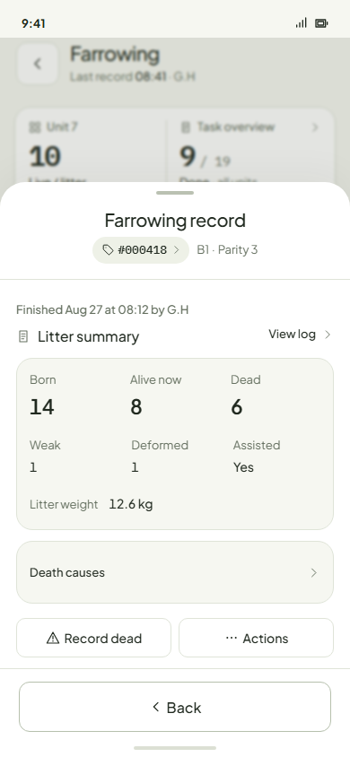 | 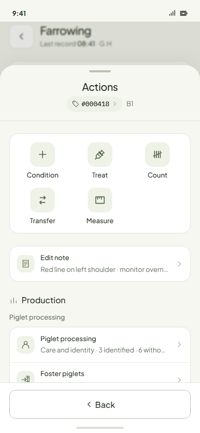 |
| **The finished record.** Edit leaves the toolbar: *Record dead · Actions*. Death causes and View log stay. | **Actions.** *Count* joins the shared verb tiles (five tiles: 3 + 2, the row grid rule). *Reconcile piglet count* and *Edit litter record* leave Production. The tally glyph would be new in the icon registry. |
| 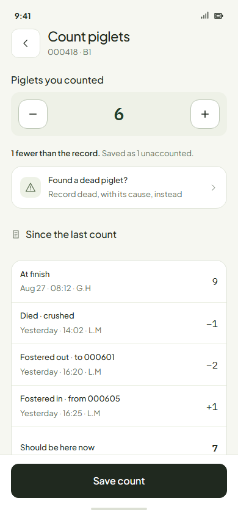 | 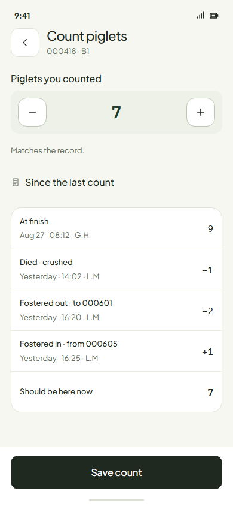 |
| **Count piglets, one fewer.** The stepper starts at what should be there. The difference is one line: *1 fewer than the record. Saved as 1 unaccounted.* *Found a dead piglet?* opens Record dead. *Since the last count* lists the evidence, the last count and every death and foster since, down to *Should be here now 7*. Save count. | **Count piglets, matches.** *Matches the record.* Saving still logs the count, so the next count starts from it. |
| 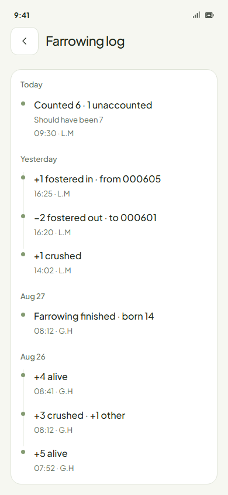 | |
| **Farrowing log.** `Counted 6 · 1 unaccounted / Should have been 7` sits with the foster lines. `Farrowing finished · born 14` is untouched. | |

Count's rules, as drawn:
- **For any group.** The page is the same for a pen or a group: *Count pigs · Pen C3*, with the evidence from moves in and out, deaths and sales. For a litter it opens only after Finish; before Finish the drawer owns the count (Q13, unchanged).
- **The baseline** is the last count or, if there has been none, the alive figure at Finish (labelled *At finish*, not "counted").
- **The difference** is unaccounted gain or loss, stamped, never a birth or a death (Piglet processing Q4: "a high count is NOT routed to More born"). It adds to the task's "N piglets unaccounted" figure (Round 9), not to a pen status.
- **Nothing is asked** beyond the number. With a lower count the one extra door is Record dead.
- **The floor** is the identified piglets still recorded alive.

## 5. Rulings this changes

| Ruling (RULINGS / PRD) | Now | Proposed |
|---|---|---|
| *Surfaces & entrances*: "ONE correction door: Edit … ONE SCREEN" | Edit before and after Finish | Edit is the one correction door **while she farrows**. After Finish there is no correction door; Count is an observation, not a correction |
| *Surfaces & entrances*: "What Edit adjusts: the observations, never the derivation … Post-lock: Born gains its ceremony … plus classification, litter weight, assisted" | Post-lock ceremony | The pre-lock half stands. **The post-lock half is retired** |
| *After the lock*: "Born is amended through the Edit ceremony … More born / Count was wrong"; "Anyone may amend born post-lock" | Allowed | **Retired**: Total born is frozen at Finish on the phone |
| *Model*: "Edit folds weak, deformed, weight and assisted into one At finish row" | Edit finish details | **Retired** with post-lock Edit (Q5) |
| Owner calls for this atlas: "Correct born exists only after farrowing has finished" | Correct born after Finish | **Retired**: no Correct born |
| PRD Decisions 2026-10-23: "Edit record moves into Litter details … the back door for re-tallies and mistakes" | Edit in Litter details | Stands for mistakes while she farrows; re-tallies after Finish go to Count |
| Piglet processing Round 9: "Set count just adjusts … no reason question … N piglets unaccounted" | Processing only | **Extended** to Farrowing and every group, as the one Count |

Screens: `farrowing.edit-finished` and `farrowing.born` retire. `farrowing.reconcile` becomes Count. `farrowing.locked`, `farrowing.sow-actions` and `farrowing.history` change. `farrowing.edit`, `farrowing.leave-edit` and `farrowing.litter` stay.

## 6. Questions only the owner can answer

1. **Lock at Finish?** After Finish, no correction of Total born, the causes or the finish details on the phone. *Recommend: yes, your direction.*
2. **A proven mistake after Finish** (a line saved twice, a slip found the next morning): leave it, or allow a correction somewhere else (a supervisor, later on desktop)? *Recommend: leave it on the phone; park a supervisor correction until the desktop exists. The other model would allow it, attached to the wrong line, with the original kept.*
3. **Fostering in Farrowing.** Count is only useful if fosters are recorded, and fostering usually happens in the first 24 hours. Open Foster piglets for every litter, not just the sow-died case? *Recommend: yes. It is still parked today.*
4. **A body found after a count** that already took it as unaccounted: should Record dead ask "Was it one of the 1 unaccounted?" (one Yes / No, only when a loss is open)? Without it the piglet is taken twice. *Recommend: yes, that one question.*
5. **Finish details after Finish** (assisted, litter weight typed wrong): locked too? *Recommend: locked; the Finish form is the check.*
6. **A reason on a count difference:** none (Round 9) or required (as Reconcile asks today)? *Recommend: none.*
