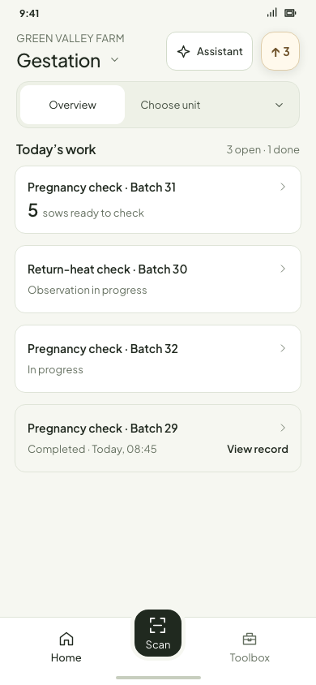
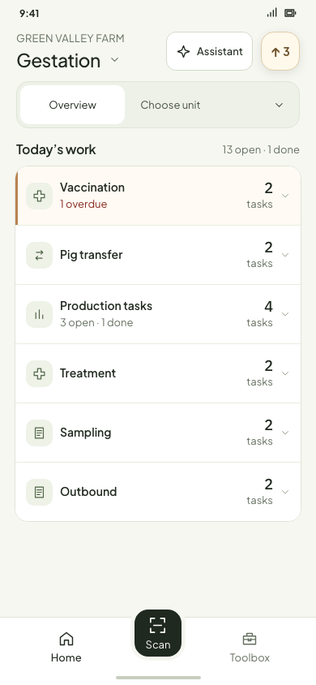
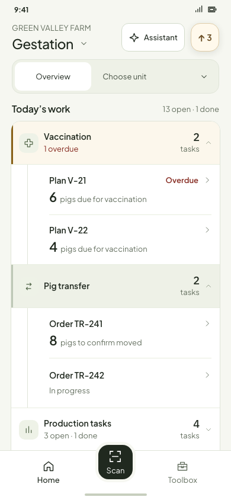
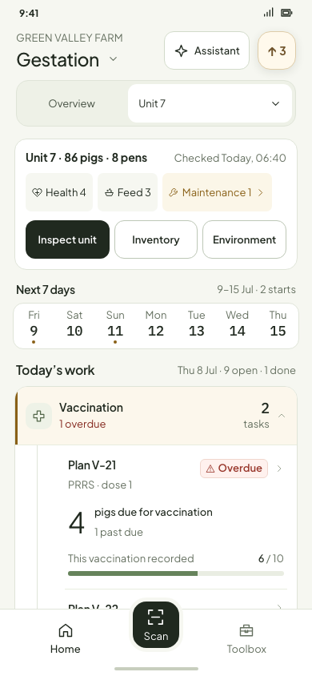
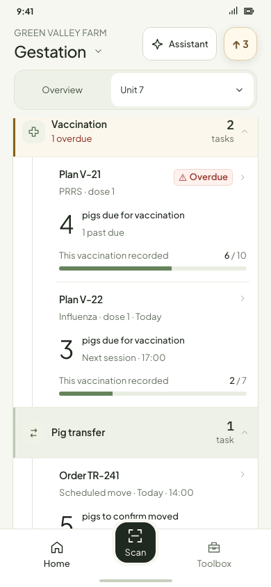
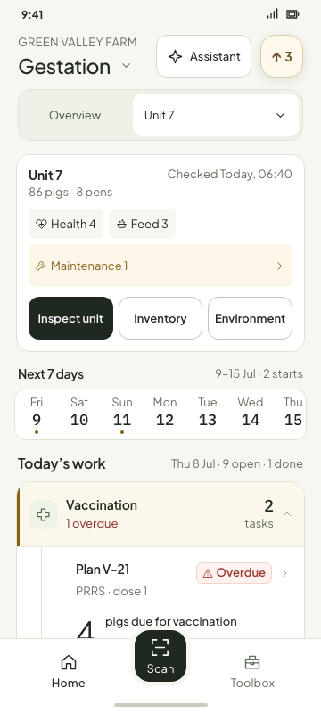

# Connected Home · review images

These are **in-design** Workbench prototype states, rendered from fictional farm data. The fixed sample date is 8 July. Open the [interactive prototype](../../ux/system/home-astra-prototype.html?section=gestation&many=operations&variant=connected) to switch scope and expand several categories independently.

## Overview: concise tasks

Overview omits Inspection, Inventory and date selection. Through four visible task instances, every instance has a concise entry. From five onward, task categories fold inside one surface: folded rows are white against the page; opening a category gives its header a pale tint and narrow side accent above indented task entries.

| Up to four: every task visible | Five or more: categories folded |
| --- | --- |
|  |  |

| Urgent category open by default | All categories open for review |
| --- | --- |
|  |  |

The category header carries the group icon and task count; its white child rows have a left inset. A completed task remains a muted, readable record entry. A due count is shown only when the task model supports it; observation outcomes are not presented as work due.

## Unit: full task cards and local tools

Selecting a unit keeps the unit hub with Inspection, Inventory and Environment, the fixed next-seven-days selector, and full cards inside expanded categories. The date selector previews only future tasks that have not started.

| Unit hub and date selector | One date selected |
| --- | --- |
|  |  |

Desktop pointer feedback fills the whole task row. The native touch design uses pressed feedback.

## Expanded hierarchy and Unit polish · 2026-10-16

The page and an expanded category header now use different surfaces. A regular open header has a neutral tint and a narrow neutral accent; an overdue category uses a pale warm tint and amber accent. Overview and Unit both use the same thin vertical guide beneath an expanded header. Their child rows or full cards sit inward of it, without adding borders around each task card.

| Overview: expanded categories | Unit: hub, dates and first group |
| --- | --- |
|  |  |

| Unit: full cards inside the group | Unit: narrow width |
| --- | --- |
|  |  |

The Unit review also raised the small status and card captions to readable size, made the 360px population and maintenance rows break deliberately, and corrected the seven-day caption to **9–15 Jul · 2 starts**. The sample date remains fixed to 8 July in this study.

Overview task separators now start at the child content inset and end before its right padding, matching Unit. They no longer cross the left guide; the rule also applies to finished entries and stays visible during pointer feedback.
