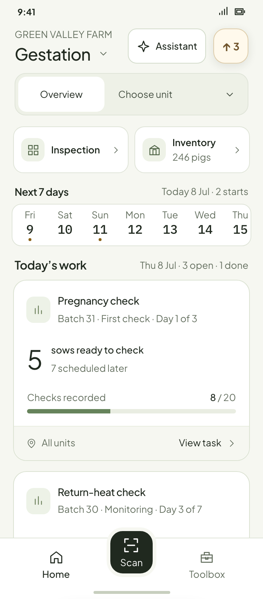
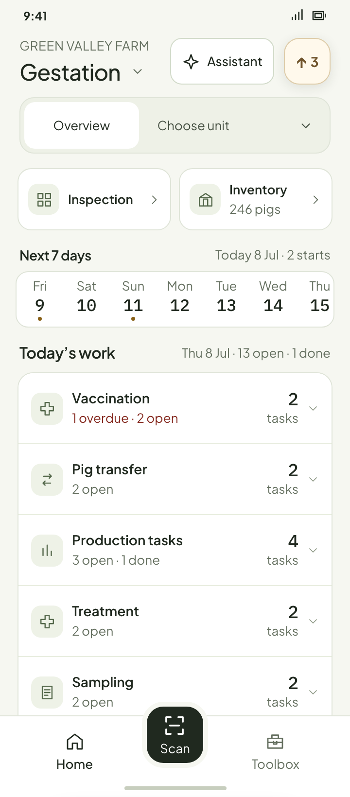
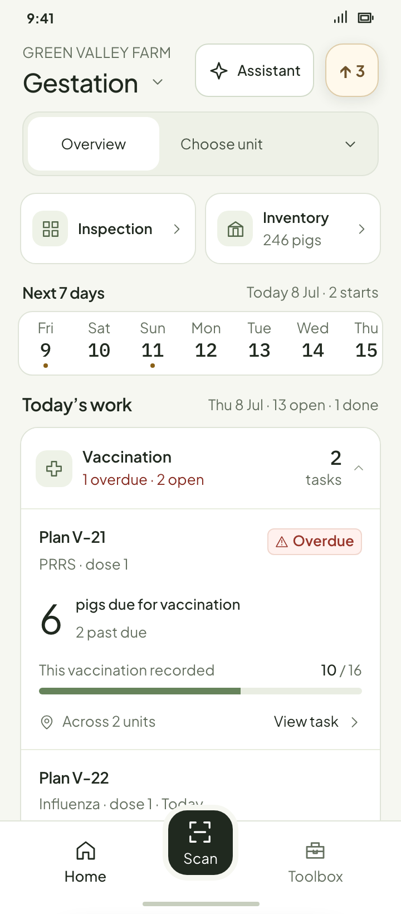
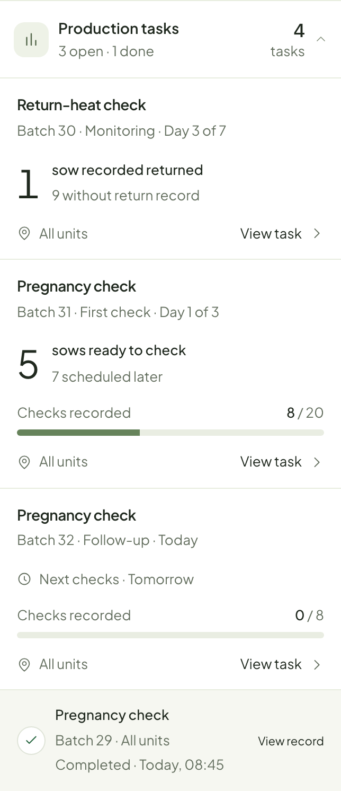
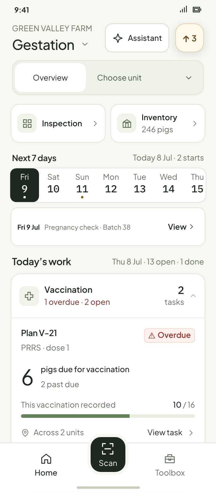
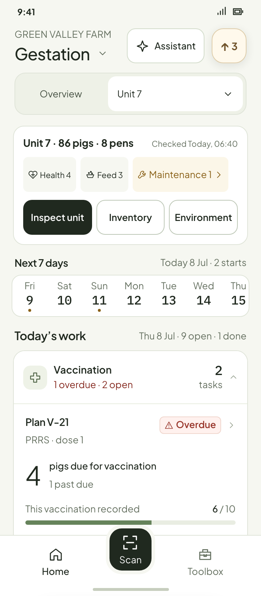
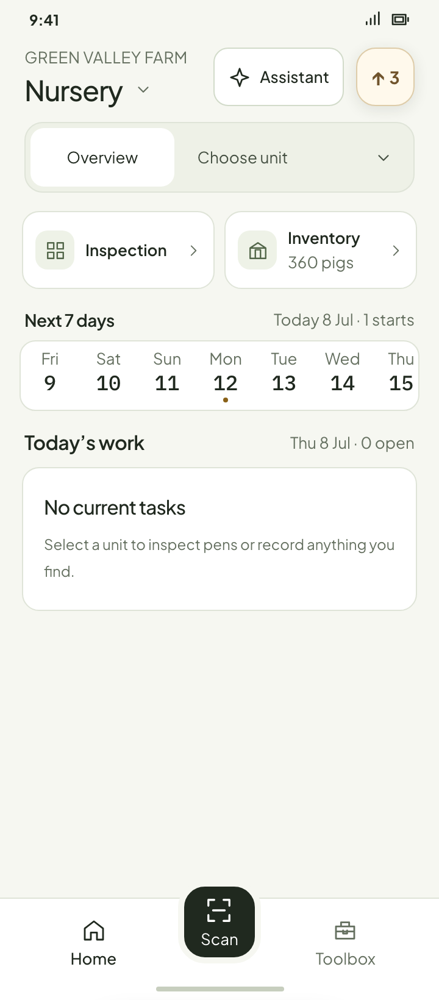
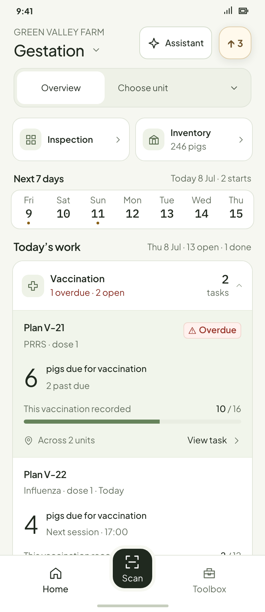

# Connected Home · review images

These are **in-design** Workbench prototype states, rendered from fictional farm data. The fixed sample date is 8 July. Open the [interactive prototype](../../ux/system/home-astra-prototype.html?section=gestation&many=operations&variant=connected) to change scope, dates and expanded categories.

## Task density

| Up to four instances: full cards | Five or more: categories folded |
| --- | --- |
|  |  |

| Many tasks: first urgent category open | Production category open, including today's finished receipt |
| --- | --- |
|  |  |

## Fixed seven-day preview

| Seven dates visible together | One date selected |
| --- | --- |
|  |  |

## Scope and state

| Unit overview | No current tasks |
| --- | --- |
|  |  |

Desktop pointer feedback fills the entire connected row; the content keeps its 14 px inset. The native touch design uses pressed feedback.

