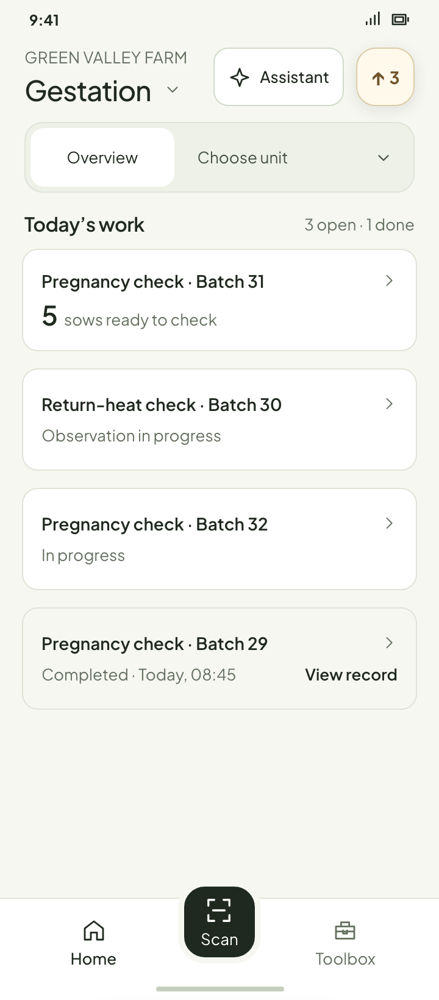
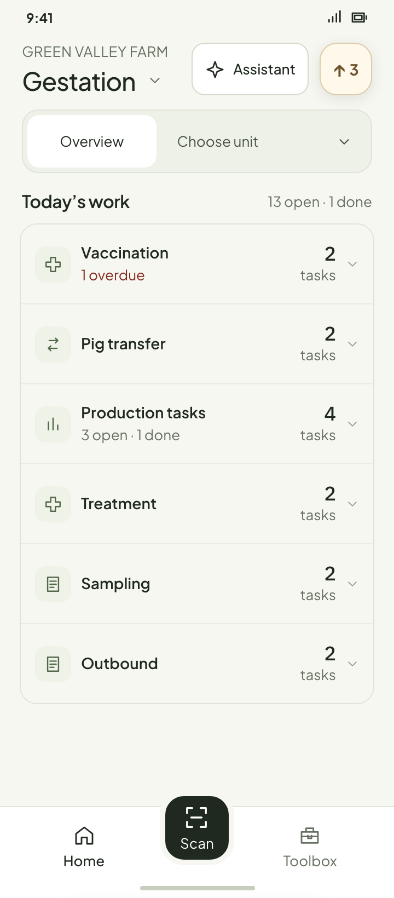
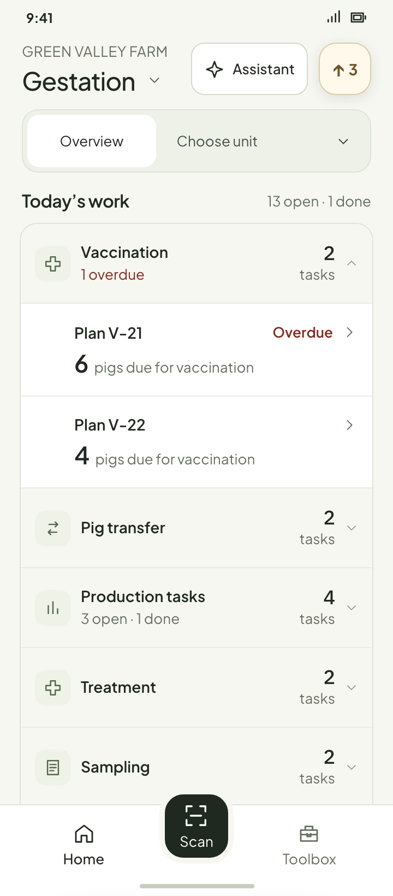
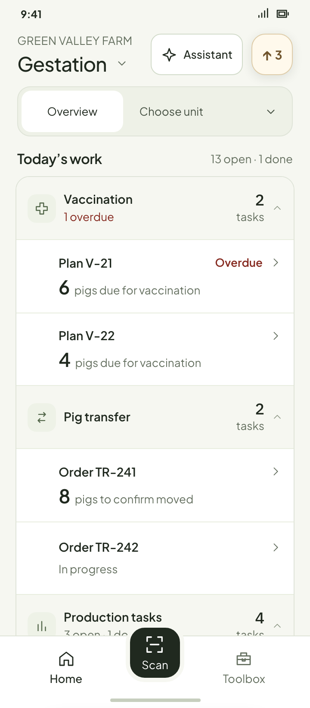
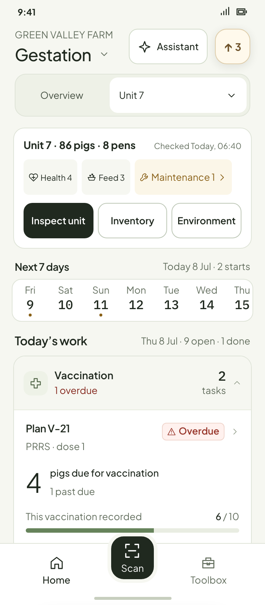
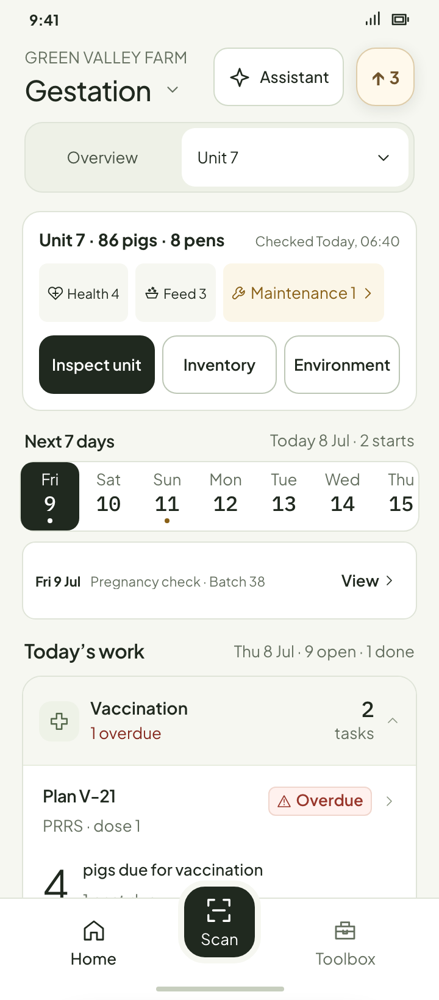
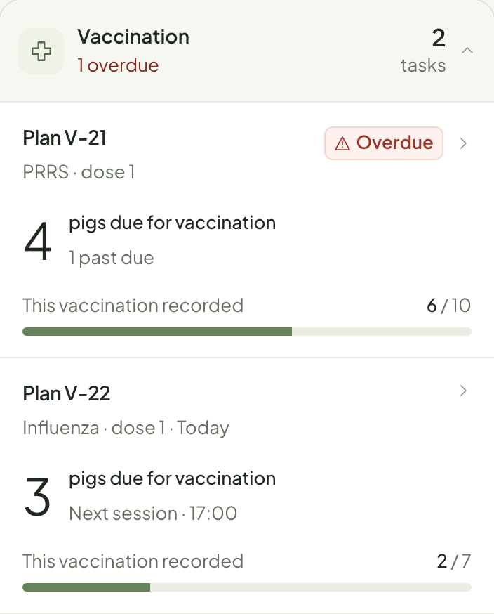

# Connected Home · review images

These are **in-design** Workbench prototype states, rendered from fictional farm data. The fixed sample date is 8 July. Open the [interactive prototype](../../ux/system/home-astra-prototype.html?section=gestation&many=operations&variant=connected) to switch scope and expand several categories independently.

## Overview: concise tasks

Overview omits Inspection, Inventory and date selection. Through four visible task instances, every instance has a concise entry. From five onward, task categories fold inside one surface; opening a category reveals the same concise task entries, indented below a tinted header.

| Up to four: every task visible | Five or more: categories folded |
| --- | --- |
|  |  |

| Urgent category open by default | All categories open for review |
| --- | --- |
|  |  |

The category header carries the group icon and task count; its white child rows have a left inset. A completed task remains a muted, readable record entry. A due count is shown only when the task model supports it; observation outcomes are not presented as work due.

## Unit: full task cards and local tools

Selecting a unit keeps the unit hub with Inspection, Inventory and Environment, the fixed next-seven-days selector, and full cards inside expanded categories. The date selector previews only future tasks that have not started.

| Unit hub and date selector | One date selected |
| --- | --- |
|  |  |

Desktop pointer feedback fills the whole task row. The native touch design uses pressed feedback.
