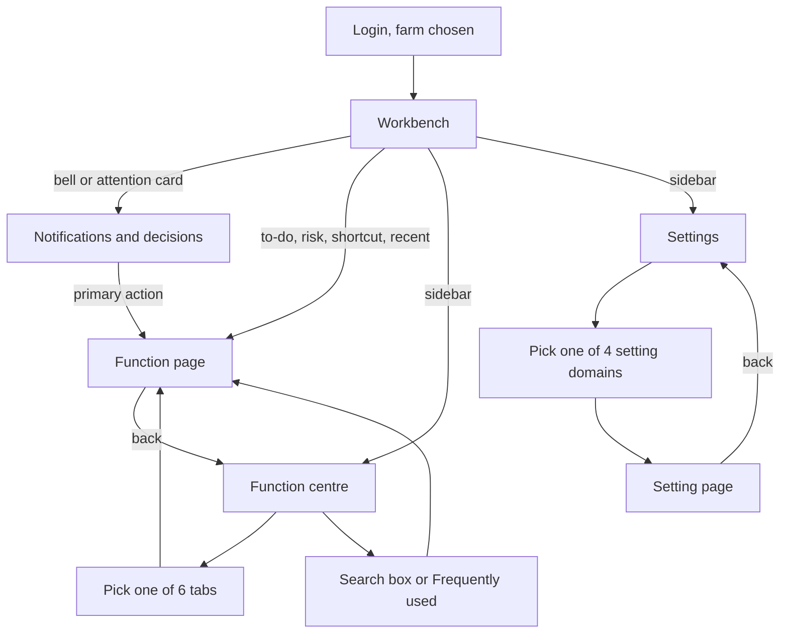

# Console workbench / home (Console 工作台)

| | |
|---|---|
| Area | [Console IA, workbench and access](../console-ia-workbench-access.md) |
| Platforms | Console |
| Maturity | built only (no PRD) for the newer, 3-entry version; the older "revised home 1" is specified + built in prototype |
| Newest sources | `线上Console侧边栏整理预览.html` (2026-08-25); `修改日志/修改日志-2026-08-25-Console信息架构预览.md` (2026-08-25); `Vaccine/prds/console/00-Console工作台首页-PRD.md` (working copy 2026-08-17, older version); `Vaccine/docs/修改日志-2026-08-24-Console信息架构原型.md` (2026-08-24) |
| Related flows | [login-and-farm-switch](login-and-farm-switch.md), [visitor-entry](visitor-entry.md), [staff-registration-and-entry](staff-registration-and-entry.md), [stock-overview](stock-overview.md), [onboarding-setup](onboarding-setup.md) |

## Job
A farm manager lands on the Console, sees what needs attention today, and reaches any function within two clicks. When done, the person has opened the right function page (or a notification's target) and can return to the same place in the navigation.

## Trigger and actors
- Opening the Console after login (see [login-and-farm-switch](login-and-farm-switch.md)). The sidebar's first entry is the workbench.
- Actors: Console manager (decides, approves, reads risks); Console staff who execute (find their to-dos). The bell in the top bar opens notifications from any page.
- Both versions below are wireframes with mock data. Nothing is written back to any business module.

## Flow

## Steps
Newest version: online Console information-architecture preview (2026-08-25).

1. **Sidebar.** Three entries: Workbench (工作台), Function centre (功能中心), Settings (设置). Current farm and user sit at the bottom. The sidebar collapses to icons at 1080 px or narrower, or by the collapse button.
2. **Workbench (工作台).** Top to bottom:
   - six snapshot tiles: on-farm stock, farrowings today, weanings today, transfers today, deaths/culls today, outbound orders waiting;
   - three attention cards: waiting for me / risk alerts / waiting for my decision;
   - today's to-dos;
   - risk monitoring in four groups: production anomalies, health risks, materials and stock risks, biosecurity;
   - six shortcuts: production batch, diagnosis, immunisation plan, create sampling task, transfer, pens;
   - five recent actions (who did what, when).
   It is a manager's entry point, not a dashboard.
3. **Notifications and decisions (通知与决策).** Opened by the bell or an attention card. Filter: all / to-do / risk / decision. Each item shows priority (high, medium, low), source module and entry, time, and one primary action that deep-links to the target entry (for example a pending entry request opens Site access > Entry requests).
4. **Function centre (功能中心).** One page. Above the tabs: a function search box (searches across all tabs) and a "Frequently used" strip of the six functions the user opens most (ranked automatically by clicks; first-time users get a short guide). Six tabs in this order:

| Tab | Groups -> entries |
|---|---|
| Production (生产管理) | Production operations: production lines, production batches. Breeding resources: semen management |
| Herd (猪群管理) | Herd overview: pens, pigs. Herd movement: transfer. Pigs leaving: outbound tasks, outbound data |
| Biosecurity (生物安全) | Monitoring: overview. Disinfection execution: material disinfection. Sampling: waiting to sample, waiting for test, tested, create sampling task |
| Site access (厂区权限) | People permissions: waiting for authorisation, permission list, permission change log. Entry applications: applications, application records |
| Health (健康与防疫) | Pig health: diagnosis, prescription list, immunisation plan |
| People (人员管理) | On-farm: staff. External: visitors |

5. **Opening an entry.** Shows a placeholder page with a three-level breadcrumb (Function centre / tab / entry). Back returns to the same tab.
6. **Settings (设置).** Four domains, nine items: Farm base (site layout, pen types); IoT (camera management, device management); Master data (drug management, vaccine management); Access (role management, permission configuration, site access).
7. **Deep links.** Every view has a URL hash (for example production batch, camera setting, risk inbox), so a page can be shared. Entry grid is 4 / 3 / 2 columns at 1440 / 1280 / 1024 px.

## States
| Object | State | How it gets there | What it allows next |
|---|---|---|---|
| Notification item | to-do / risk / decision; priority high, medium, low | Raised by a module (mock in the preview) | Primary action opens the target entry |
| Function entry | has badge or tag (for example "3 pending") | Count from the owning module (mock) | Opens the entry |
| Function usage | counted per click | Opening an entry | Feeds "Frequently used" (top 6) |
| Tab context | active tab remembered | Opening an entry from a tab | Back restores the tab |

## Rules
1. Only three sidebar entries; notifications are not a sidebar entry any more (bell only).
2. The function centre is one page with six tabs; no second "module card" page between the tab and the entry (changed 2026-08-24).
3. Each entry lives in exactly one tab. Moves made on 2026-08-25: transfer to Herd; outbound to Herd ("Pigs leaving"); semen to Production; sampling merged into Biosecurity; immunisation plan merged into Pig health.
4. Prescription states (not executed / executing / executed) are filters inside the prescription list, not separate entries.
5. "Frequently used" shows the six most-clicked entries, ranked by actual use; recent and starred entries are also kept (stored in the browser in the preview).
6. Culling and retention-for-breeding are not in this IA; their notification items were removed with them.
7. Workbench to-dos and notification actions must land on a specific entry or tab (for example entry requests go to Site access).
8. Real version (implied by the older PRD): counts come from aggregate APIs and are filtered by the user's permissions; a target the user may not open shows a no-permission message and stays on the workbench.

## Data
| Field | Where | Required? |
|---|---|---|
| Snapshot value, unit, change note | Workbench tiles | mock in preview |
| Notification: title, text, priority, source, time, action | Notifications | yes |
| Entry: name, group, tab, icon, description, status text or count, search keywords | Function centre | yes |
| Frequently-used and recent lists | browser storage | per user |

## Edge cases
- Search with no match, no recents yet, no notifications: not specified in the preview (first-use guidance for "Frequently used" only).
- Entry pages are placeholders; no business page, empty or error state is designed here.
- Narrow window: sidebar collapses, tabs wrap, no horizontal scroll.

## Versions
- 2026-08-07 to 08-17: **Revised home 1** inside the Vaccine prototype (see below).
- 2026-08-21: online Console sidebar tidied into 12 "apps" in 4 groups (file overwritten, not recoverable).
- 2026-08-24: launchpad with 4 entries; v2 replaced module cards by tabs; v3 added search, favourites, recents, a "has to-do" filter and a command palette.
- 2026-08-25: current preview: 3 entries, bell for notifications, 6 tabs, Site access tab added, breeding management and culling/retention removed, the "all functions" tab and the dashed "start" card dropped.

### Older version: revised home 1 (改版首页1), Vaccine prototype
Specified in `Vaccine/prds/console/00-Console工作台首页-PRD.md`. A button "revised home 1" at the top right of any normal page switches to it; "back to original home" restores the previous page and old sidebar. Hidden on full-screen flows (login, onboarding).
- Sidebar (5): Workbench, Task centre (任务中心), Business centre (业务中心), Data analysis (数据分析, opens the finance analysis page directly), then Settings; "Switch to Mobile" at the bottom.
- Workbench: to-dos (vaccine tasks to issue, culls to confirm, immunity results to review, inventory risk), run overview (to inject, running, done this week, exceptions), common actions (find task, create vaccine task, both open the vaccine task page), recent visits (first three vaccine tasks).
- Business centre: category filter (all, people, immunisation, treatment, culling and retention, semen, inventory, finance, settings) plus search by name or description; opening an entry keeps the sidebar and shows a back link (to business centre, task centre or settings) that restores the earlier category.
- Rules: no vaccine tasks gives count 0 and empty recents; empty search gives an empty state without switching category; per-block error state when aggregate data fails; mock data is never written back.

## Figma and repo
- Figma (Console, from the area doc): 🖥️ 工作台 > Home `3985:5458` with task calendar, batch list, production and health cards; Notifications and decisions as a 480 px side panel. Figma wins on visuals. The handover wireframe is a different composition (snapshot tiles, attention cards, risk groups).
- Repo: no Console feature in `features/`. The mobile `features/workbench/` is a different product surface (see [mobile-home-toolbox](mobile-home-toolbox.md)).

## Open questions
1. **Which IA is the target?** Revised home 1 covers vaccine, culling, semen, inventory and finance; the 3-entry IA covers production, herd, health, biosecurity, site access and people. Neither contains the other's modules; inventory, feed, finance and immunity review have no place in the 3-entry IA. (`00-Console工作台首页-PRD.md` vs `修改日志-2026-08-25-Console信息架构预览.md`.)
2. The 2026-08-24 log says the console PRD must be updated if the new IA is adopted; it was not.
3. Culling and retention vanish from the 3-entry IA but remain in the older PRD, the Console culling PRDs and the Mobile home. Semen is one entry in one IA and four in the other.
4. Duplicates inside the 3-entry IA: Site access is both a tab and a Settings item; Visitors and Entry applications list the same three requests; Staff vs the permission list.
5. Notifications: full page (preview) vs 480 px side panel (Figma).
6. The 2026-08-25 log's verification note says Health still shows an "immunisation" group; the log body and the file merge it. The file is right.
