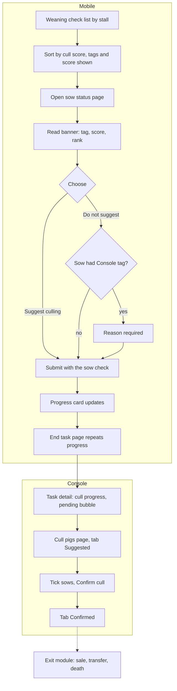

# Cull review and confirmation (淘汰复核)

| | |
|---|---|
| Area | [Culling, replacement and semen](../culling-replacement-semen.md) |
| Platforms | Mobile (review inside a task), Console (result and confirmation), back end |
| Maturity | specified + built in prototype (the "why not cull" reason prompt is specified only; the Mobile 淘汰中心 is built only, no PRD) |
| Newest sources | `Vaccine/prds/culling&replacement/03-mobile-淘汰复核.md` (2026-07-22); `Vaccine/prds/culling&replacement/01-console-母猪淘汰计划.md` §6 (2026-08-05); `Vaccine/prds/culling&replacement/修改日志/修改日志-2026-06-18-淘汰留种导航调整.md`; prototype `Vaccine/src/components/culling/CullingTaskDetailPage.tsx`, `MobileCullingCenterPage.tsx` |
| Related flows | [culling-plan](culling-plan.md), [pig-exit-and-sale](pig-exit-and-sale.md), [keep-for-breeding](keep-for-breeding.md) |

## Job
A stockperson judges each sow during an existing task and records "needs culling" or "not". Afterwards a manager confirms the culls on the Console. When done, confirmed sows are marked for the exit process; they have not left yet.

## Trigger and actors
- Mobile: weaning check (the main one), postpartum check and inspection per PRD 03. Review is part of the task, never a separate task.
- Console: task detail (任务信息, field 淘汰进度 with a 查看 icon) and a page 淘汰猪只.
- Manager confirms; the exit work (sale, transfer, death) belongs to [pig-exit-and-sale](pig-exit-and-sale.md).

## Flow

## Steps
**Mobile**
1. Open the weaning-check task. The list groups sows by stall (one sow per stall at weaning). Each card shows the ear tag, any of the tags 建议淘汰, 需淘汰, 已淘汰 (the last two in different colours) and the cull score. The shared sort sheet offers cull score ascending or descending; only stall order changes and stall numbers stay visible.
2. Tap a sow to open the sow status editor. Above 体况评分 a banner shows suggested/planned culling, 淘汰评分 ("暂无评分" when none) and 淘汰排名 ("排名待生成" when none). It is reference only.
3. Choose 建议淘汰 or 不建议淘汰 (only two choices). Choosing changes the banner's suggestion count at once (1 or 0).
4. If the sow carried the Console tag and the user picks 不建议淘汰, a dialog forces a written reason; cancelling reverts to 建议淘汰.
5. Submit the sow as one check: the review is part of the single per-sow submit. A network failure keeps what was typed.
6. The progress card shows 已检查/需检查 and, only when a plan is on, 已淘汰/目标淘汰 (really "confirmed as needing culling" over target). Planned 0 still shows "0 / 0".
7. End task page repeats the cull progress. 结束任务 is a red outline button. If this task has a pre-end check and the count is short, an alert says exactly how many are still missing; otherwise ending is allowed and the shortfall is shown for later review.

**Console**
8. Task detail, card 任务信息: field 淘汰进度 shows confirmed over target; a 查看 icon opens the page (hover explains the number). When the task has ended and suggestions are still open, a non-clickable bubble beside the icon reads that N suggested sows await confirmation; hidden at 0 or without permission.
9. Page 淘汰猪只: one table, two tabs 建议淘汰 N 头 and 确认淘汰 N 头, search by sow ID, 10 rows per page, footer with the last update source and time. Columns: sow ID, location, cull index, parity, avg litter, teats, avg born alive, return-to-heat, disease tags, operator and time. No progress bar, no stat cards, no sale or transfer status.
10. In 建议淘汰, tick sows and press 确认淘汰. The prototype opens a dialog asking the user to type the number of pigs being confirmed; the button stays disabled until it matches the ticked count. The dialog warns that confirmed pigs are flagged "confirmed cull", can be filtered quickly in the sale and transfer modules and will not join a new batch. Confirmed sows move to the other tab with operator and time.

## States
| Object | State | How it gets there | What it allows next |
|---|---|---|---|
| Sow tag | 建议淘汰 | Console plan (manual pick) | Mobile review |
| Sow (task result) | 需淘汰 | Mobile choice 建议淘汰 | appears in Console tab Suggested/Pending |
| Sow (task result) | not culled + reason | Mobile choice 不建议淘汰 on a tagged sow | reason visible on the Console result for review |
| Sow | 确认淘汰 | Console confirmation | picked up by the exit module |
| Sow | 已淘汰 | exit completed (sold, moved, died) | nothing; set by other modules |

## Rules
1. Review is not a separate task and not a separate submit.
2. The cull progress on Mobile and Console must use the same wording and number.
3. A sow without the plan tag may still be chosen for culling in the field.
4. A tagged sow that is not culled must carry a reason; the reason reaches the Console result.
5. Falling short of the target never blocks ending unless the task's own rule says so; the gap must be shown.
6. The sow can carry both 建议淘汰 and 重点留种来源 together.
7. Console page shows decisions only: no sold, moved, left or dead status.
8. 已淘汰 is set only after downstream handling; 需淘汰 and 确认淘汰 must never be called 已淘汰.

## Data
| Field | Where | Required? |
|---|---|---|
| Cull choice (suggest / not) | sow status editor | yes, with the sow check |
| Reason for not culling | dialog | when tagged and "not" |
| Cull score, rank | banner, card | read-only, from engine |
| Operator and time of confirmation | Console table | system |

## Edge cases
- Score not generated: banner shows the placeholders above; the score batch status stays "collecting data" until the batch scoring time.
- Offline or failed submit: typed content kept; no duplicate entry.
- Suggestions left unresolved after the task ends: bubble on task detail.
- Mobile 淘汰中心 (built, no PRD): Home entry 淘汰任务 and Toolbox; batch dashboard with a progress percent, a sow list with filters 全部 / 建议淘汰 / 已标记淘汰 / 未标记 and bulk 标记淘汰 / 取消淘汰. It sits beside, not inside, the specified review.

## Versions
- 2026-04-16: brainstorm split culling into a review task plus a handling task.
- 2026-04-22: replaced by review embedded in the weaning check.
- 2026-06-18: Console cull detail redesigned (option C won) and merged into one table with two tabs.
- 2026-07-22: PRD 03 current; pre-dates score V1.3 and the 淘汰中心 screens.
- 2026-08-13: score V1.3; 历史难产 removed from Console and Mobile lists.

## Figma and repo
Weaning check in progress and ended: Figma 生产任务 file `psrxDa9LRWLdTL9XMZmWdc`, node `8023:17019`; postpartum check node `8006:14820`. Repo: `weaning`, `wean` (not designed yet), `post-farrowing`; the Console pages are not in Figma or `features/`.

## Open questions
1. Does a Mobile 需淘汰 land directly under 确认淘汰 or wait on the Console confirmation? PRD 03 versus PRD 01 and the prototype's 建议淘汰 tab.
2. The reason prompt is specified (PRD 03) but not built (`cullRejectReason` exists in `MobileWeaningCheckFlow.tsx`).
3. Who owns outbound for confirmed sows, and who sets 已淘汰: only the April brainstorm and the 2026-08-25 IA preview (猪只出场) exist.
4. The 淘汰中心 and the in-task review overlap; no PRD defines 淘汰任务.
5. The "type the count" confirmation is prototype-only; no PRD mentions it.
6. The 2026-08-25 IA preview removes the 淘汰&留种 sidebar group without giving the pages a new home.
