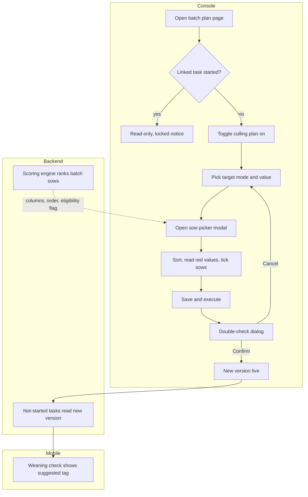

# Sow culling plan (母猪淘汰计划)

| | |
|---|---|
| Area | [Culling, replacement and semen](../culling-replacement-semen.md) |
| Platforms | Console (plan, result), back end (scoring engine); Mobile only reads the tags |
| Maturity | specified + built in prototype (plan page, task and batch detail; save-and-execute and locking are specified only) |
| Newest sources | `Vaccine/prds/culling&replacement/01-console-母猪淘汰计划.md` (2026-08-05); `Vaccine/prds/culling&replacement/05-console-淘汰&留种计划编辑与生效规则补充说明.md` (2026-05-04); `Vaccine/prds/culling&replacement/修改日志/修改日志-2026-08-13-母猪淘汰评分规则V1.3.md` (2026-08-13) |
| Related flows | [cull-review](cull-review.md), [replacement-plan](replacement-plan.md), [pig-exit-and-sale](pig-exit-and-sale.md) |

## Job
A manager, before a batch starts, sets a soft target for how many production sows should leave and names the sows the floor should look at first. When it is done, the weaning check on Mobile shows a "suggested for culling" tag on those sows; nothing is culled yet.

## Trigger and actors
- Console user (manager) opens the batch plan page: sidebar group 淘汰&留种, item 母猪淘汰&后备留种, card 母猪淘汰计划.
- Back end: the sow scoring engine ranks the batch and feeds the modal columns and the tag source (see Rules).
- Mobile user only reads the result; see [cull-review](cull-review.md).

## Flow

## Steps
**Console, plan page**
1. Open the plan page. It shows the last live version, never an earlier unsaved edit. The page holds two cards, culling and replacement ([replacement-plan](replacement-plan.md)).
2. Switch 母猪淘汰计划 on. The config opens; the page is now "edited, not saved" and the bottom button becomes 保存并执行 (save and execute).
3. Choose target mode 百分比 (percent) or 头数 (head count) and type a value. The page always shows both the typed value and the converted planned head count, based on the batch's eligible sows.
4. Open 指定淘汰母猪. The modal lists the batch's sows with ear tag, parity, average litter size, average born alive, teat count, return-to-heat count and disease tags. Columns with values sort; abnormal values show red. The outer button shows "已选 N 头".
5. Tick sows and close. A sow that left the farm before saving cannot be added; the page asks for a refresh.
6. Press 保存并执行. A double-check dialog lists the plan on or off, mode, value, planned head count, picked sow count and which not-yet-started tasks are affected. 确认修改 makes it live; 取消 returns to editing.
7. Leaving the page, switching batch or closing with unsaved edits opens a guard: 继续编辑 or 放弃修改.
8. After the batch task has run, the same plan is read-only and says the linked task has started and the plan is locked.

**Console, result** (task detail card 任务信息, field 淘汰进度) is described in [cull-review](cull-review.md).

## States
| Object | State | How it gets there | What it allows next |
|---|---|---|---|
| Plan | Off (never configured) | default | switch on |
| Plan | Edited, unsaved | any change to toggle, target or list | save and execute, or leave and discard |
| Plan | Live version | confirmed in the double-check | edit again while no task has started |
| Plan | Pending off | toggle switched off, not yet saved | save to stop new tags; target and list are kept |
| Plan | Locked | linked task started | nothing; read-only |
| Sow tag | 建议淘汰 (suggested) | picked in a live plan version | Mobile review |

## Rules
1. The target is soft. A shortfall never blocks ending a task; whether the task blocks is that task's own rule.
2. 建议淘汰 is a plan tag, not a result. A sow may carry both 建议淘汰 and 重点留种来源 (focus source for keeping); nothing resolves the overlap.
3. Target 0 with a manual list is allowed: it only sends attention.
4. Toggle, target mode, target value and the sow list are all "formal changes" that need 保存并执行. Merely opening the page changes nothing.
5. Live scope: the new version is the batch's only valid one. Tasks not yet started read it; started tasks keep the version they began with.
6. Switching off keeps target and list; switching on restores them but still needs a new save.
7. Saving fails server-side if the task started after the page opened; the page then shows the locked notice.
8. A batch with no selectable sows still lets the target be edited; the modal shows an empty state.
9. Suggested list from the scoring engine (inputs only). The current rule generation (V1.3, 2026-08-13) scores each sow once per batch at the weaning point and ranks within the batch. Inputs: reproductive history, the current litter's outcome, weaning outcome corrected for fostering, body and health checks from the weaning form, mobility, and teat count and prolapse. The score is an economic culling priority, not a welfare alert. Missing values are filled from the farm's historic median, so a sow is still scored. One red line (uterine prolapse, or any prolapse that recurs after reset) forces the suggestion. A sow below 60 percent own-data completeness never enters an automatic top-N list. Sows that died, left or are marked non-breeding are not scored.
10. Order in the picker follows the batch ranking; the V1.3 changelog proposes that the top N, N from the target, gets the 建议淘汰 tag automatically. PRD 01 has the manager pick by hand. This is open (see Open questions).

## Data
| Field | Where | Required? |
|---|---|---|
| Plan on/off | plan card | yes |
| Target mode and value | plan card | when on |
| Planned head count | derived, shown beside the value | derived |
| Picked sows (ear tag) | picker modal | optional |
| Sow columns: parity, avg litter, avg born alive, teats, return-to-heat, disease tags | picker modal | display |
| Sow score and batch rank | picker modal and Mobile banner | from the engine |

## Edge cases
- Sow gone before save: blocked from the list, refresh asked.
- Percent target on a batch whose sow count changes: planned head count is recalculated on screen.
- Unsaved edit then leave: guard; discard restores the live version.
- The old list field 历史难产 (dystocia history) was removed on 2026-08-13 because the score already counts its consequences; return-to-heat count stayed.
- Concurrent editors: not specified beyond the server rejecting writes after the task starts.

## Versions
- 2026-04-15: brainstorm fixes a soft target in percent or head count; a "finalise cull" step was proposed.
- 2026-04-22: task-based culling pages dropped; plan page plus Mobile review embedded in the weaning check.
- 2026-05-04: edit and lock rules written as PRD 05.
- 2026-06-18: sidebar group 淘汰&留种 gets task detail and batch detail pages.
- 2026-08-04 to 08-13: sow score V1.2 (hard gates, 90+ tier) replaced by V1.3 (no tiers, no gates, one red line, median fill).

## Figma and repo
Not in Figma. No repo `features/` entry for the Console plan. The weaning check where the tag appears is in Figma file 生产任务 (`psrxDa9LRWLdTL9XMZmWdc`, node `8023:17019`) and the repo `weaning`/`wean` placeholders.

## Open questions
1. Auto top-N tagging from the score versus manual picking: V1.3 changelog ("衔接待确认") versus PRD 01.
2. Which score scale the PRDs mean by 淘汰指数 and 淘汰评分: PRD 01 and 03 cite no rule version; V1.3 uses 0 to 5 indicator scores.
3. Save-and-execute, double-check and locking are specified in PRD 05 but absent from the prototype (`CullingPlanPage.tsx`).
4. The V1.3 rule files live outside the handover; fetch them before design work.
5. Acute illness is deliberately not escalated by the score (V1.3, decision 4); revisit if the floor relies on this list for urgent cases.
6. PRD 05 treats the retention number like an executable target while PRD 02 calls it a reference only (see [replacement-plan](replacement-plan.md)).
