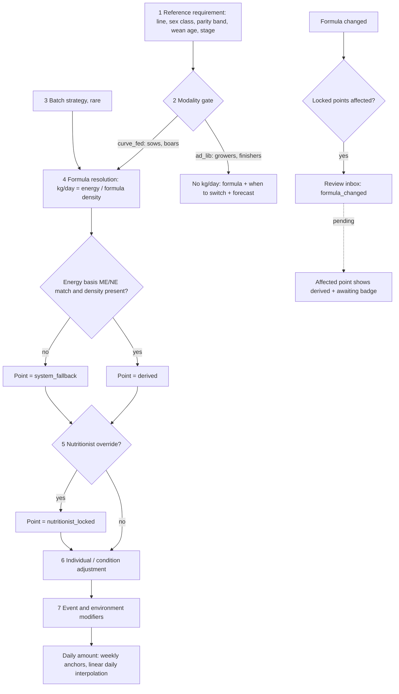

# Feed requirement resolution (饲料解析级联)

| | |
|---|---|
| Area | [Transfers, feed, production lines, legacy design system](../transfers-feed-lines-legacy.md) |
| Platforms | back end (resolution); Console (assign formulas, overrides, review inbox); Mobile (read, preset override, answer inbox) |
| Maturity | specified only (PRD v2.1 draft; no screens). The repo's `features/feed-plan` is built only for the mobile editor. |
| Newest sources | `Sentri_Feed_Management_PRD_v2_1_中文.html` s7-s11, s13, s16 (2026-08-12; v2.1 dated 2026-08-11); `饲料管理/assets/饲料解析级联-中文.svg` (2026-08-12) |
| Related flows | [feed-stock-reconciliation](feed-stock-reconciliation.md), [task-stock-deduction](task-stock-deduction.md), [production-line-setup](production-line-setup.md), [pig-transfer](pig-transfer.md) |

## Job
The farm enters only what it already has: a stage, a feed product, a kg-per-day curve. The system turns the stage's reference energy requirement into a daily amount for each pen or batch, and lets people override it without ever losing the override. When it is done, a worker can read "what formula, how much, when to switch" for a pen today, and every curve point says where its value came from.

## Trigger and actors
- **System:** recomputes whenever an input changes (formula data, stage, genetic line, batch strategy).
- **Farm manager or owner:** assigns formulas and the feeding program, sets batch strategy at batch start, makes whole-curve or point overrides, sets policy.
- **Farm worker:** logs events (wean, cull, spot weight), applies preset individual overrides, answers inbox items; cannot edit curve, formula or reference.
- **Nutrition contact** (optional, defaults to the manager): higher-trust override badge; resolves formula-change flags.
- **Sentri admin:** maintains the global reference library (the farm cannot edit it).

## Flow

## Steps
1. **Reference requirement (layer 1).** System reads the global library by genetic line, sex class (barrow, gilt, boar, entire male, mixed), parity band (P1, P2-5, P6+), wean age and stage. Energy basis (ME or NE) is mandatory.
2. **Modality gate (layer 2).** Sows and boars are `curve_fed` and get kg/day. Growers and finishers are `ad_lib` and never get a per-pen ration; they get the formula in the feeder, the date to switch, and a forward estimate. Gilt development resolves by the genetic line's lean-potential tier (high lean: ad lib; medium or low: restricted).
3. **Batch strategy (layer 3).** Manager may set standard, market-time or accelerated at batch start; rarely used, reserved pattern in MVP.
4. **Formula resolution (layer 4).** kg/day = reference energy divided by the assigned formula's energy density. Precision tier is whatever the formula data supports: default curve, basic derived (energy only), advanced derived (adds lysine, Liebig minimum), nutritionist manual. ME and NE are never mixed; a mismatch or missing basis sets the point to `system_fallback`.
5. **Nutritionist override (layer 5).** Whole curve in MVP, point-level as fast follow. The value becomes `nutritionist_locked`.
6. **Individual or condition adjustment (layer 6).** A worker or manager applies one shared adjustment to an animal, pen or batch (percent, absolute, or rate per unit). MVP is a severity-band preset dropdown (body condition or backfat), not a scoring engine.
7. **Event and environment modifiers (layer 7).** Flushing is a manual button for a window of N days before a transition; heat or cold adjustments are a manual seasonal switch.
8. **Daily lookup.** The curve is stored at weekly anchors; the day's value is a linear interpolation between neighbours.
9. **Grower to finisher** has no discrete event: the system estimates the day from `growth_offset_days`, a one-tap confirmation on the physical pen move corrects it, and spot weights recalibrate.
10. **Mixed-sex pens** resolve each sex class and take the higher-requirement value, never the average.

## States
| Object | State | How it gets there | Allows next |
|---|---|---|---|
| Curve point | `derived` | normal computation | silent recompute on any upstream change |
| Curve point | `system_fallback` | data gap (no density, basis missing or mismatched) | returns to derived on its own when the gap is fixed |
| Curve point | `nutritionist_locked` | a human set it; also every imported farm program on day one | never auto-reverts; upstream change raises a review flag; released only by accept, edit or release |
| Adjustment | active, expired, cleared | start date required, `expires_at` prompted | `override_aging` flag after 30 days without an expiry |
| Review item | pending, resolved, dismissed | system flag | see feed-stock-reconciliation for the other item types |

## Rules
1. Anchor is stage, curve, formula, performance. Nutrition science is never a required farm input.
2. Unset inherits the default: a farm that overrides, counts and calibrates nothing still gets a working system.
3. Computed values recompute silently; human-set values are never silently overwritten.
4. A formula change that touches a locked point raises `formula_changed` to the nutrition contact. While pending, that point falls back to derived with an "awaiting nutrition contact" badge; the locked value is kept and restorable.
5. Override permission is not role-gated to nutritionists; the UI shows who set it and a trust badge (manager override is lower than nutrition-contact override).
6. Individual override MVP: flat presets, with asymmetric caution (over-conditioned sows near farrowing get smaller, more conservative changes). Numeric thresholds are an open decision needing a nutritionist.
7. Day-one import: the farm's existing program enters as `nutritionist_locked` so feeding does not change; unlock stage by stage.
8. Growth estimate and feed calibration share one self-correcting offset mechanism (open decision on shared implementation).
9. MVP on: reference, modality, density, derivation, whole-curve override, review inbox, locked import. Reserved pattern: batch strategy, individual presets, flushing, environment. Deferred: per-animal IoT feeding, AI curve suggestions, price variance, tenant reference curves, push or email escalation.
10. A formula edit that would break a lock or a fallback chain is handled in [feed-stock-reconciliation](feed-stock-reconciliation.md) (stock-out and retirement).

## Data
| Field | Where | Required? |
|---|---|---|
| Energy density, energy basis | feed formula | density optional; basis required if density set |
| Crude protein, lysine, full profile | feed formula | optional (unlock advanced tier) |
| Phase budget kg per head, phase duration days | feed formula | optional (feed forecast and switch prompt) |
| Stage, genetic line, formula, fallback formula, batch strategy | feeding program | stage, line and formula yes; others optional |
| Target (batch or animal), program, effective date | feeding assignment | yes |
| Curve points: day, kg, source state, derivation tier | feeding curve | system-built |
| Scope, type, value, start date, expiry, applier | adjustment | start date required; expiry prompted |
| Sex class, mix ratio, head count, growth offset | batch | sex class nullable |

## Edge cases
- Ad-lib stage with neither phase-budget field set: no forecast, no switch prompt; feeding itself is unaffected.
- Sow culled or dead mid-lactation: her litter's nursery transition fires on "end of lactation", early wean if near wean age, otherwise a foster or reassign prompt.
- Gilt with no estrus events: transition gate falls back to age plus weight.
- Concurrent edits to curves are not specified; adjustments, purchases, counts and calibrations keep an append-only correction history.

## Versions
- 2026-08-05: spec v1 (not in the handover).
- 2026-08-11: v2.1 consensus draft after five independent reviews (about 70 findings, Appendix A).
- 2026-08-12: full Chinese translation; no business change.
- Dropped in review: per-batch variance attribution, single flat per-stage modality, and the flat symmetric plus or minus 10 percent preset (replaced by severity bands; thresholds still open).

## Figma and repo
Not in Figma: `[Web] 饲喂计划` (`2owiBMZ66JOILBd5VELWgt`) is a cover page only. Repo `features/feed-plan` covers only the mobile pen read and the Adjust feed editor (minus 50 to plus 50 percent, hold, stop), which maps to layer 6 and to "stop". Layers 1-5 and 7, formula authoring and the review inbox have no repo design. The repo keeps "feeding program" and "feed formula" separate, as the PRD does.

## Open questions
1. Who owns reference curves (global, or per tenant)? PRD s17, open decision 1.
2. Is the backend `feedPlanId` in `06-库存出库后端逻辑.md` the same object as `feeding_program` plus `feeding_assignment`? Neither PRD defines the other.
3. Does the repo's plus or minus 50 percent editor equal the PRD's plus or minus 10 percent presets and severity bands? Different limits and different models.
4. Which screen explains "Formula due" on the pen header (repo) versus the `phase_diet_switch_due` inbox item (PRD)?
5. The PRD's cross-references look inconsistent in the translation (persistence check cited as s12.6 in s9.16 but described in s12.4); the English source is not in the handover.
