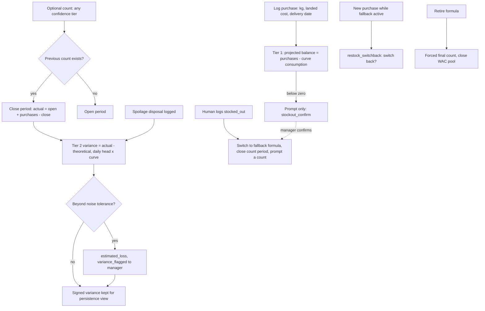

# Feed stock and reconciliation (饲料库存与对账)

| | |
|---|---|
| Area | [Transfers, feed, production lines, legacy design system](../transfers-feed-lines-legacy.md) |
| Platforms | Console (purchases, counts, variance, cost, inbox); Mobile (log purchase and count, answer inbox); back end (periods, WAC, deduction) |
| Maturity | specified only (feed PRD v2.1, no screens), plus a Console inventory thread that is built in the Vaccine prototype and contradicts it |
| Newest sources | `Sentri_Feed_Management_PRD_v2_1_中文.html` s9.12-9.17, s12-13 (2026-08-12); `饲料管理/assets/饲料库存对账流程-中文.svg`, `饲料对账时间线-中文.svg`; `Vaccine/prds/inventory/03-饲料预计可用天数.md` (2026-08-14); `Inventory management/Inventory PRD/06-库存出库后端逻辑.md` (2026-08-19) |
| Related flows | [feed-requirement](feed-requirement.md), [task-stock-deduction](task-stock-deduction.md), [stocktake](stocktake.md), [offline-production-tasks](offline-production-tasks.md) |

## Job
Tell the farm whether it follows its feeding plan and wastes feed, without feeder machines and without distorting financial reports. The farm logs every purchase (the only required input), optionally counts the bin, and the system compares the plan with reality in periods. Done means: a projected balance is always visible, and each closed period carries a variance and, when it persists, an estimated loss.

## Trigger and actors
- **Farm worker or manager** logs a purchase on delivery and, optionally, counts a silo or bin in scoops, bags, a dipstick or a sensor reading (Mobile and Console; platform split is not specified).
- **System** computes balances, closes periods, raises inbox items.
- **Farm manager** answers stock-out, restock, variance and phase-switch items; **nutrition contact** answers formula changes; worker or manager answers spot-check items.
- **Storekeeper** (Console) sees the inventory-module view of the same feed (reference stock, days of use). See Open questions: it is a different model.

## Flow

## Steps
1. **Log purchases (always).** Quantity, total landed cost (freight and handling included), delivery date, silo. Delivery date governs, not invoice or payment. The log date is stored separately to expose late entry.
2. **Read the projected balance (tier 1).** Cumulative purchases minus cumulative theoretical consumption. It is labelled projected or unconfirmed, never stock, shows days since the last count, and is never presented to workers as a raw negative ("unconfirmed since date, count to verify").
3. **Count (optional).** Raw reading plus calibration (scoop, bag, ruler, level fraction) converts to kg; each silo has a default confidence tier (eyeball, dipstick, sensor, self-report). Two counts bound a period.
4. **Close a period.** Actual consumption = opening count + purchases in the period - closing count. Theoretical = daily sum of head times that day's stage curve for each animal's actual stage.
5. **Variance (tier 2).** Variance = actual - theoretical, in kg and money, signed. Spoilage disposals are removed first. Noise tolerance depends on the looser of the two counts' confidence tiers. Estimated loss = variance beyond tolerance, valued at the period's weighted average cost.
6. **Persistence.** MVP shows the last few signed variances side by side; the farmer or nutrition contact spots repeats. One period is a hint, repeated same-sign periods are a real issue.
7. **Stock-out.** A human-logged stock-out auto-switches the pens to the fallback formula, closes the count period and prompts a count. If none is configured, the app asks inline to name one. A projected balance below zero never switches by itself; it only raises `stockout_confirm`.
8. **Restock.** A purchase while a fallback is active raises `restock_switchback`; one tap switches back.
9. **Retire a formula.** The stop action forces a final count and closes or writes off the remainder.
10. **Review inbox.** One persistent, role-routed list, visible in-app only in MVP.

## States
| Object | State | How it gets there | Allows next |
|---|---|---|---|
| Reconciliation period | open | a count with no later count | tier 1 projection only |
| Reconciliation period | closed | a second count | variance, loss estimate, frozen cost snapshot |
| Silo formula | primary or fallback | stocked_out logged or confirmed | switch back after restock |
| Formula | active, discontinued | stop-formula action with final count | none |
| Inbox item | pending, resolved, dismissed | system flag | types: `formula_changed`, `stockout_confirm`, `restock_switchback`, `variance_flagged`, `override_aging`, `spot_check_due`, `phase_diet_switch_due` |

## Rules
1. Reconciliation is periodic, not a running balance: a continuous deduction has no self-correction.
2. Tier 1 may be negative, is informational, and must never become a booked financial adjustment. Only count-anchored tier 2 can.
3. Variance is reported at the physical measurement level (silo), never attributed per batch or pen. Whoever knows the site investigates.
4. Persistence is judged on signed raw variance, not the tolerance-clipped loss.
5. Cost is a weighted average over a trailing window (length is an open decision). Each period keeps an immutable cost snapshot. Batch feed cost is standard (curve times cost), not measured. Usage variance only, no price variance.
6. Purchase timing never moves batch cost; purchasing is cash flow, batch cost is consumption.
7. Cycles of fallback formulas (A to B to A) are rejected on save; chains are allowed. A fallback change re-resolves any pens currently on the old fallback.
8. Fallback activation counts as a formula change for locked curve points: it raises a review flag rather than rescaling a locked kg value.
9. Purchases, counts and calibrations keep an append-only correction history (who, when, old, new).
10. Single-farm, single-currency in practice; a currency field exists for later.

## Data
| Field | Where | Required? |
|---|---|---|
| Kg, total cost, delivery date, logged date, recorded by | purchase | yes |
| Raw quantity, calibration, counted kg, confidence tier, date | physical count | optional entity |
| Spoilage kg, reason, date | disposal | optional |
| Opening and closing count, purchases, theoretical, actual, variance, tolerance snapshot, estimated loss, cost snapshot | period | system-built |
| Name, capacity, current formula, default confidence tier | silo | name nullable (bagged feed in a shed) |
| Item type, subject, routed role, status | inbox item | system-built |

## Edge cases
- A farm that never counts: tier 1 only, with a staleness label; purchases still give cost data.
- Counts at irregular times: any interval works; the span since the last count stays open and is for projection only.
- Mid-period stage change of a batch: handled by the daily sum, not by one rate.
- Late purchase entry: the gap between delivery and log date is its own diagnostic.
- Retired formula with stock left: forced final count prevents orphan balances.
- Offline: the PRD says nothing; the app's other offline rules would apply (implied).

## Versions
- 2026-08-05: spec v1 (not in the handover); 2026-08-11: v2.1 adds periodic reconciliation, WAC history and the inbox after review.
- Inventory thread, same weeks: 08-11 feed becomes read-only reference; 08-12 stock restored; 08-14 batch module removed again; 08-19 back-end rule deducts the plan's quantity on schedule.
- 2026-08-14: days of use shown on the Console feed list from a 30-day average (`floor(stock / daily use)`; bands red at 3 days or fewer, orange 4-7, yellow 8-15, green above 15, dash when no use).

## Figma and repo
Not in Figma (`[Web] 饲喂计划` is a cover; `[Web] 库存管理` is a cover). Repo: no matching feature. `features/feed-plan` explicitly leaves feed inventory, purchase and supplier to "management screens".

## Open questions
1. **Three models of one feed stock.** The feed PRD says no stock, only projected balance and optional counts, never labelled inventory (s12.2). The inventory module says 预计库存 as reference stock without batches (`03-饲料预计可用天数.md`, 08-14) but `01-Console库存管理PRD.md` still shows 当前库存 and value for feed. Backend `06` deducts the plan's quantity from the SKU total on schedule. Which one is the ledger?
2. Days of use averages 30 days of "business usage" (`03`), which per `06` is the plan, not observation. The PRD computes variance against the curve. Does the Console number use plan or counts?
3. Feed unit conversion `1吨 = xxL` is mandatory in inventory (feeder machines), while the PRD assumes no feeder machine.
4. The PRD's silo (bin) is not an inventory object; inventory is material plus batch. How do silos map to materials?
5. Stocktake is limited to medicine and semen (inventory 08-07), so counting feed lives only in this PRD. Who builds the count UI?
6. Does a human stock-out also write an inventory ledger row, or only switch the formula?
7. The nine open decisions in PRD s17 (noise bands, WAC window length and others) are all still open.
