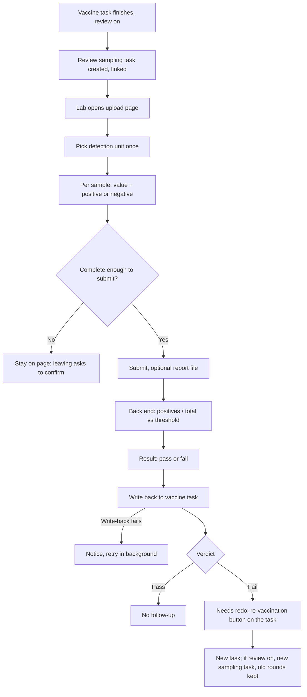

# Immune-effect review (免疫复核 / 免疫复核采样结果管理)

| | |
|---|---|
| Area | [Vaccination and medical tasks](../vaccination-and-treatment.md) |
| Platforms | Console (lab entry and read-only views); back end (task creation, maths, write-back). No Mobile sampling step is specified. |
| Maturity | specified + built in prototype; the PRD and the prototype disagree on tabs and partial save (see Open questions) |
| Newest sources | `Vaccine/prds/vaccine prd/08-免疫复核采样结果管理.md` (2026-05-25); `Vaccine/prds/vaccine prd/09-疫苗计划与疫苗任务测试用例.md` section 9 (2026-07-06); `Vaccine/src/components/ReviewSamplingManagementPage.tsx` (last changed 2026-06-04); `Vaccine/src/planEffectTracking.tsx` |
| Related flows | [vaccine-task](vaccine-task.md), [vaccination-plan](vaccination-plan.md), [mobile-vaccination](mobile-vaccination.md) |

## Job
After a vaccine task finishes, check whether the herd really made the antibody. Lab staff enter a positive or negative result for each sampled pig. The system works out the pass rate, compares it with the threshold, and writes the verdict back to the vaccine task, which then offers or hides a re-vaccination.

## Trigger and actors
- Review is switched on in a plan or in a manually created task. Early name was "effect tracking" (效果追踪); it is now "immune review".
- Trigger: the vaccine task finishes (Mobile end task, or all pigs done). Console then creates one review sampling task linked to it. No review switch, no sampling task.
- Actors: laboratory staff (实验室人员) enter results; Console managers read the verdict and decide follow-up; the back end calculates and writes back.
- Console menu 免疫 > 免疫复核采样. A create-sampling button also allows a free antibody sampling task.

## Flow

## Steps
1. **Task creation (back end).** On completion of a review-enabled vaccine task, one sampling task is created holding a snapshot of the review config (target antibody, sampling method, container, threshold), the sample list and the link to the vaccine task. The Console task list shows detection progress (0/0 until samples exist) and no verdict yet.
2. **List page.** Header text describes the page; a create-sampling button sits top right. The PRD keeps only a "tested" tab with two sub-tabs. Routine checks list one row per sampling task: antibody, container, target count, creator, result (pass or fail), created time, view. Immune-review rows list one row per pig sample: ear tag, antibody, container, creator, positive or negative, view only; no upload here. View opens the detail of the sampling task.
3. **Create sampling (optional).** The button opens a type chooser, virus or antibody. Virus only says it is not open yet. Antibody opens a page: antibody to test, sampling method, container, pass threshold, pigs to sample. Saving creates the samples but they do not appear in the tested list until results exist.
4. **Result upload page** (title "review result upload"): a help block explains detection unit, detection value and result. The lab picks one detection unit for the whole round (S/P value, OD value, blocking rate, titre). Search by ear tag or sample ID. One table row per sample with sample ID, ear tag, room and pen, a detection value, and a result chosen by hand: positive or negative (pending until filled). A counter at the bottom shows how many rows are filled. A report file can be uploaded for later tracing.
5. **Submit.** See Rule 5. Leaving with unsaved input asks for confirmation; going back discards the entry.
6. **System calculation and write-back.** Positives, negatives, pass rate and verdict are computed, then written to the vaccine task immediately: review result block, follow-up flag and reason, and whether the re-vaccination button shows. If the write fails, the lab sees "submitted but write-back failed" and the system retries.
7. **Detail page** (title "review result detail"): summary on top (progress uploaded over total with a bar, then cards for pass rate, positives, negatives, threshold and verdict), then read-only sample rows. The summary is current until every sample is in and final afterwards. Back needs no confirmation.
8. **On the vaccine task.** The review result card appears under the review settings only after results exist, with progress, pass rate, positives, negatives, threshold and verdict. A failed verdict with "needs redo" shows the re-vaccination button on that card ([vaccine-task](vaccine-task.md) Rule 9).

## States
| Object | State | How it gets there | Allows next |
|---|---|---|---|
| Sampling task (code) | to sample | Created, no samples collected | View |
| Sampling task (code) | to test | Samples exist, results not in | Upload results |
| Sampling task | tested (已检测) | Results submitted (all, or all uploaded in batches) | Read only |
| Sample | pending / positive / negative | Lab choice | Counted in the rate |
| Verdict | pass / fail | Rate compared with threshold | Fail sets "needs redo" on the vaccine task |

## Rules
1. Positive means the antibody was found and counts as qualified. Negative counts as not qualified.
2. Pass rate = positives divided by total samples. Pass when the rate is greater than or equal to the threshold; fail otherwise. Example: 20 samples with 14 positives gives 70 percent, which fails an 80 percent threshold. A rate equal to the threshold passes (VRV-007). Zero positives is a valid 0 percent and fails (VRV-008).
3. The detection value is stored as raw lab data only. It does not decide positive or negative; the lab decides.
4. The target antibody comes from the vaccine record and is read only; it must be filled or selectable when review is on (live defect ST-06 left it empty and disabled).
5. Submit: routine checks can be submitted only when every sample has both value and result; the antibody sub-type may save progress in batches, but a sample that has been started needs both value and result, and at least one must be uploaded. A mismatch between sampled count and sample rows blocks submit with a data error and nothing is written back.
6. Each vaccine task has its own sampling task. A re-vaccination task inherits the review config and, when finished, creates a fresh sampling task; earlier rounds stay, never overwritten.
7. Write-back is immediate and must be retryable.
8. Review defaults when set in a plan or task: check interval 28 days, sampling ratio 5 percent, threshold 80 percent; interval at least 1, ratio and threshold between 1 and 100.
9. A passing review does not archive the plan, and no veterinarian confirmation step exists (those ideas are only in an old note).

## Data
| Field | Where | Required |
|---|---|---|
| Target antibody, sampling method, container, interval, ratio, threshold | Plan or task form, copied to the sampling task | When review is on |
| Sample ID, ear tag, room, pen | Sample row | System |
| Detection unit (one per round) | Upload page | Yes |
| Detection value, result (positive or negative) | Sample row | Yes per started sample |
| Report file | Upload page | Optional |
| Positives, negatives, pass rate, verdict | Computed | System |
| Link to vaccine task, round number | Sampling task | System |

## Edge cases
- No samples entered and submit pressed: asks to finish all samples. Part entered and back pressed: confirmation, entry lost.
- Sampled count and sample rows differ: no submit, no write-back.
- Who collects the samples and how swapping a dead sampled pig is handled: not specified (the learning note listed a replace-pig idea, never specified).
- Concurrent editing by two lab users: not specified.

## Versions
- 2026-04-14 notes: record only counts of samples and positives; vet must confirm wild virus excluded; automatic supplementary task from live headcount; passing plan archived. Superseded.
- 2026-05-18 PRD 08: per-sample entry, automatic pass rate, write-back, re-vaccination chain.
- 2026-05-25 PRD 08 final: "tested" tab only, routine and immune-review sub-tabs, create-sampling entry, virus stubbed.
- 2026-06-04 last prototype change; it still has three tabs (to sample, to test, tested) and a continue-upload action.
- 2026-07-06 doc 09 adds boundary cases VRV-001 to VRV-011.

## Figma and repo
Not in the immunization Figma file. Possibly in 🖥 采样与检测 (`WJYP32oqthOUHOa7xdjDcb`, node `6001:4860`), not compared. Mobile sampling file 采样与检测 (`PqMXbJLyoJ9lFGjmqBv5Cs`, node `6032:6415`) maps to repo `features/sampling`, a placeholder "not designed yet".

## Open questions
1. Partial save: PRD 08 goal says no partial submit; its entry table lets the immune-review sub-type save in batches (test VRV-004 flags it). Which applies to a vaccine-triggered review?
2. Tabs: PRD 08 says only "tested"; the prototype still has to-sample and to-test tabs and a continue-upload button.
3. Sub-type naming: the PRD says routine checks come from the vaccine task and the immune-review sub-tab lists per-pig samples; the code labels vaccine-built tasks as antibody type. Which list shows a vaccine-triggered review?
4. Where are samples collected on Mobile, and by whom? No source covers it.
5. Vet confirmation and plan archiving after pass: wanted or dropped? No PRD.
6. When do the sampling tasks become due relative to the review interval (28 days default)? The PRD creates the task on completion; the learning note said after the interval.
