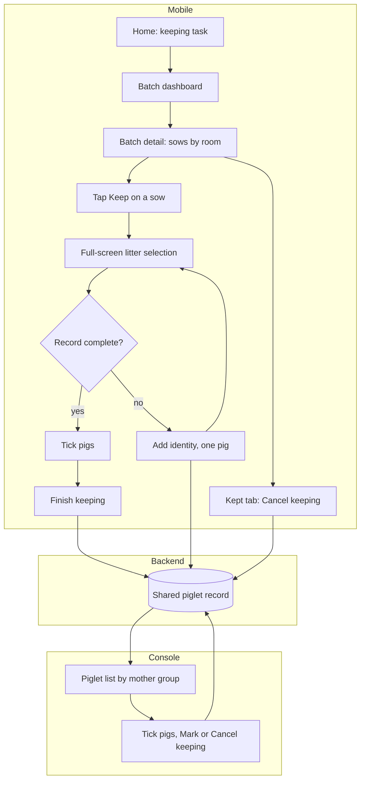

# Keep for breeding (留种标记 / 留种中心)

| | |
|---|---|
| Area | [Culling, replacement and semen](../culling-replacement-semen.md) |
| Platforms | Mobile (keeping centre), Console (shared piglet list), back end (score, shared record) |
| Maturity | specified + built in prototype (mock data, batches B2401 to B2404) |
| Newest sources | `Vaccine/prds/culling&replacement/04-mobile-留种标记.md` (2026-08-06); `Vaccine/prds/culling&replacement/02-console-后备留种计划.md` §6 to §9 (2026-08-04); `Vaccine/prds/culling&replacement/修改日志/修改日志-2026-07-28-Console-Mobile共享留种名单.md`, `…07-28-Mobile留种补耳标与选择解耦.md` |
| Related flows | [replacement-plan](replacement-plan.md), [cull-review](cull-review.md) |

## Job
Staff mark which ear-tagged piglets become breeders, and can revoke it. Mobile (in the barn) and Console (at the desk) work on one shared list; when done, the pig's current state is "kept" on both ends. Keeping is a continuous decision across the batch, not a task step.

## Trigger and actors
- Mobile: Home has fixed cards 留种任务 and 淘汰任务; the Toolbox keeps a secondary entry. Reminders from end-nursery, end-finishing and keeping tasks show "advise keeping, kept X, to confirm X" with 立即处理, opening the batch directly.
- Console: task detail, field 留种数量, 查看 icon, page 留种仔猪.
- Stockperson, keeping supervisor, Console user. Any of them may mark or cancel.

## Flow

## Steps
**Mobile**
1. Keeping centre, batch dashboard: search by batch number, name or line. Each card shows batch number, "line, batch name, day-age", kept count (main), to-confirm count (= current candidates) and status 进行中, 已完成 or 待开始. No target, remaining, percent or bar.
2. Batch detail: sticky summary (kept, to confirm, last update). Tabs 母猪待选 and 已留种. Room chips and search by sow tag, room, breed. Sows are listed by room, highest sow score first; each card shows tag, parity, breed, sow score, PSY, average weaning weight, litter count, kept count and selectable count. One action: 留种.
3. 留种 opens a full-screen page for her litter, mother summary pinned, a question mark opens an explanation sheet. Piglet cards sorted by score: checkbox, tag and sex icon, score and change from the previous node, data and health/structure state, day-age, weaning weight, daily gain, up to two reasons. 8px gaps, own border per card. Blue is selection, green kept or normal, orange attention, red abnormal or blocked.
4. Only 候选 (candidate) or 未评估 (not assessed) pigs with a complete record can be ticked; kept and culled pigs never appear. 全选可留种 X 头 counts only complete records and notes "Y 头身份待补充".
5. A pig without tag or complete record has a disabled checkbox, grey card and the text 补耳标 or 完善档案. Tapping it opens one pig's 补充身份 page: room, source sow and RFID on top, then sex, day-age, weaning weight, score "to check against the pig in front of you, then enter the tag just applied". Required: tag, ear notch, sex, breed. Optional: sire and dam ID. Tag and notch must each be unique. Saving only updates that pig, keeps its status, returns to the same list position, selects nothing and clears nothing. Closing discards. The pig appears in the Console list at once.
6. Bottom bar: one dynamic "本次已选 X 头" and 完成留种. Closing with a selection asks 放弃本次选择？. On success: toast "已完成留种 X 头。", counts and the kept list update. The back end revalidates; on failure the selection stays and no success is shown.
7. Kept tab: one bordered card per pig (tag, sex icon, 已留种, score area, two-column facts, reasons). 取消留种 asks to confirm, returns the pig to candidate, keeps tag and record, and is not culling.
8. Single-pig page (not a modal): identity facts, health, structure review, reason, notes; editable breeding identity (replacement gilt, boar, other), status, health, structure, notes; fixed 保存.

**Console**
9. 留种仔猪 page title with counts 已打耳标, 已留种, 未留种, 批次活仔. One table of all ear-tagged piglets, no status tabs, boars and gilts mixed with a sex icon by the tag. Untagged pigs never appear.
10. Grouped by mother. Each sow has a white summary header (tag, litter value or 优秀 / 普通 / 关注 badge, health, parity, breed, PSY, average weaning weight; right: this-time selection of the litter and kept count). Default expanded, remembered locally, no header checkbox, groups ordered by the best piglet score, 25 piglets per page with the header repeated across pages.
11. Piglet row: tag (with 已留种 chip), overall score with trend, day-age and weaning weight, daily gain, structure review (pass / to review / abnormal), health, "marked by and time" (only for currently kept pigs). Label rule: only a normally calculated pig in the top tenth of its batch and sex shows 推荐; degraded 需复核; insufficient 数据不足; rejected 不推荐.
12. Score drawer from the number: basis and trend over five fixed nodes (birth, 7, 14, 21 days, current), axis 0 to 100, fewer than two nodes shows 暂无趋势, each snapshot keeps its rule version.
13. Tick rows (one state per selection; the other state's boxes grey out). The bottom bar appears only with a selection and shows pig count, litter count and one button, 标记留种 or 取消留种.

## States
| Object | State | How it gets there | What it allows next |
|---|---|---|---|
| Piglet | Untagged (Mobile only) | born, no unique tag | add identity on Mobile |
| Piglet | 未评估 or 候选, record incomplete | tag or record gaps | single-pig identity |
| Piglet | 未评估 or 候选, complete | identity saved | tick and keep |
| Piglet | 已留种 | Finish keeping (Mobile) or Mark keeping (Console) | cancel from either end |
| Piglet | 已淘汰 | decided not to keep | not selectable |
| Plan tag | 重点留种来源 | live replacement plan | informational |

## Rules
1. One shared record. Marking and cancelling are equal on both ends; there is no candidate-then-approve step.
2. A pig enters the Console list only with a non-empty unique ear tag; no temporary ID or RFID is shown there.
3. Cancel keeping removes only the kept result; tag, score, weights, structure, health, dam and history stay. It is not culling.
4. Mobile data changes update the same Console row (no duplicates) and never overwrite who marked and when; that stamp is only the last successful "mark".
5. Both ends send the same write; the last successful server write wins; the loser rolls back and is asked to reload.
6. The reference number from the plan never gates any control.
7. Fronts show the server's score and status and never recompute.
8. High score with unhealthy signs: Mobile shows 需要现场复核 first but keeping stays allowed (PRD 04).

## Data
| Field | Where | Required? |
|---|---|---|
| Ear tag, ear notch, sex, breed | identity page | yes (unique tag and notch) |
| Sire ID, dam ID | identity page | no |
| Weaning weight, structure, health | Mobile edits | needed for score |
| Marked by, marked at | Console row | system, kept pigs only |

## Edge cases
- Duplicate tag or notch: blocked, no overwrite.
- Identity save then keep fails: saved identity kept, retry allowed.
- Closing identity or failed validation: no draft written.
- Mixed selection on Console: blocked.
- Write timeout: optimistic change rolled back, selection kept, retry shown.
- Task reminder without batch: 立即处理 disabled or explained.

## Versions
- 2026-07-01: Mobile candidates plus Console second approval; 07-03 positive selection.
- 2026-07-23: keeping leaves tasks and becomes a resident centre; Console list grouped by mother.
- 2026-07-25 to 27: untagged pigs collected inside keeping; Home gets fixed cards; drawer becomes a full screen.
- 2026-07-28: shared list, no approval, no targets or percent, tagging split from selecting.
- 2026-08-06: rule set rc.7; Mobile kept cards redone.

## Figma and repo
Not in Figma. Repo `features/keep-breeding` ("Mark as breeder", in-design, 4 screens), drawn on Figma Inspection file `4GZGPBauEOWQQjnRrzoUgF`, node `60:408`.

**Where the two agree:** the job (pick breeders from tagged pigs); Mark and Unmark are two verbs, not a toggle; marking needs a unique tag, unmarking does not; a marked pig keeps its tag and record; blocked pigs are named, never silently dropped (repo: "2 left out" line; handover: grey card with 补耳标); no confirmation page beyond the action (repo: the sheet is the confirmation; handover: 完成留种 and a cancel confirm).

**Where they differ:**
| Point | Handover | Repo `keep-breeding` |
|---|---|---|
| Container | resident centre by batch, room, sow, litter | bulk action from a pig selection |
| Scoring | server score, trend, 推荐 label, shared Console list | none |
| Untagged pigs | single-pig identity from the tapped card; no batch tagging, no auto next pig (removed 2026-07-28) | identity conveyor spliced over the untagged subset |
| Eligibility | stated: candidate or not assessed, complete record, not kept or culled | unstated, open |
| After marking | kept list on both ends | marked-set filter, drained by Transfer (e.g. to gilt development) |
| Durable fact | in the keeping centre's single-pig dossier | under Identity on the pig page |
| Feedback | toast on success | no toast, row update and filter count |

Treat them as overlapping candidates; the handover does not replace the repo feature.

## Open questions
1. What 留种 means: choosing piglets (PRD 02, 04) versus refilling a batch with gilts (April brainstorm; orphan `src/components/replacement/`).
2. Gilts only (V0.1, V0.2) or both sexes (PRD 02, 04); 2026-07-03 had boar and gilt tabs.
3. Unresolved from the 2026-07-26 review: who may revoke and with what audit; offline and conflict handling beyond last write wins; whether kept pigs enter replacement rearing with health, immunity and pen approval.
4. Batch name on the Mobile batch card was removed and restored on 2026-08-06 with no time order in the two logs; PRD 04 shows it.
5. Home entry 留种任务 versus the repo's pig-selection entry; where the durable fact lives.
6. The 2026-08-25 IA preview removes the 留种 sidebar entry without a replacement.
