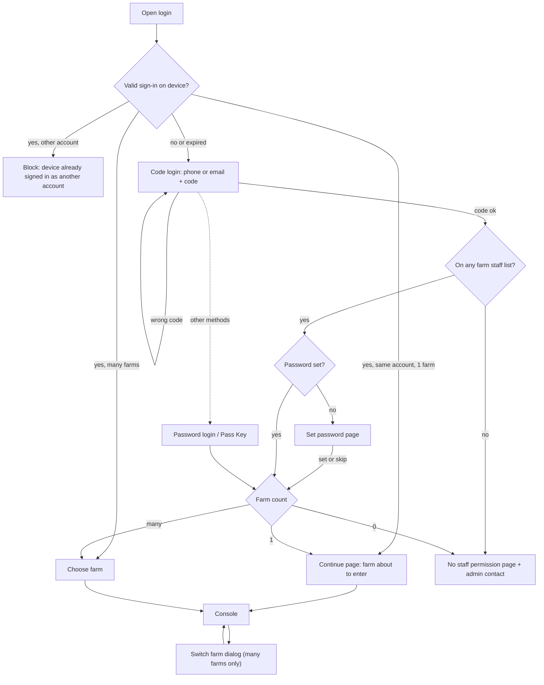

# Login, farm selection and farm switching (登录与厂区切换)

| | |
|---|---|
| Area | [Console IA, workbench and access](../console-ia-workbench-access.md) |
| Platforms | Console (Mobile login is not specified) |
| Maturity | specified + built in prototype |
| Newest sources | `Vaccine/prds/saas-login/04-新登录流程-PRD.md` (2026-07-03); `Vaccine/prds/saas-login/修改日志/修改日志-2026-07-03-Console厂区切换入口.md`; `Vaccine/prds/saas-login/修改日志/修改日志-2026-07-02-新登录流程密码与厂区分流.md`; `Vaccine/docs/UNIFIED_ACCESS_FLOW.md` (2026-06-01, partly superseded) |
| Related flows | [staff-registration-and-entry](staff-registration-and-entry.md), [console-workbench](console-workbench.md), [onboarding-setup](onboarding-setup.md), [offline-production-tasks](offline-production-tasks.md) |

## Job
A person who works at one or more farms proves who they are, is told whether they have farm access, and enters one farm. Inside the Console they can later switch farm. When done, every request uses the chosen farm and nothing from another farm is shown.

## Trigger and actors
- Opening the Console without a valid sign-in on this device, or after the user signs out or changes account.
- Actors: the person signing in (single-farm staff, multi-farm manager, user without a password, user with a password or passkey, user with no farm); the back end (identity check, staff-farm relations, password state, farm list); the farm admin (only named on the "no permission" page).
- Out of scope: staff entry applications, visitors, roles and menu permissions, account bans, and any force to fill in a profile at login.

## Flow

## Steps
1. **Open login.** The system checks the device's sign-in:
   - valid and one farm: "Continue using Sentri" page showing the farm about to be entered; `Continue` enters the Console;
   - valid and many farms: farm chooser with the last-used farm preselected;
   - valid but belonging to another account than the one typed: a block page telling the user to sign out inside the system first (the new number never overwrites the old sign-in);
   - none, expired, or user chose to switch account: step 2.
2. **Main login page.** Phone or email (phone prefilled, editable), `Get code` (format checked first; 60 s cooldown), code field, primary `Log in now`. Alternatives: password, Pass Key. Editing the contact clears the "code sent" state.
3. **Server checks, in order:** code correct (otherwise the error appears and no farm lookup is done); the contact is on at least one farm's staff list (otherwise the no-permission page); whether a password is set.
4. **Set password** (only if none set): 8 to 32 characters with letters and digits, confirmed twice. `Set and continue` saves. `Skip for now` saves nothing, so the next code login shows the page again.
5. **Farm routing** by count: 0 farms: no-permission page. 1: "Enter farm" page showing the farm (no list). Many: choose-farm page.
6. **Choose farm.** Order: last used first (preselected), then frequent (tagged), then others; one tag per farm. With more than 10 farms only the first 3 show, `Show all farms` reveals a search box; no match shows "no matching farm". `Enter farm` confirms.
7. **Other methods.** Password login: unknown account, no password set (tells the user to log in by code first), wrong password. Pass Key: must be verified before `Enter Sentri`. Both go to farm routing.
8. **Forgot password.** Contact -> code (the contact must be on a staff list, otherwise a message to ask the admin) -> new password twice -> straight to farm routing without another password step.
9. **Inside the Console.** Top-left shows `Sentri` with the current farm name below. One farm: the name is plain text. Many farms: a switch icon beside the name opens a `Switch farm` dialog (not a dropdown); the current farm is shown selected and cannot be picked again. Picking another farm closes the dialog, shows a "switched to <farm>" message, and every later request uses the new farm.

## States
| Object | State | How it gets there | What it allows next |
|---|---|---|---|
| Device sign-in | valid / expired / other account | Token check on open | Continue, choose farm, or block page |
| Password | set / not set | Set-password page; skipping keeps "not set" | Password login only when set |
| Account's farm access | 0 / 1 / many | Staff-farm relations | No-permission / enter page / chooser |
| Verification | code sent (60 s cooldown) / verified | Get code / correct code | Staff lookup |
| Current farm | selected | Enter or switch | All requests scoped to it |

## Rules
1. Code login is the main method; password and Pass Key are alternatives.
2. A correct code is checked before any farm relation is looked up; "verified" never means "has access".
3. Skipping the password never blocks entry and records nothing.
4. A person with no farm relation sees only the admin's phone and email; there is no sign-up or entry-application link.
5. One farm still shows a confirmation page; the person always sees which farm they are entering.
6. A device signed in as account A cannot be re-used to sign in as B; sign out first.
7. Switching farm in the Console: the back end re-checks access to the target farm and returns that farm's data context; the front end must not reuse the previous farm's data.
8. At entry, if access was revoked meanwhile, the entry is refused with "this account cannot enter this farm, contact the admin".
9. A failed staff-relation lookup keeps the user on the page with a retry; it is not shown as "no permission".

## Data
| Field | Where | Required? |
|---|---|---|
| Phone or email | login, forgot password | yes |
| Code (60 s resend) | login | yes |
| Password, confirmation (8-32, letters + digits) | set password, reset | when setting |
| Last-used farm, frequent-farm flag | chooser | back end supplies |
| Current farm | Console header | yes |

## Edge cases
- Wrong format, no code requested, wrong code, empty password, wrong password, Pass Key not verified: each blocks with its own message.
- Search with no match in the chooser leaves the list untouched.
- Prototype has mock accounts and mock tokens for each branch (single farm, many farms, no password, no permission, other account); details not recorded here.
- Offline: not covered by the login PRD. The offline test found the farm chooser blank offline and no warning about unsent records ([offline-production-tasks](offline-production-tasks.md)); the repo's data-sync design blocks switching with unsent records.

## Versions
- 2026-06-01: unified access flow (phone first, password required at registration, 5 s auto-enter countdown, several pending farms).
- 2026-07-02: code becomes the main method; password optional; farm choice moved after login.
- 2026-07-03: PRD 04 final; Console top-left `Sentri` plus farm switcher added.
- Dropped from the unified flow: farm field on step one, multi-pending-farm choice, mixed registered + pending list, the countdown.

## Figma and repo
- Figma: Sentri Console (Done) > Log-in (8 screens), phone/email + password + Farm ID, with the Farm ID filled and locked on a farm URL and forgot password = "contact admin". No screens for the chooser, switcher or token states.
- Repo: no feature. `features/data-sync/` carries the sign-in rules that touch this flow (block switching with unsent records, only the original account can log back in).

## Open questions
1. **Which login is live?** Figma (password + Farm ID) vs PRD 04 (code first, no Farm ID, optional password, Pass Key). Production uses an identity provider that matches the PRD. Figma has no date. (Figma Log-in vs `04-新登录流程-PRD.md`.)
2. The 5 s auto-enter countdown for a valid sign-in with many farms (`UNIFIED_ACCESS_FLOW.md`, decision 8) is absent from PRD 04. Dropped or forgotten?
3. PRD 04 sends any contact not on a farm list to "no permission" and never mentions pending invites; the unified flow handled people with pending invites on the same screen. See [staff-registration-and-entry](staff-registration-and-entry.md).
4. Mobile login is not specified; the standalone onboarding project's `/mobile` page is an empty shell.
5. Password reset conflicts with Figma's "contact admin".
