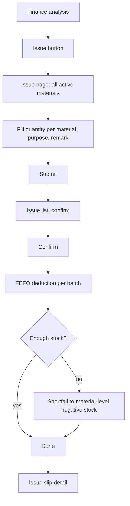

# Manual issue (出库)

| | |
|---|---|
| Area | [Inventory (库存)](../inventory.md) |
| Platforms | Console (entry on finance analysis, 财务分析) |
| Maturity | specified + built in prototype; the 2026-08-19 back-end doc leaves it outside its design |
| Newest sources | `Inventory management/Inventory PRD/01-Console库存管理PRD.md` s8.6 (header 2026-08-11); `Vaccine/prds/inventory/修改日志/修改日志-2026-07-10-出库入口迁移至财务分析.md`, `…-2026-07-07-批量出库页面.md`; `Inventory management/Inventory PRD/06-库存出库后端逻辑.md` s6 G-02, s7 (2026-08-19) |
| Related flows | [task-stock-deduction](task-stock-deduction.md), [stock-overview](stock-overview.md), [negative-stock-correction](negative-stock-correction.md), [stocktake](stocktake.md) |

## Job
The storekeeper records stock taken out for a use that no task covers (for example bulk requisition). Done means each material has a business-consumption ledger row by FEFO batch, a printable issue slip exists, and the stock is lower, possibly negative.

## Trigger and actors
- Console: "issue" button at the top right of finance analysis (财务 > 财务分析). It moved there on 2026-07-10 and is not on inventory home.
- Actor: storekeeper / manager. The requisitioner is the logged-in user; there is no approval step (issue approval is out of scope for the MVP).

## Flow

## Steps
1. On finance analysis click the issue button. The page lists every active material; search and a category filter sit in one row together with the purpose and remark fields (single row on wide screens, wrapping when narrow).
2. For each material the user may enter a quantity; the unit is fixed to the accounting unit and the page shows current stock so a negative result is visible.
3. The user fills purpose (required) and remark (optional, max 200 characters).
4. Submit opens an "issue list" with the chosen lines for confirmation.
5. Confirm creates the slip and shows "issue slip detail": slip number, time, requisitioner, purpose, remark, lines, and how many ledger rows were made. The toast only says "issue succeeded".

## States
| Object | State | How it gets there | What it allows next |
|---|---|---|---|
| Issue slip | created (no other status stated) | confirm | view detail; ledger rows exist |
| Batch | reduced / exhausted | FEFO deduction | normal batch states |
| Material | possibly negative | shortfall | [negative-stock-correction](negative-stock-correction.md) |

## Rules
1. Quantity > 0; the unit is the accounting unit and cannot be changed.
2. The system fills batch (FEFO over batches with stock), requisitioner (current user) and issue date (the day of submit); users do not choose batches.
3. When one batch is short the next is used and rows are split per batch; if all are short, the remainder is a material-level negative-stock row with an empty batch, shown as "material-level negative stock" or blank.
4. Ledger type is business consumption; batches reaching zero become exhausted.
5. Stopped materials are not listed.
6. The issue entry is only on finance analysis; old single-material modal was replaced by this page (2026-07-07).

## Data
| Field | Where | Required? |
|---|---|---|
| Material, quantity | line | at least one line, qty > 0 |
| Purpose | slip | yes |
| Remark | slip | no, <= 200 chars |
| Batch, requisitioner, date | system | auto |

## Edge cases
- Quantity larger than stock: allowed, creates negative stock; page shows the projected number.
- No lines filled: submit is not possible (implied by "at least one quantity").
- Duplicate submit protection and concurrent issues are not specified for the Console path; the back-end doc requires idempotency only for event-driven issue.
- Feed machines and Mobile have no manual issue.

## Versions
- 2026-06-24: single-material issue modal added.
- 2026-07-07: replaced by a batch issue page (list all, issue list, slip detail).
- 2026-07-10: entry moved to finance analysis.
- 2026-08-19: the event-driven back-end design says manual issue, if kept, must be specified separately.

## Figma and repo
Not in Figma; no `features/` entry. Prototype: finance analysis and issue pages under `Vaccine/src/` (see `Vaccine/src/App.tsx` routing).

## Open questions
1. Is manual issue still wanted? `01` s8.6 and `05` s9.4 describe it; `06` G-02 says it needs its own source type and must not be mixed with task settlement; `00-库存模块开发基准.md` does not mention it.
2. Should issue sit under inventory rather than finance analysis (07-10 decision vs `01` s11 "task requisition not in MVP")?
3. What business type and idempotency key would the back end give a manual issue?
4. Is there an approval or confirmation by a second person (listed as MVP-out in `01` s11)?
