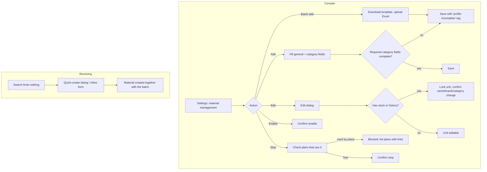

# Material master (物料管理)

| | |
|---|---|
| Area | [Inventory (库存)](../inventory.md) |
| Platforms | Console (Settings > 物料管理, plus the quick-create dialog inside Receive); Mobile (quick-create inside receive only) |
| Maturity | specified + built in prototype (no Figma, no repo feature) |
| Newest sources | `Inventory management/Inventory PRD/01-Console库存管理PRD.md` s8.4, s8.7 (header 2026-08-11); `Vaccine/prds/inventory/修改日志/修改日志-2026-07-29-单位换算盘点与物料停用校验.md`; `Inventory management/Inventory PRD/02-Mobile库存管理PRD.md` s8.3 (2026-09-09); `Vaccine/prds/vaccine prd/01-疫苗管理.md` (2026-08-13, partly stale) |
| Related flows | [receive-stock](receive-stock.md), [stock-overview](stock-overview.md), [stocktake](stocktake.md), [task-stock-deduction](task-stock-deduction.md), [vaccine-task](vaccine-task.md), [treatment-task](treatment-task.md) |

## Job
The storekeeper or manager maintains the list of materials (物料) that every stock, task and plan refers to: create, edit, add unit conversions, stop or re-enable. When done, a material has one stable identity, one accounting unit, and a status that decides whether it can be received or picked in new tasks.

## Trigger and actors
- Console: Settings > material management (full create/edit, Excel batch add); edit and stop/enable also from the inventory list and the material detail page (top right).
- Console and Mobile: "quick-create" appears inside receiving when a search finds nothing (see [receive-stock](receive-stock.md)).
- Actors: storekeeper / manager. Field staff on Mobile only create through receiving. Plans that reference a material can block stopping it.

## Flow

## Steps
**Console, add (Settings > 物料管理)**
1. List shows tabs by category with a count, search by Chinese/English name, brand, type. Buttons: add, batch add.
2. Add dialog: general fields (name, optional English name, category, brand, accounting unit, remark) plus the category block (see Data). Medicine first asks sub-class (vaccine / veterinary drug / supplement).
3. Feed requires at least one unit conversion including "1 ton = xxL"; other categories may leave conversions empty, but any rule entered must convert back to the accounting unit.
4. Missing required category-specific fields do not block saving: the material is tagged "资料待完善" and can be completed later.
5. Batch add: download the Excel template (general fields only), upload; invalid rows block the whole import and the first bad row is named; after import the list jumps to the category of the first new row.

**Console, edit (dialog "编辑物料": basic info / unit conversion / remark)**
1. Code is read-only. Remark always editable. Name, brand and category are editable; if the material has stock, batches, ledger or task references, a confirmation says the change affects later display only, not history.
2. Accounting unit is greyed out with "already has stock records" once any stock, batch, ledger, receipt, consumption, stocktake or task reference exists. To change unit, create a new material and stop the old one.
3. Unit conversion: existing rules are read-only and cannot be deleted; "add conversion" appends. New rules become selectable in later receiving and counting.
4. Stock quantity, value, costing and deduction rules cannot be changed from here. Saved -> "material updated".

**Console, stop / enable**
1. Stop first asks the server which plans use the material. If any: dialog "cannot disable" with the plans (name, type, status) as links; no continue button.
2. If none: confirm; the wording differs when stock remains (stock and history are kept and still counted). Result: status "stopped".
3. Enable: confirm, status back to "active"; usable again in receiving and new tasks.

**Quick-create during receiving** is specified in [receive-stock](receive-stock.md); it uses the same field definitions and the same required rules.

## States
| Object | State | How it gets there | What it allows next |
|---|---|---|---|
| Material | Active (启用中) | create / enable | receive, pick in tasks, count (medicine, semen), issue |
| Material | Active, profile incomplete | saved without all required category fields | all of the above; shows a tag until completed |
| Material | Stopped (已停用) | stop, only when no plan uses it | history visible; hidden from new receiving and new task pickers; stock still counted |
| Unit | Editable / locked | no business record / any record exists | locked unit cannot change |

## Rules
1. No delete anywhere; stop-use only (newest). Older `Vaccine/prds/vaccine prd/01-疫苗管理.md` still lists delete (see Open questions).
2. Uniqueness: name + brand + category + accounting unit; a duplicate blocks save.
3. Accounting unit has conversion factor 1; tasks always deduct in the accounting unit.
4. Receiving units are limited to the accounting unit plus maintained conversion units; no free-typed units.
5. Feed needs "1 ton = xxL" so a feed machine's litre readings convert both ways.
6. Open categories: feed, medicine, semen, other. Consumables and tools remain as history only and cannot be created.
7. Medicine has one sub-class level (vaccine / veterinary drug / supplement) with extra fields; vaccine and drug carry dose, interval and withdrawal period.
8. Remark max 200 chars.
9. Stopping is blocked while any plan references the material; stock on hand does not block it.

## Data
| Field | Where | Required? |
|---|---|---|
| Name (Chinese); English name | add / edit | Chinese yes |
| Category; medicine sub-class | add | yes |
| Brand (Chinese; English) | add / edit | Chinese yes (Settings PRD also marks English brand required; see open question) |
| Accounting unit | add | yes; locked after first record |
| Unit conversions | add / edit | feed yes (with ton = L); others optional |
| Code | system | read-only |
| Vaccine block | add | type, administration method, dosage form required; cold chain, storage temp, single dose, immunity validity, withdrawal, interval optional |
| Veterinary drug block | add | dosage form, use method, withdrawal period (none strictly required in quick-create) |
| Supplement; feed form | add | main ingredient / use method; form (pellet, meal, concentrate) |
| Remark | add / edit | no |
| Safety stock | Settings PRD only | removed from inventory 2026-07-08; see open questions |

## Edge cases
- Category switch while editing: only the new category's specific fields are kept.
- Empty category tab still shows (list empty); search with no result shows an empty state.
- Excel: empty file, missing required cell, unknown category all block the import with a message.
- A material already used by plans, tasks or stock should be archived or stopped rather than removed (stated in the Settings PRD edge table).
- Stopped material with stock still contributes to stock quantity and value.

## Versions
- 2026-06-19..20: edit dialog, stop/enable, structured package spec added (changelogs under `Inventory management/Inventory PRD/修改日志/`).
- 2026-06-29: Settings entry renamed from drug management to material management; one shared model with dynamic fields and Excel batch add.
- 2026-07-08: safety stock removed from inventory; medicine collapsed to one sub-class level.
- 2026-07-10 / 07-29: unit conversion mandatory at quick-create, then narrowed to feed only; stop-use blocked by plan references added.
- 2026-08-07: categories narrowed to feed / medicine / semen / other.

## Figma and repo
Partly drafted in Figma: "药品管理（还要改，改成入库出库）" draft group in file `8BkIL2azMuBS2w6Vn26Cac` (list empty `11024:4145`, delete `11076:9170`, add medicine `11024:7930`, vaccine management `11024:4223`), all marked draft. No match in `features/`; `features/treat` has a separate phone-side medicines list with no stock.

## Open questions
1. Delete vs stop-only: `Vaccine/prds/vaccine prd/01-疫苗管理.md` has a delete action; `01-Console库存管理PRD.md` s8.7 and 8.3 forbid delete. Newest rule used here is stop-only.
2. Category tabs in the Settings PRD list five categories including consumables and tools; the 2026-08-07 changelog opens only four.
3. Safety stock still appears as a general field in the Settings PRD and in the Excel template; inventory removed it on 2026-07-08.
4. English brand is marked required in the Settings PRD, optional in the Mobile quick-create table.
5. Whether a stopped material can still be chosen when correcting a negative-stock record (the picker allows any SKU in the stock list).
