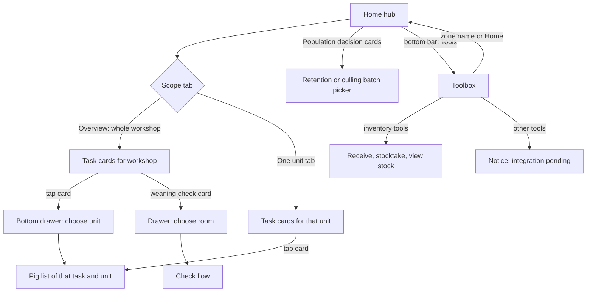

# Mobile home and toolbox (工作台 / 工具箱)

| | |
|---|---|
| Area | [Console IA, workbench and access](../console-ia-workbench-access.md) |
| Platforms | Mobile |
| Maturity | built only (no PRD); the Mobile layout doc is partly stale |
| Newest sources | `Vaccine/prds/vaccine prd/修改日志/修改日志-2026-09-08-Mobile工作台分组对齐.md` (2026-09-08); `Vaccine/src/components/toolbox/MobileToolboxHomePage.tsx`; `Vaccine/src/components/MobileVaccinationPage.tsx` (screens hub, tools); `Vaccine/prds/vaccine prd/修改日志/修改日志-2026-08-20-Mobile工具箱UI复刻.md` (2026-08-20) |
| Related flows | [vaccine-task](vaccine-task.md), [keep-for-breeding](keep-for-breeding.md), [stock-overview](stock-overview.md), [offline-production-tasks](offline-production-tasks.md), [login-and-farm-switch](login-and-farm-switch.md) |

## Job
A floor worker opens the phone app, sees the tasks waiting in their area, enters a unit to do them, and finds the secondary tools (biosecurity, outbound, inventory, account) in one place. When done, the worker is inside the right unit's pig list for a task, or inside a tool.

## Trigger and actors
- Opened after login on the phone. Home is the landing screen; the toolbox is the right-hand item of the bottom bar.
- Actors: floor worker; supervisor sees the same cards. Task content is owned by the task flows (vaccination, treatment, weaning check, culling, retention).
- Prototype only: a "demo" layer supplies weaning-check and transfer cards, a fixed stock count and a placeholder quick-actions button.

## Flow

## Steps
**Home hub (首页)**
1. Top bar: avatar, a location select (workshop at Overview scope, unit when a unit tab is chosen), bell.
2. Tabs: "Overview" (总览, workshop scope) plus one tab per unit (unit scope).
3. Two stat cards: stock count (a fixed placeholder number) and weaning check as "done / total checked"; the second is tappable.
4. "Population decision" (种群决策, since 2026-07-27): two fixed cards, retention task and culling task. Each opens its batch picker (see [keep-for-breeding](keep-for-breeding.md)).
5. Task cards, in this order: treatment, vaccination (one card per batch, with a "dispatched N days" badge and progress; at workshop scope also pending heads per unit), then demo cards (weaning checks, transfer).
6. Tap behaviour: at workshop scope a card opens a bottom drawer "choose unit" (待处理 / total heads per unit); choosing a unit opens the pig list. At unit scope the card goes straight to the pig list. Weaning/post-partum check cards open a "choose room" drawer, then the check flow. Transfer shows an informational dialog only.
7. No tasks in scope: text "no tasks in this area" in place of the list.
8. Bottom bar: Home, a centre button (quick actions; demo message only), Tools.

**Toolbox (工具箱 page; its bottom bar labels the active item "Workbench")**
1. Header: the zone name (tap returns to Home) and an avatar that opens account information.
2. Four collapsible groups, all expanded by default; all use one 4-column grid with equal columns and a 4 px gap (changed 2026-09-08):

| Group | Entries |
|---|---|
| Biosecurity (生物安全) | New sampling, material disinfection, door access |
| Pigs out (猪只出场) | Loading, loading records |
| Inventory (库存) | Receive, stocktake, view stock (no stand-alone issue; consumption is deducted by tasks) |
| Other settings (其他设置) | Account information, language (value shown: Chinese), log out (a list, not a grid) |

3. Tap an inventory entry: opens the matching inventory tool page (back returns to the toolbox). Tap any other entry: a toast says it will be connected in a later version.

## States
| Object | State | How it gets there | What it allows next |
|---|---|---|---|
| Home scope | Overview / one unit | Tab tap | Changes cards and drawer behaviour |
| Task card | pending / done counts per unit | Aggregated from pig tasks | Opens drawer or pig list |
| Toolbox group | expanded / collapsed | Tap group title | Shows or hides entries |
| Toolbox entry | wired / pending | Inventory = wired; others = pending | Opens tool or shows notice |

## Rules
1. Home groups work by place: workshop first, then unit. A card at workshop scope never skips the unit choice.
2. Vaccination cards are built per batch from the pig tasks; superseded original tasks are left out; pending counts exclude completed, skipped and suspended tasks.
3. Retention and culling were removed from the toolbox on 2026-08-20 and live as fixed Home cards.
4. The toolbox has no issue/outbound-of-stock entry; stock is reduced by task completion.
5. Group order and entries are fixed; groups can be collapsed but state is not remembered (implied: it is local screen state).
6. Layout (2026-09-08): all grouped entries share one column rhythm; no group-specific column count.

## Data
| Field | Where | Required? |
|---|---|---|
| Workshop and unit labels | location select, tabs, drawers | yes |
| Card: title, subtitle (vaccine, route, dose), batch, dispatched days | task cards | yes |
| Pending / total heads per unit | drawers | yes |
| Weaning check: batch, day n of N, checked / needed | check cards | demo data |

## Edge cases
- Offline or pending-upload cues: none on Home (finding OT-05 in [offline-production-tasks](offline-production-tasks.md)).
- Language and log out are placeholders; behaviour is not defined.
- The centre button and the "back to top" button are demo toasts.
- No scan or search entry on Home.

## Versions
- 2026-04-20: field-layout doc (hub with site select, tabs, stat cards, task cards).
- 2026-07-23 to 07-27: toolbox became a category directory with retain/cull; then Home got fixed retention and culling cards.
- 2026-08-20: toolbox redrawn as four groups from a reference image (3-column grid).
- 2026-08-25: density tuning and one shared status-bar component.
- 2026-09-08: all groups on a 4-column grid; settings list indent removed.

## Figma and repo
- Figma (Mobile, per area doc): 首页 > 工作台 `6003:11580` (5 screens).
- Repo: `features/workbench/` is the current Home (section chooser, Production/Health/Other overview, Schedule, offline badge) and supersedes the handover hub layout. The repo PRD mentions Toolbox and Records but has no feature of its own; language and log out are undecided there. The retention/culling cards and the 4-group toolbox exist only in the handover.

## Open questions
1. Naming: the bottom bar says "Tools" on Home and "Workbench" on the toolbox; the repo calls the Home hub the Workbench. (`MobileVaccinationPage.tsx`, `MobileToolboxHomePage.tsx`, `features/workbench`.)
2. Grid: 3 columns (2026-08-20 log) vs 4 columns (2026-08-25 and 2026-09-08 logs); the later wins.
3. The toolbox type still lists breeding and culling keys that no group shows.
4. `Vaccine/docs/MOBILE_FIELD_LAYOUT.md` puts the Console/Mobile switch at the sidebar top; the Console PRD puts it at the bottom; the layout doc also lacks the population-decision cards.
5. Drawer titles: the code uses "choose unit" for vaccination and treatment and "choose room" for weaning checks; the area doc says "choose room" for all (minor correction).
6. Mobile login, account information and language screens are not specified anywhere.
