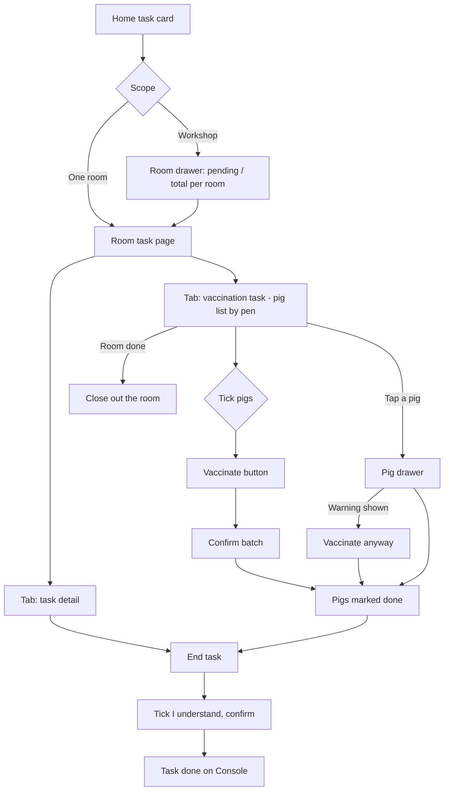

# Mobile vaccination task (接种任务)

| | |
|---|---|
| Area | [Vaccination and medical tasks](../vaccination-and-treatment.md) |
| Platforms | Mobile (execution); back end (progress sync, exemption results, override log) |
| Maturity | specified + built in prototype; the PRD is thin, the prototype and test doc 09 hold the detail |
| Newest sources | `Vaccine/prds/vaccine prd/05-Mobile接种任务.md` (2026-05-21); `Vaccine/prds/vaccine prd/09-疫苗计划与疫苗任务测试用例.md` section 7 (2026-07-06); `Vaccine/src/components/MobileVaccinationPage.tsx`; `Vaccine/docs/MOBILE_FIELD_LAYOUT.md` (2026-04-20) |
| Related flows | [vaccine-task](vaccine-task.md), [vaccination-exemption](vaccination-exemption.md), [immune-effect-review](immune-effect-review.md), [mobile-home-toolbox](mobile-home-toolbox.md) |

## Job
A vaccinator walks the barn with the phone, finds the pigs of a Console-issued vaccine task room by room and pen by pen, marks them vaccinated (many at once), sees warnings for pigs that should not be vaccinated now, and ends the task. Console then sees the progress and any pigs left over.

## Trigger and actors
- Entry: a task card on the Mobile home screen, next to the weaning-check card and the treatment card (see [treatment-task](treatment-task.md)).
- Actors: vaccinator (field worker). Console users see the results in [vaccine-task](vaccine-task.md) detail. The back end supplies exemption results.
- The location is chosen first (workshop or one room), per `Vaccine/docs/MOBILE_FIELD_LAYOUT.md`.

## Flow

## Steps
1. **Home card.** Fixed title "vaccination task", top-right "issued X days ago" (from creation time), a summary line (batch, vaccine, brand, method, dose), a progress figure and an enter hint. The whole card is the tap target.
2. **Room drawer** (only when the scope is a workshop). Rooms with pending and total pig counts; a distribution view lists pending counts for all rooms. "Enter" opens a room. When the scope is already one room this step is skipped.
3. **Room task page**, two tabs. The first lists pigs; the second shows task details (total progress, task ID, vaccine, brand, method, dose, date, target group, covered pigs, exemption count, and an interval field kept for old tasks).
4. **Unit progress card** on the first tab: room, vaccine, brand, method, dose, done over total with a bar.
5. **Find pigs.** Search by ear tag, notch number or pen; filter all / pending / done. The list is grouped by pen with a count per group. Tick all in the room (the room checkbox shows partial state), tick all in a pen, or tick one pig. A red exclamation mark on a row is the exemption mark: tapping opens a floating card with the reason from the back end; scrolling behind it is locked.
6. **Vaccinate** (the one bottom button) is disabled while nothing is ticked. Pressing it opens a confirm dialog titled for vaccination; cancel leaves state unchanged and the selection intact. Confirm marks the ticked pigs done, records time and operator, and updates the home card and Console.
7. **Pig drawer** (tap a pig card): ear tag, pen, status, exemption and immune-interval warnings, and the button. An exempt pig's button reads "vaccinate anyway"; confirming records a forced completion. A pig already done has the button disabled. The interval warning says the pig was last vaccinated with a named vaccine on a date, the brand's interval has not passed, and suggests a date after which to vaccinate.
8. **More actions** (list footer): report abnormal, report death, move. Each only shows a stub message in the tests.
9. **Close out the room** ("room done"). If pigs are still unmarked it asks to confirm marking all of them vaccinated. If some of them are exempt-hit it says how many and offers "vaccinate anyway and mark" or back. If nothing is left it just says the room is finished.
10. **End task.** A dialog shows done, not done and execution detail. The user must tick "I understand" before the confirm button works. Pigs not done stay unvaccinated for Console to top up later.

## States
| Object | State | How it gets there | Allows next |
|---|---|---|---|
| Pig row | pending | Task issued | Tick, vaccinate, drawer |
| Pig row | done (normal) | Batch or single vaccinate | Locked, no repeat |
| Pig row | done (forced) | Vaccinate anyway on an exempt pig | Locked; override recorded |
| Pig row | deferred / skipped / suspended | Seeded or left over in the prototype | See Rule 8 |
| Task | in progress | First pig done | Continue, end task |
| Task | done | Everything done, or end task confirmed | Console follow-ups, review sampling |

## Rules
1. One main action: vaccinate. The old second action (take pigs out of the list) was removed from the new PRD; changing the target pigs is done by editing a pending task on Console.
2. A warning never blocks. The worker may vaccinate anyway; the back end must log a manual override, never just change the status (`.../05`, `.../06`).
3. Mobile only renders what the back end returns for an exemption hit and its reason. It computes nothing, except the interval warning, which the prototype builds from brand interval days plus last vaccination date and name.
4. Mobile reads the task snapshot, not live master data.
5. Overlays lock the scroll beneath them.
6. A batch failure keeps the selection and shows the reason (`.../05`).
7. A room with no pending pigs says the room is already handled. The home screen shows no card when the scope has no vaccine task, and other cards are unaffected.
8. The prototype keeps an older deferral model: a deferred pig can be cloned as a "re-do" pig with an `Is_Retry` flag into a re-do list on Home. The clone helper exists but the current screens do not call it; see Open questions.
9. Progress, state and counts must match Console in both directions (tests VX-006, VX-007).
10. Touch targets at least 44 px, one main colour, location chosen first (layout law in `MOBILE_FIELD_LAYOUT.md`).

## Data
| Field | Where | Required |
|---|---|---|
| Task, batch, room, pen, pig ear tag, notch number | Row | System |
| Exemption hit, reason, rule code | Row, popup | From back end |
| Last vaccination date and vaccine name, brand interval days | Drawer warning | From back end or master data |
| Done time, operator, completion subtype (normal or forced) | Row | System on completion |
| End-task confirmation tick | End dialog | Yes |

## Edge cases
- Nothing ticked: vaccinate disabled. Search with no hit: empty hint.
- Cancelled confirm: no change. Cancelled task on Console: the card and rows disappear from Mobile (VX-005).
- Offline: not specified for vaccines. A 2026-09-03 offline test of Mobile found 73 cached vaccination rows and vaccine cards pushing production tasks off the first screen (`Vaccine/docs/offline-test-2026-09-03/`).
- Live test 2026-08-04 on a phone: one pig vaccinated and written back to Console; the exemption count on Console did not match the Mobile mark (ST-07, ST-26).

## Versions
- 2026-04-14 learning note: double check, forced vaccination with a reason, deferral into a re-do pool, room close-out.
- 2026-04-20 Mobile layout law written.
- 2026-04-23 old PRD: bulk vaccinate plus a take-out action, no confirmation.
- 2026-05-21 new PRD: only the vaccinate button; red mark opens a reason popup; no end-task, no deferral described.
- 2026-07-06 test doc 09 adds the batch confirm, end-task dialog and forced completion.
- Undated Figma: grid view, pen pig list and a second room-done confirm dropped, yet the prototype keeps room-done.

## Figma and repo
Figma 🖥 📱 免疫 mobile frames: overview `11047:13784`, choose task `11047:13667`, task detail list `11056:5538`, unit single dose `11067:6734`, goal reached or not `11047:13941`, `11416:9530`, `11416:9562`, more actions `11416:9786`, result `11141:21702`, health jump `11416:9883`. Dropped (archived): grid `11067:5850`, pen list `11067:6234`, room-done confirm `11067:6634`. End task `11067:7385`, `11067:7463` (red note questions the execution-detail block); take-out `11067:6654` unclear. Repo `features/`: only `pig-profile` has a single-pig record-vaccination card; vaccine batch tasks are not a repo feature.

## Open questions
1. Is deferral and the re-do pool still wanted, or is Console top-up the only route (area doc contradiction 9)? Code and learning notes keep the pool; PRDs 04 and 07 do not.
2. Batch vaccinate confirmation: the old PRD says none, doc 09 and code have one; new PRD 05 is silent.
3. Can exempt pigs be ticked in a batch, or only handled one by one? The close-out path allows "vaccinate anyway"; the list selection rule is not written.
4. Where are review samples collected on the phone? Nothing in the handover covers it (repo `sampling` is a placeholder).
5. Is the end-task execution-detail block kept (Figma red note questions it)?
6. Mobile home ordering: vaccine cards crowd production tasks off the first screen (test OT-10, 2026-09-03).
