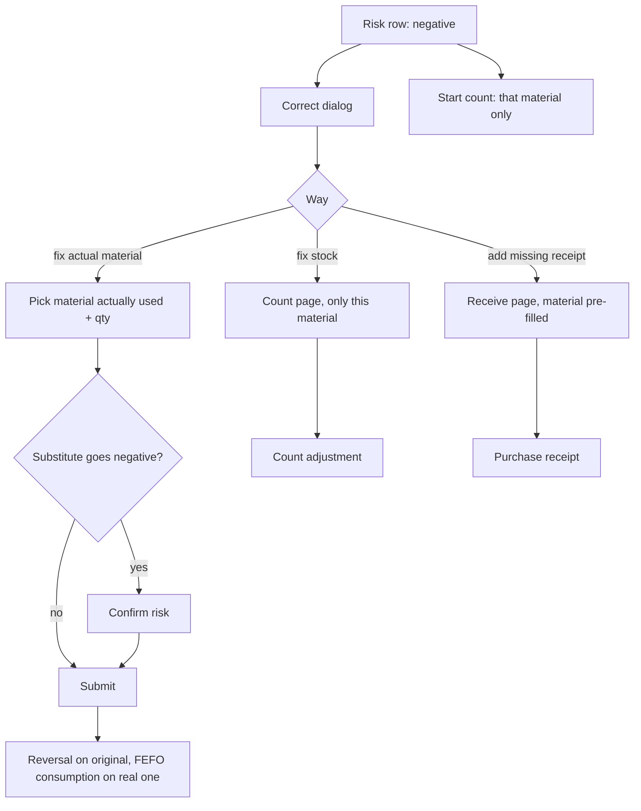

# Negative-stock correction (修正透支记录)

| | |
|---|---|
| Area | [Inventory (库存)](../inventory.md) |
| Platforms | Console (inventory home risk row); Mobile (only a shortcut into counting) |
| Maturity | specified + built in prototype |
| Newest sources | `Vaccine/prds/inventory/修改日志/修改日志-2026-08-05-负库存实际用料选择.md`, `…-2026-08-04-负库存盘点入口恢复.md`, `…-2026-08-03-负库存透支记录修正.md`; `Inventory management/Inventory PRD/01-Console库存管理PRD.md` s10.1 |
| Related flows | [stock-overview](stock-overview.md), [stocktake](stocktake.md), [receive-stock](receive-stock.md), [task-stock-deduction](task-stock-deduction.md) |

## Job
A material went below zero because tasks consumed more than was recorded as received, or the wrong material was picked. The storekeeper decides which of three causes it was and fixes the record so the books explain what happened. Done means the negative risk is closed (or moved to the substitute) and the ledger shows traceable rows.

## Trigger and actors
- Console: negative-stock risk row on inventory home has two buttons, "correct" and "start count".
- Mobile: a countable negative item in view stock offers "go count and correct" (count only; see [stocktake](stocktake.md)).
- Actor: storekeeper / manager.

## Flow

## Steps
1. Click "correct" on the risk row. Dialog "correct overdraft record" shows material, current stock, overdraft quantity and date overdraft started.
2. The user picks one of three ways:
   - Correct material stock: opens the count page restricted to this material (see [stocktake](stocktake.md)).
   - Correct actual material used: choose the material actually used from a searchable dropdown (by SKU code, name or brand), enter quantity in that material's own unit.
   - Add missing receipt: opens the receive workbench with this material already a row (see [receive-stock](receive-stock.md)).
3. For "actual material": quantity must not exceed the overdraft. If the substitute's own stock is not enough, the dialog shows its resulting negative stock and requires a risk confirmation before submit.
4. On submit the original material gets a positive consumption-reversal ledger row; the substitute gets a business-consumption row by FEFO, and any shortfall becomes its material-level negative stock without a batch.
5. The original risk closes; a new risk may appear on the substitute.
6. "Start count" from the same row goes straight to the count for that material.

## States
| Object | State | How it gets there | What it allows next |
|---|---|---|---|
| Material | negative stock | task or issue deducted more than stock | correct, count, receive |
| Material | zero or positive | correction, count or receipt | risk closes |
| Substitute material | possibly negative | correction exceeds its stock | appears as its own risk |

## Rules
1. Negative stock is allowed and never blocks tasks; it lives on the material, not on a batch.
2. Actual-material candidates: every SKU in the stock list except the overdrawn one; no filter by status, category or unit (2026-08-05).
3. Quantity <= overdraft; unit follows the chosen SKU.
4. The correction writes both sides (reversal and consumption); the summary stock number cannot be edited directly.
5. No "default material" is remembered; the dialog never reuses the last selection (checkbox removed 2026-08-05).
6. Fixing stock is only for counting; missing receipts have their own way.
7. Only medicine and semen can be counted; feed rows have no count entry (stock-overview rules), so for feed "fix stock" is implied to be unavailable. The sources do not say what the dialog shows for feed.

## Data
| Field | Where | Required? |
|---|---|---|
| Actual material (searchable) | dialog | yes for that way |
| Actual quantity | dialog | yes, <= overdraft |
| Overdraft quantity, date started | dialog | system |

## Edge cases
- Substitute without enough stock: shows result and asks for confirmation.
- Cross-category and cross-unit substitution is allowed; the unit label follows the SKU.
- Whether the first task that overdrew gets a corrected task record is not specified.
- Later receipts do not automatically clear negative stock.

## Versions
- 2026-08-03: "correct" added next to "start count"; two ways (fix stock, fix actual quantity), same-category and same-unit substitutes only.
- 2026-08-04: count entry restored on the risk row.
- 2026-08-05: three ways; candidate list opened to all SKUs with search; "set as default material" removed.

## Figma and repo
Not in Figma; no `features/` entry.

## Open questions
1. Does a later receipt offset negative stock automatically (`03-库存模块决策记录.md` s2, `06-库存出库后端逻辑.md` s7)?
2. No reversal rules for cancelled tasks or corrected treatment records (`06` s7), which would otherwise cause the same overdrafts.
3. Candidate list now includes stopped SKUs and other categories (08-05); the 08-03 wording limited to enabled, same-category materials.
