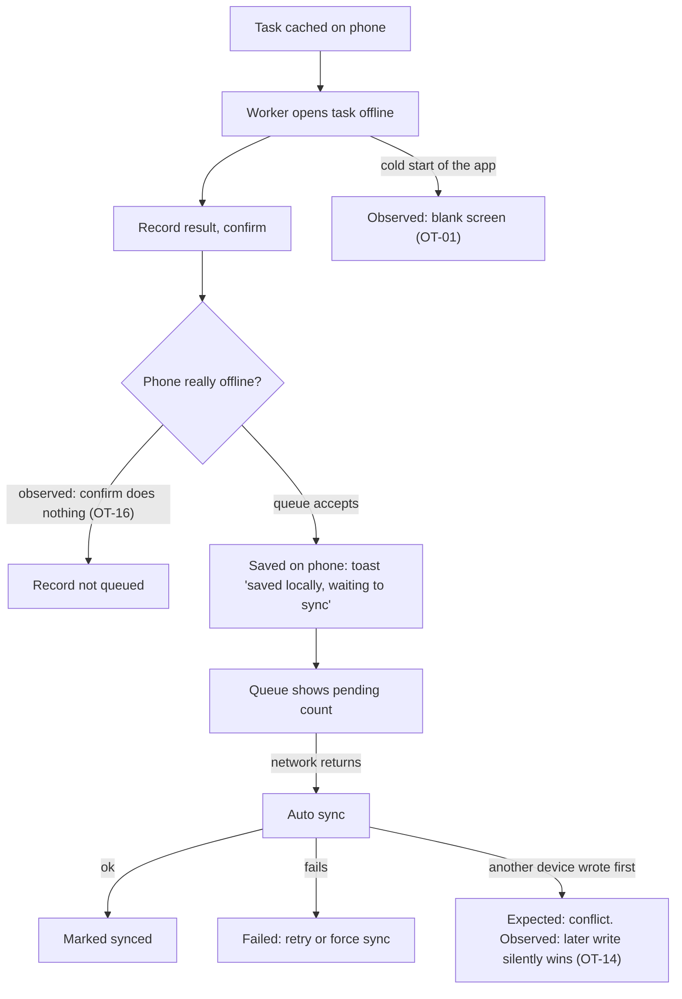

# Offline production tasks on Mobile (Mobile 生产任务离线)

| | |
|---|---|
| Area | [Console IA, workbench and access](../console-ia-workbench-access.md) |
| Platforms | Mobile (Android app), back end |
| Maturity | seen on the live product only (a test report on a development build, not a spec) |
| Newest sources | `Vaccine/docs/offline-test-2026-09-03/测试报告-2026-09-03-Mobile生产任务离线能力多角色专项.md` (2026-09-03, round-4 cumulative); the four round logs in the same folder (superseded by the report) |
| Related flows | [mobile-home-toolbox](mobile-home-toolbox.md), [login-and-farm-switch](login-and-farm-switch.md), [pig-transfer](pig-transfer.md), [vaccine-task](vaccine-task.md) |

## Job
A worker in a barn with no signal opens a production task, records results on the phone, and expects the records to reach the farm later without loss, duplication or silent overwrite. This spec records what the report expects, what it observed, and how that compares to the repo's `features/data-sync/` design. The report's verdict: do not release for pens without signal.

## Trigger and actors
- Any worker running a production task (heat check, breeding, return-heat check, pregnancy check, farrowing, piglet processing, post-partum check, weaning/lactation, end nursery, end finishing) on the phone while offline or on weak signal. Other task types (vaccination, inspection, treatment, transfer, outbound, semen) also appear as offline categories but are not production-line tasks.
- A second worker or device may record the same task; an admin may change a task in the Console while the phone is offline.
- Where it runs: the Android app loads a bundled web package; a remote web page was used for most tests.

## Flow
Expected path, with the observed breakages marked.

## Steps
**What the app exposes (observed)**
1. Tools > Offline & Sync > **Offline Data**: a list by category with states Pending, Synced, Failed, Conflict, Cancelled, and actions Sync Now, Retry, Force Sync, Cancel local record, Delete, Bulk Sync, Clear.
2. Tools > Offline & Sync > **Network Test**: a lock for Auto, Offline, Unstable or Good, and a switch that fails a share of writes (30%, 3 s). This is a test aid visible in the production Tools page.
3. Heat check, working path: open a cached task, tap a pig, choose a result, Confirm. Offline: the list updates at once and a toast says the record is "saved locally and waiting to sync". Online: "operation successful". A global hourglass button shows the pending count on task pages. Back online, the queue syncs by itself; manual sync is available but not required.
4. Heat check unit "submit": the confirm layer says unticked pigs are treated as not in heat and move to Breeding (revealed only at the last step).
5. Other task types: opened and viewed offline (with their cached pig or pen counts); results were not entered in the test.

**What the report treats as expected**
6. A task already downloaded can be viewed, filled in and submitted without signal, including after app restart.
7. The worker always knows (a) whether the phone is offline, (b) whether a result is only on the phone or on the server, (c) how many are waiting, (d) what to do when a record fails or conflicts.
8. Two workers recording the same task offline must not silently overwrite each other. The report's table of conflict rules is a **proposal for the product owner**, not an existing requirement (see Rules).

## States
| Object | State | How it gets there | What it allows next |
|---|---|---|---|
| Local record | Pending (queued) | Confirm while "offline" | Auto sync; cancel, delete (offline list) |
| Local record | Synced | Back end accepts | Nothing; stays in history |
| Local record | Failed | Back end or network rejects | Retry, force sync (declared; never seen) |
| Local record | Conflict | Another write collided | Declared; never produced |
| Local record | Cancelled | Worker cancels it | Nothing |
| Network lock (test aid) | Auto / Offline / Unstable / Good | Network Test page | Simulates signal, not real loss |

## Rules
Observed behaviour unless marked "proposal".
1. Results are queued as one command per pig action, then applied to the phone's task data at once (optimistic update).
2. Duplicate protection key includes a time stamp, so tapping an edit on the same pig creates a **second** command; both sync and the later one wins (OT-03).
3. On sync the **last writer wins**, even when its record is older than what the server already holds; both sides show "synced" (OT-14).
4. Proposal, not a requirement: first successful sync is the current result; later arrivals become conflicts with both versions kept; identical results merge into one; cancelled, locked or reassigned tasks refuse writes with a clear message; overdue submission is allowed with a flag (farm-rule dependent); non-overlapping fields merge, overlapping fields need a person.
5. The offline lock is not real offline: with true no-network the Confirm button is disabled in the app and nothing is queued (OT-16).
6. Switching to the farm chooser while records are pending shows a blank page and no warning (OT-15).

## Data
| Field | Where | Required? |
|---|---|---|
| Command: operation name (e.g. check-heat, submit-heat-status), pig, payload with time, status | phone queue | yes |
| Task cache, pig cache | phone store | yes |
| Command log (queued, synced) | phone store | yes |
| Task result (heat state, mating details, whether pregnant, litter data, piglet processing items) | per task type | per task |

## Edge cases
- Cold start of the bundled package on Android shows a blank page (resource paths break under local file loading); the bundled and remote origins do not share the queue (OT-01, OT-13).
- Real no-network: opened lists stay visible, but Confirm does nothing and switching to another task route blanks the page (OT-15, OT-16).
- Same pig changed twice offline: two commands, last wins (OT-03).
- Two devices, same account: later sync overwrites; an older offline record can overwrite a newer online one (OT-14).
- Weak signal with write failures: the single sample queued fine; no Failed or Retry UI was reached.
- End-finishing task route returns to Home (OT-09). Cumulative-estrus progress on the unit page stayed at an old value after single records were saved (copy not refreshed until unit submit).
- Not tested: two different accounts, Console changes while offline, queue dependencies, entering results in tasks other than heat check.

## Versions
- 2026-09-03: four test rounds (inventory and cache; single phone; two-end conflict; real no-network and farm switch). 16 findings logged, 2 closed; open: 3 P0 (OT-01, OT-14, OT-16), 4 P1, 5 P2, 2 P3. Verdict: do not release for offline pens.
- The four round logs are superseded by the report.

## Figma and repo
- Figma: not in Figma.
- Repo: `features/data-sync/` is the design that replaces the report's model. Differences:

| Topic | Report (observed or proposed) | Repo `features/data-sync/` |
|---|---|---|
| Feedback | "saved locally", global hourglass | "saved on this phone", header badge: icon only on Home; icon + count inside a task; red "!" only when a person must act |
| Retry | Retry, Force Sync buttons (declared) | No manual upload or retry; automatic; no buttons |
| Collision | Conflict state and proposed rules | The farm keeps the earlier record; the later one is "not accepted" with a reason (rules per feature); identical results count as uploaded; no conflict UI |
| Duplicates | Key with a time stamp (bug) | Each local operation has a stable operation ID, reused by every retry |
| Farm or account switch | No warning (bug) | Blocked while unsent records exist; sign-in loss pauses upload; only the original account can log back in |
| Network Test page | In the production Tools page | Not supported as a production tool |
| Cleanup | Delete, Cancel, Clear in Offline Data | No delete or clear; uploaded and not-accepted records expire after 30 days |

## Open questions
1. Report model (Retry, Force Sync, Conflict) vs repo model (worker does not handle rejections). The report's conflict table is explicitly a proposal.
2. OT-15 (no warning on farm switch) breaks the repo rule "block switching with unsent records".
3. OT-16 means "lock offline" tests are not valid evidence of barn behaviour; a true no-network retest is needed.
4. Collision rule per task is undefined: the repo says each feature writes its own "Offline" section.
5. Which write wins when an old offline record meets a newer online one: report observed last-writer; repo default keeps the earlier team record.
