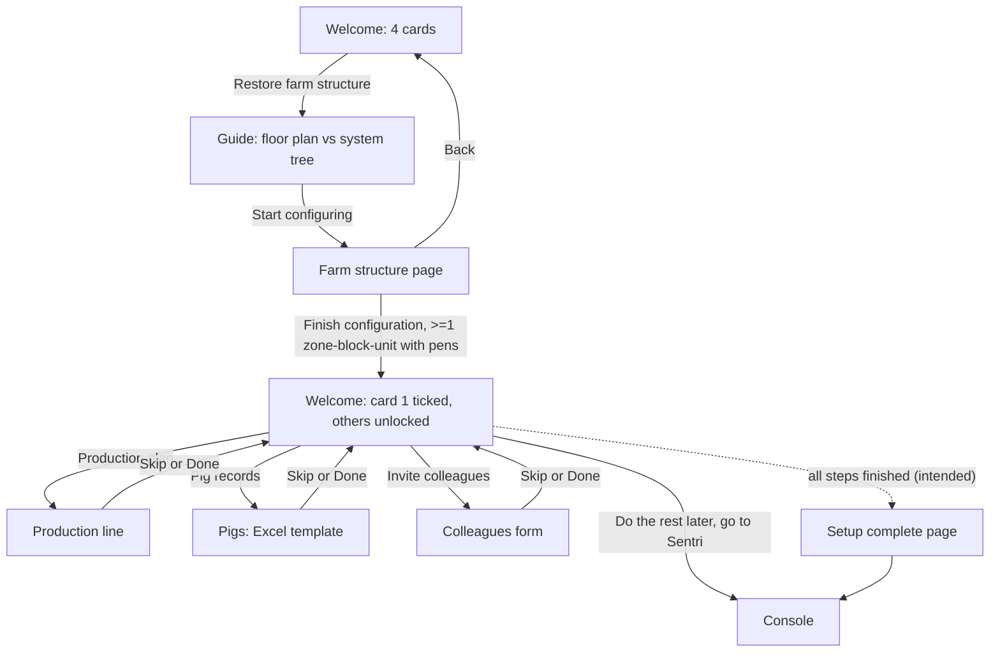

# Console onboarding / setup hub (初始化引导)

| | |
|---|---|
| Area | [Console IA, workbench and access](../console-ia-workbench-access.md) |
| Platforms | Console (full-screen, before the main app) |
| Maturity | specified + built in prototype (demo wiring incomplete; nothing is saved) |
| Newest sources | `OnBoarding/sentri-react/docs/PRD-Onboarding.md` (written 2026-01, committed 2026-06-20); `OnBoarding/sentri-react/src/pages/console/onboarding/` (`OnboardingFlow.tsx`, `steps/StepWelcome.tsx`); `OnBoarding/sentri-react/docs/修改日志-2026-07-03-Onboarding类型与构建修复.md`; the older untyped copy under `Vaccine/src/components/onboarding/` |
| Related flows | [login-and-farm-switch](login-and-farm-switch.md), [console-workbench](console-workbench.md), [staff-registration-and-entry](staff-registration-and-entry.md) |

## Job
A new farm's administrator sets up the minimum needed to start: the physical farm structure first, then optionally a production line, pig records and colleagues. When done, at least one zone > block > unit with pens exists and the person enters the Console.

## Trigger and actors
- First time an admin enters a new farm (entry condition and trigger are not specified); also reachable later from Settings > Initialisation in the Vaccine prototype.
- Actor: the farm admin. Colleagues invited in the last step receive invites later (see [staff-registration-and-entry](staff-registration-and-entry.md)).

## Flow

## Steps
1. **Welcome page** (full screen): "Welcome to Sentri, your cloud farm", subtitle "build your smart farm hub in 3 minutes". Four cards in a vertical list:

| Card | Badge | Unlocked when |
|---|---|---|
| Restore farm structure (还原猪场结构) | Required | always |
| Customise production plan (定制生产计划) | Recommended | farm structure done |
| Put pig records online (猪只档案上云) | Recommended | farm structure done |
| Invite colleagues (邀请同事协作) | none | farm structure done |

   Until the structure is done, cards 2 to 4 are greyed out and cannot be tapped. Afterwards card 1 shows "done" (green tick), the others unlock, and a link "do the rest later, enter Sentri" appears. A hint under the list says any card can be reopened to change what was set.
2. **Farm structure, guide page**: the zone, block, unit and pen model in three levels (zone, block, unit with pens), shown as a floor plan beside the matching system tree, and why the structure matters (task dispatch depends on it). `Start configuring`.
3. **Farm structure, main page**: "copy your farm 1:1", with a preview of the tree and add/edit dialogs for zone (English and Chinese name), block, unit (name with a read-only zone-block prefix, pen range start and end, pen type) and pen type (name, capacity, feeding stations, water stations). With no pen type, the unit dialog asks to configure one first; with types, the dropdown ends with "new pen type" and selects the new one automatically. Preview cards show "X pens". Footer: `Back` (to welcome) and `Finish configuration`.
4. **Production line**: line name (required), covered block (required), maximum sows mated per batch, planned first-batch start year and week (required), production plan template, task KPI template (standard, advanced, test template; view, create, set per-task KPI), transfer plan.
5. **Pig records**: three-step import: download the Excel template, fill it in, upload. Demo only (an alert). The page notes pigs can be added later from the herd overview.
6. **Colleagues**: family name, given name, phone, email, role (feeder, admin, technician, vet, other), added to a pending list; `send invites` is a demo message.
7. Steps 4 to 6 have only `Skip` and `Done` in the footer (no back); both return to the welcome page. Skipping leaves the card un-ticked.
8. **Finish**: a "setup complete" page with `Enter dashboard` and suggestions (add pigs, add staff, add lines, create tasks). Intended to follow the last step (see Open questions).

## States
| Object | State | How it gets there | What it allows next |
|---|---|---|---|
| Farm structure | not done / done | At least one zone > block > unit with pens exists | Unlocks other cards |
| Other steps | not done / done / skipped | Done ticks (needs data or the Done button); skipped counts as not done | Reopen any time |
| Welcome page | locked variant / unlocked variant | Structure done | Skip link appears |

## Rules
1. Farm structure is the only required step; everything else can be skipped and revisited, and the user can enter Sentri at any point after the structure is done.
2. "Done" for the structure means at least one complete path from zone to pens; more can be added later in Settings > Farm layout.
3. A skipped step is treated as not done, even if data was entered earlier.
4. Steps 4 to 6 never block progress.
5. Hierarchy has three levels and a pen type is reusable (standard specification for pens).
6. The pig import and colleague invite are not real in the prototype.

## Data
| Field | Where | Required? |
|---|---|---|
| Zone: English and Chinese name | Structure | yes |
| Block: English and Chinese name | Structure | yes |
| Unit: name, pen start, pen end, pen type | Structure | yes |
| Pen type: name, capacity, feeding stations, water stations | Structure | yes |
| Line: name, block, first-batch week, max sows per batch, plan templates | Line | name, block, week |
| Pig import file | Pigs | optional |
| Colleague: names, phone, email, role | Colleagues | optional step |

## Edge cases
- Back from the structure page returns to the welcome page without losing entered data (state is kept in memory only).
- Nothing persists after a reload; the demo keeps state in the page.
- No empty, error or conflict states are designed for the import or the invite.

## Versions
- 2026-01-07 to 01-28: React demo built (welcome, structure, steps).
- 2026-06-20: PRD committed (no content change dated).
- 2026-07-03: type and build fixes; the Vaccine app keeps an older untyped copy.
- A step-indicator component exists in the code but is not used anywhere (leftover of an earlier linear wizard, implied).

## Figma and repo
- Figma: 🖥️ Console 初始化: a setup checklist with `Create` / `View` rows, a three-step layout wizard, production line, add pigs, add staff (bulk upload plus a confirm-errors step). `Enter Sentri` is enabled when all four are done. 🖥 场区布局 is a separate, emptied copy.
- Repo: no feature. Same four tasks as the Figma checklist, different shape (cards vs checklist).

## Open questions
1. **Demo wiring (read from code):** the "enter Sentri" link only logs a message in the standalone copy and calls a missing step in the embedded copy; the completion page needs a step index past the last step, which the flow never reaches. The PRD ends the flow at that page.
2. **Figma vs handover:** manual add-staff vs bulk upload with error confirmation; welcome cards vs checklist rows; the PRD is dated January 2026, the Figma date is unknown.
3. Entry condition and trigger for first-run are not specified; the Vaccine prototype only offers it under Settings.
4. Mobile has no onboarding; the standalone project's mobile page is an empty shell.
5. Whether "Finish configuration" on the structure should validate pen ranges or name clashes is not specified.
