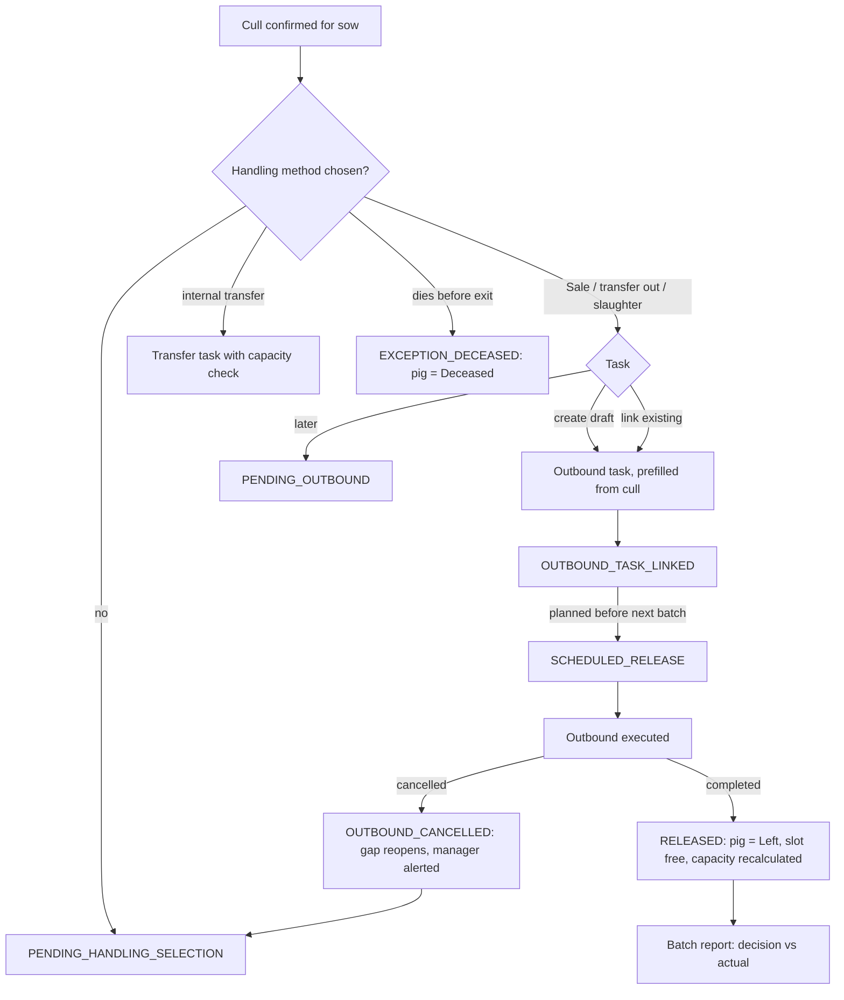

# Pig exit and sale (离场 / 出售 / 淘汰后处置)

| | |
|---|---|
| Area | [Transfers, feed, production lines, legacy design system](../transfers-feed-lines-legacy.md) |
| Platforms | Console (outbound task, exit data); back end (events); Mobile (death only, plus offline `outboundTask` store) |
| Maturity | brainstorm (post-culling exit); the status lifecycle itself is specified only. No PRD for 出场任务 / 出场数据. |
| Newest sources | `brainstorm/&&sale.md` (2026-04-15); `General copy/Pig_Status.md` (2025-11-13); `General copy/Sentri_Primer.md` s4.1, s5.5 (2025-11-28); `修改日志/修改日志-2026-08-25-Console信息架构预览.md` |
| Related flows | [cull-review](cull-review.md), [pig-transfer](pig-transfer.md), [production-line-setup](production-line-setup.md), [offline-production-tasks](offline-production-tasks.md) |

## Job
After a manager has decided to cull a sow, someone has to take her off the farm (or move her, or record her death) so that her pen slot is really free. This flow turns a confirmed culling decision into an outbound task, and the completed task into a terminal pig status, a released slot and a batch-report entry. Sold pigs from a finished batch use the same terminal status.

## Trigger and actors
- Manager, on the Console culling finalisation panel, after confirming a cull (`&&sale.md` s4).
- Manager or store person, on the Console menu 猪群管理 > 猪只出场 > 出场任务 (schedule, assign executor, track loading) and 出场数据 (head, average weight, loss, settlement basis). Menu copy only.
- Worker, on mobile, for death before outbound (death flow, separate) and for loading, if the offline `outboundTask` store is any indication.
- Back end: outbound module publishes completed/cancelled events; the culling module consumes them.

## Flow

## Steps
1. Manager confirms a sow for culling on the finalisation panel. The item becomes `CONFIRMED_FOR_CULLING`; if no handling method is set it shows as needing one (`&&sale.md` s4.1, s7).
2. Manager picks a handling method: `SALE`, `TRANSFER_OUT_OF_FARM`, `INTERNAL_TRANSFER`, `SLAUGHTER_OR_DISPOSAL`, `EUTHANASIA_OR_DEATH_HANDLING`, or `PENDING_OUTBOUND` (decided, nothing scheduled).
3. Create path: "Create Sale/Outbound Task" opens a draft prefilled with pig ids, source culling plan and batch, reason culling, suggested date before the next batch start, and current locations. Buyer, vehicle, destination, responsible person and date are edited on the task.
4. Link path: choose an existing task (same farm, status draft, planned or in progress, supports production sows, no active link on the pig). Eligible pigs link; ineligible ones are listed with the reason.
5. The outbound task runs in Sale/Outbound. On completion the culling item becomes `RELEASED`, the pig status becomes `Left`, the actual date is stored and capacity is recalculated (`OUTBOUND_TASK_COMPLETED`).
6. If the task is cancelled, or the pig is removed from it, the link is dropped, the slot stays occupied, the capacity gap reappears and the Console alerts the manager.
7. If the sow dies first, the item is `EXCEPTION_DECEASED`, the death record is linked and the case is reported apart from normal sales.
8. Mobile never shows these states: decision pages hide sold, transferred or left pigs, and `已淘汰` appears only once sale, death or transfer to another farm has completed (culling PRD 03).

## States
| Object | State | How it gets there | Allows next |
|---|---|---|---|
| Culling decision | PLANNED, FIELD_CONFIRMED / FIELD_CONTESTED, CONFIRMED_FOR_CULLING, RETAINED_BY_OVERRIDE, CULLING_CANCELLED | culling flow | Handling only after CONFIRMED |
| Handling execution | PENDING_HANDLING_SELECTION, PENDING_OUTBOUND, OUTBOUND_TASK_LINKED, SCHEDULED_RELEASE, RELEASED, OUTBOUND_CANCELLED, EXCEPTION_DECEASED | method, link, event | Cancelled returns to selection |
| Slot release | NOT_RELEASED, SCHEDULED_RELEASE, RELEASED, CANCELLED | task date and events | counts as capacity only as below |
| Pig status | any production status, then **Left (离场)** or **Deceased (死亡)** | sale, transfer to another farm, removal from inventory; death recorded | none. Both terminal, no way back (`Pig_Status.md` s5.2) |
| Pig category | production sow / boar / breeder / piglet / fattener | independent of status | status never changes category |

Pig-status lifecycle (`Pig_Status.md`): sow Empty/Gilt, In Estrus, Bred, Pregnant, Lactating, back to Empty; boar only In Production; piglet and breeder Lactating Period then Growing Period at weaning. Left and Deceased are reachable from every one of these.

## Rules
1. Culling is a decision; sale/outbound is the execution. The culling module must not duplicate the outbound module (`&&sale.md` s1-2).
2. A confirmed cull still occupies its pen until sale, transfer or death is complete.
3. Scheduled release (linked task dated before the next batch start) is counted apart from actual release (task completed). A task dated later is allowed with a warning and does not count for the next batch.
4. One active outbound link per pig; the back end must enforce it under concurrent linking.
5. Pigs already Left or Deceased cannot be linked.
6. Internal transfer is blocked, or needs another destination, when the destination has no capacity.
7. Batch closure: after the final production task the batch stays active until every pig is recorded sold/outbound, or the manager ends it; then a batch report is generated (Primer s5.5).
8. Offline: a mobile cull confirmation made after an outbound task exists may take the latest sync for the field note, but must not overwrite the outbound link silently (`&&sale.md` s12).
9. Console exposes four numbers: actual released slots, scheduled release before next batch, confirmed culls without handling, remaining gap.

## Data
| Field | Where | Required? |
|---|---|---|
| `handlingMethod`, `handlingExecutionState` | culling item | method conditional; state set on confirmation |
| `linkedOutboundTaskId`, `linkedTransferTaskId` | culling item | optional; transfer id needed for internal transfer |
| `plannedOutboundDate`, `actualOutboundDate` | item | planned optional; actual set by event |
| `slotReleaseStatus`, `capacityCountsAt` | item | yes |
| Source and destination location | item | source yes; destination for internal transfer |
| Task fields: buyer, vehicle, destination, executor | outbound task | not specified |

## Edge cases
- Sale cancelled after counting as scheduled: gap reopens and manager is alerted.
- Pig removed from a task by hand: link ends, state returns to selection or pending.
- Partially eligible link: eligible pigs go through, ineligible are listed.
- Concurrency and offline conflicts as in Rules 4 and 8. Partial outbound completion is deferred.
- Sold-pig data for a batch (head, weight, loss) belongs to 出场数据, which has no spec.

## Versions
- 2025-11-13 and 11-28: status model and "sale/outbound in development" note.
- 2026-04-15: `&&sale.md` brainstorm; V1 proposes sale, transfer out and pending outbound, internal transfer optional.
- 2026-08-04..05: culling PRDs say a decision page never shows downstream states.
- 2026-08-25: 出场管理 renamed 猪只出场 and moved under 猪群管理.
- 2026-09-03: offline test confirms an `outboundTask` store in the live app.

## Figma and repo
Not in Figma. Repo: no sale or outbound feature. `features/report-death` is the death half (a pending cull recommendation closes when she dies). `features/find-pig` has open question 2 on listing dead, sold and moved pigs. `features/workbench` shows outbound rows in "Other" with withdrawal in red.

## Open questions
1. Is the end status `Left` or a separate "Transferred Out"? `Pig_Status.md` has Left; `&&sale.md` s3 says either.
2. Is a "culled" flag a status? Primer s4.1 calls sold, deceased, culled status flags; `Pig_Status.md` lists only Left and Deceased; culling PRDs add `需淘汰` and `已淘汰` labels.
3. Does the outbound module exist? Primer says in development; `&&sale.md` assumes it; no PRD for 出场任务 or 出场数据.
4. Slaughter and disposal: are they outbound types or a separate removal record?
5. Does a withdrawal period block outbound? Repo Workbench shows it; no handover exit source states the rule.
