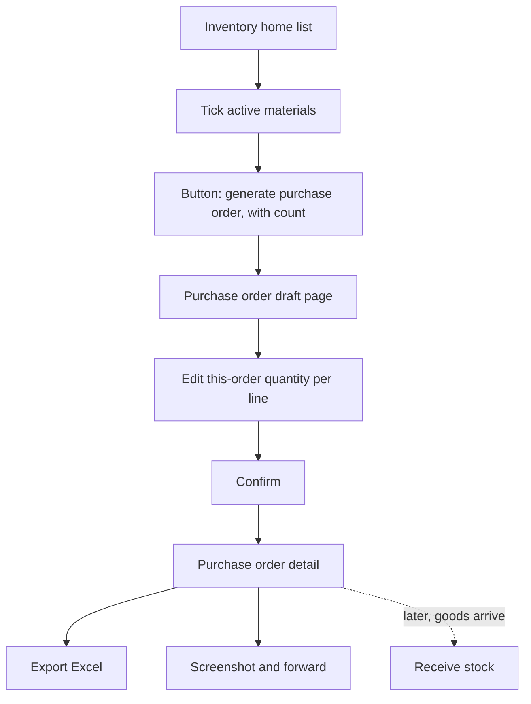

# Generate purchase order (生成采购单)

| | |
|---|---|
| Area | [Inventory (库存)](../inventory.md) |
| Platforms | Console (inventory home list) |
| Maturity | specified (changelogs only) + built in prototype; not described in the main Console PRD |
| Newest sources | `Vaccine/prds/inventory/修改日志/修改日志-2026-08-10-饲料列表采购单与字段精简.md`; `…-2026-07-08-库存首页采购单按钮按需显示.md`; `Inventory management/Inventory PRD/修改日志/修改日志-2026-07-07-首页生成采购单.md`; `Vaccine/prds/inventory/03-饲料预计可用天数.md` (2026-08-14) |
| Related flows | [stock-overview](stock-overview.md), [receive-stock](receive-stock.md), [feed-stock-reconciliation](feed-stock-reconciliation.md) |

## Job
The storekeeper ticks materials that are running low and produces a shareable purchase sheet with suggested quantities, to send to whoever buys. Done means a purchase-order detail page exists, can be screenshotted or exported to Excel, and stock has not changed.

## Trigger and actors
- Console: inventory home, category list; the button appears only after at least one active material is ticked (the "N selected" count and button were hidden when nothing is selected on 2026-07-08).
- Actor: storekeeper. The buyer receives the screenshot or Excel outside the system. There is no purchase module (out of scope for the MVP).

## Flow

## Steps
1. On the list, tick one or more active materials; ticking works across category tabs (07-07), and from 2026-08-10 the feed tab shows the button too. Semen has no purchase-order action.
2. Click "generate purchase order" (with the number selected). The draft page lists each ticked material with last receive date, last receive quantity, supplier / batch reference, current stock and estimated days of use.
3. "This order" quantity defaults to the last receive quantity for each line; the user edits per line using the stock and days of use as guidance.
4. Confirm. The detail page shows the order number, generated time, number of materials and the lines, designed to be screenshotted and forwarded.
5. "Export Excel" produces a file with the same fields as the page.
6. When goods arrive they go through the normal receive page; the order does not link to receipts (not stated).

## States
| Object | State | How it gets there | What it allows next |
|---|---|---|---|
| Purchase order | draft page | button | edit quantities, confirm |
| Purchase order | generated (detail page) | confirm | export, screenshot |

No further statuses (sent, received, cancelled) are specified.

## Rules
1. Does not change stock, create batches or write ledger rows.
2. Default quantity = last receive quantity from the latest purchase-receipt ledger row; with no ledger row, falls back to the batch quantity.
3. Only active materials can be ticked.
4. Estimated days of use is shown for feed (stock divided by 30-day average daily use). It was added for medicine on 2026-07-09 and withdrawn on 2026-07-10 as consumption is unstable, so medicine rows carry no days figure (implied by the withdrawal; the 07-09 line in the order is not reversed in any source read).
5. Terminology: "last receive" (上次入库), not "last purchase".

## Data
| Field | Where | Required? |
|---|---|---|
| Material, brand, category | line | system |
| Last receive date, quantity | line | system (reference) |
| Current stock, days of use | line | system (reference) |
| This-order quantity | line | editable, default last receive |
| Order number, generated time, count | detail | system |

## Edge cases
- No receive history: batch quantity is the fallback; if neither exists the sources are silent.
- Selecting only stopped materials is not possible (not ticked).
- Deselecting everything removes the button.
- The order is not stored as a managed record beyond the detail page and export (implied).

## Versions
- 2026-07-07: generation from home with multi-select, last quantity default, detail page, Excel export; stock and days of use added in the same day.
- 2026-07-08: button shown only when something is ticked.
- 2026-07-09/10: medicine days-of-use added then withdrawn.
- 2026-08-10: feed tab gets the button; feed list loses trend and nearest-expiry columns.

## Figma and repo
Not in Figma; no `features/` entry; `features/feed-plan` says purchase and supplier belong to management screens. The main Console PRD (`01`) has no purchase-order section despite the changelog claiming it was added.

## Open questions
1. `01-Console库存管理PRD.md` lacks the purchase-order page the 2026-07-07 changelog says it added; confirm the changelogs are the spec.
2. Whether supplier suggestions and a link between a purchase order and later receipts are wanted.
3. Whether medicine and "other" rows should show days of use (07-09 added, 07-10 removed from the list only).
