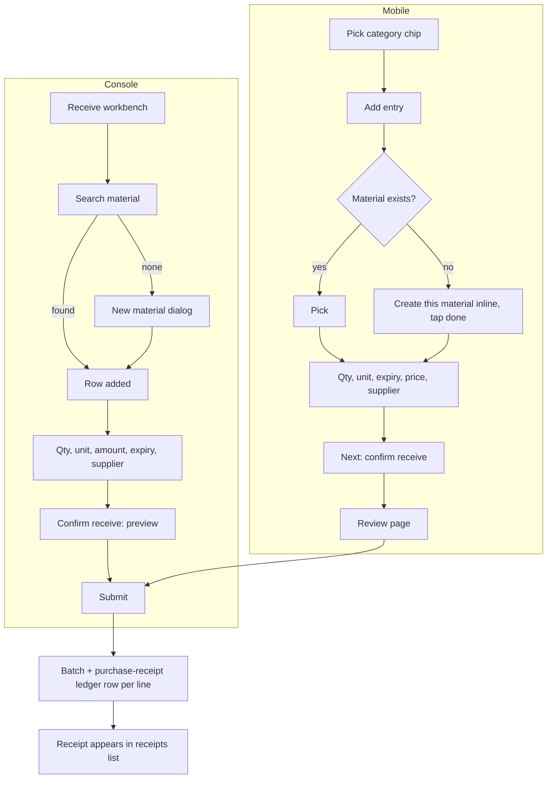

# Receive stock (入库)

| | |
|---|---|
| Area | [Inventory (库存)](../inventory.md) |
| Platforms | Console (receive workbench + receipts list); Mobile (receive with per-category drafts) |
| Maturity | specified + built in prototype (no Figma, no repo feature) |
| Newest sources | `Inventory management/Inventory PRD/02-Mobile库存管理PRD.md` s8.3 (2026-09-09); `Vaccine/prds/inventory/修改日志/修改日志-2026-08-26-Mobile库存工具箱评审优化.md`, `…-2026-08-20-Mobile入库UI重构.md`; `…-2026-08-10-统一入库记录.md`, `…-2026-08-10-入库记录视觉分组与隐藏单号.md`; `Inventory management/Inventory PRD/01-Console库存管理PRD.md` s8.5, s8.9 |
| Related flows | [material-master](material-master.md), [stock-overview](stock-overview.md), [negative-stock-correction](negative-stock-correction.md), [purchase-order](purchase-order.md), [stocktake](stocktake.md) |

## Job
When goods arrive, the storekeeper (Console) or field staff (Mobile) records what came in. Done means: one batch per line exists with expiry, price and supplier, a purchase-receipt ledger row exists per line, and stock for the material has risen in its accounting unit. New materials can be created in the same step.

## Trigger and actors
- Console: "receive" button on inventory home, sidebar inventory > receive, or negative-stock correction "add missing receipt" (opens with the material pre-filled).
- Mobile: toolbox inventory group > "receive".
- Receipts list: sidebar > receipts, or the business-centre list.
- Actors: storekeeper / field staff. No approval step.

## Flow

## Steps
**Console, receive workbench (one page)**
1. Open the page; if an unsaved draft exists it is restored with a light notice. Sticky footer shows material count, total amount, cancel / clear / confirm receive.
2. Header carries receive date, order number, remark (prototype); the 2026-08-26 PRD still lists warehouse (see open questions).
3. Search (name, English name, brand, SKU, pinyin) adds a row; no category pre-pick. Stopped materials are not offered; existing master data is read-only here.
4. No match -> "create material: xxx" in the dropdown -> quick-create dialog (name, brand, category, sub-class for medicine, unit, unit conversions, category fields). Material and first batch are created together on submit; incomplete profiles get "profile incomplete".
5. Row: quantity (Enter moves quantity -> amount -> expiry), unit dropdown limited to accounting unit and maintained conversions, total amount (quantity x unit price linked both ways), expiry date, supplier (phone optional).
6. Confirm -> preview/confirm page (read-only header, unit price per entered unit, total) -> submit. New materials appear under their category tab.

**Console, receipts list (receipts 入库记录)**
1. One page for medicine, semen and feed. One row = one receipt in an expandable table (collapsed by default, several open at once). It is not a ledger or stock list.
2. Filters applied with a confirm button: search (material name; semen also boar ID / breed), time (default last 30 days), category, type (purchase / surplus receipt).
3. Header: type tag, item count, total amount (none for surplus receipts), remark, operator and date. Expanded: basic info and a table of lines (name, category, brand, quantity, unit, total, expiry, supplier, phone), and "N items". Semen adds boar ID / breed and shows "valid until".
4. A mixed receipt shows once under "all"; under one category its lines are trimmed first, then count and amount are recomputed.

**Mobile, receive**
1. Pick a category (feed / medicine / semen / other). Each category keeps its own draft; switching never asks or clears; chips show draft counts.
2. Add an entry. Search by name or brand. Only when nothing matches and the user taps "create this material" does the minimal profile open inline; "done with material info" collapses it to a summary ("new material will be created with this receipt") and focuses quantity. Quantity fields and "add next" stay hidden until then. Cancelling a filled new-material form asks to confirm.
3. Entry fields: quantity, unit (configured units only), expiry date (past dates allowed with a visible warning), total purchase price, supplier (phone, remark optional). Entries show "to complete" or "ready"; top shows ready vs incomplete counts.
4. Footer button reads "fill in receive info first" / "N more to complete" until valid, then "Next, confirm receive". Clear affects only the current category and asks to confirm; leaving with any draft asks to confirm.
5. Review page "confirm this receive": per line material, brand, new-material flag, quantity and unit, converted stock, expiry, amount, supplier. Footer: back to edit / confirm receive. Only complete entries submit; incomplete ones stay as drafts and the page says so.
6. Result page lists each line with converted stock; actions "continue completing" (drafts left) or "continue receiving", and back to workbench.

## States
| Object | State | How it gets there | What it allows next |
|---|---|---|---|
| Draft (per category on Mobile; one on Console) | in progress | typing / quick-create | confirm, clear; restored on return |
| Mobile entry | to complete / ready | required fields filled | only ready entries submit |
| Batch | normal | created on submit | see [stock-overview](stock-overview.md) |
| Receipt | purchase / surplus (from a count) | submit / count | read in receipts list; no status field |

## Rules
1. Expiry date required (Console prototype and Mobile); already-expired allowed with a warning on Mobile.
2. Supplier required per row; phone optional. Total purchase price required on Mobile.
3. Units only from the material's accounting unit and maintained conversions; a unit that cannot convert blocks submit.
4. Batch number is system-generated from receive date, hidden on the form. No warehouse, location, production date or safety stock on the row.
5. Feed quick-create must include "1 ton = xxL"; vaccine quick-create requires administration method.
6. A new material is only persisted at final confirm, never when "done with material info" is tapped.
7. Stopped materials cannot be received.
8. Receiving does not clear existing negative stock automatically (open decision since 2026-06-17).
9. Receipts list: no status, no warehouse, no order number shown or searchable (2026-08-10), no stats block or operation log.

## Data
| Field | Where | Required? |
|---|---|---|
| Material, quantity, unit | line | yes |
| Expiry | line | yes |
| Total amount / unit price | line | amount yes on Mobile |
| Supplier; phone | line | supplier yes; phone no |
| Receive date, order number, remark | Console header | no (prototype) |
| Receipt type | list | purchase / surplus |

## Edge cases
- Restored draft on reopen (Console); per-category drafts survive category switching and incomplete submits (Mobile).
- Mixed complete and incomplete entries: only complete ones submit, user is told before and after.
- Delete is available on any entry except the only one (touch target >= 44 px).
- Offline behaviour is not stated in the sources.
- Feed receipts: whether they create batches is contested (see open questions).

## Versions
- 2026-06-20..29: structured package spec; modal form; card-style batch receive.
- 2026-07-07..08: doc-style form, then single workbench page; supplier, expiry, price optional.
- 2026-07-09..13: supplier required per row; unit conversion required at quick-create; receipts moved into records; warehouse dropped; convertible units selectable again.
- 2026-08-10: one receipts page; order number hidden.
- 2026-08-20..26: Mobile receive rebuilt (light list, per-category drafts, "done with material info", review page).

## Figma and repo
Not in Figma (no receive screens). No `features/` entry; prototype in `Vaccine/src/components/inventory/` (`BatchReceivePanel.tsx` and related).

## Open questions
1. Warehouse and header: `05-库存系统重整版PRD.md` s9.2 still has warehouse and optional expiry/supplier; changelogs 2026-07-09 and 07-13 removed warehouse and required supplier.
2. Receipt header: category tag and order number shown in `Vaccine/prds/inventory/04-统一入库记录-PRD.md` and `05` s9.3, hidden by the 2026-08-10 changelogs.
3. Feed receipts: fact only, no stock (`04-统一入库记录-PRD.md`, 08-11) vs batch created (08-12 restore) vs no batch module (08-14).
4. Does a later receipt offset existing negative stock (`03-库存模块决策记录.md`, `06-库存出库后端逻辑.md` s7)?
5. Mobile PRD requires total price; Console line total amount is auto-linked but not stated as mandatory.
