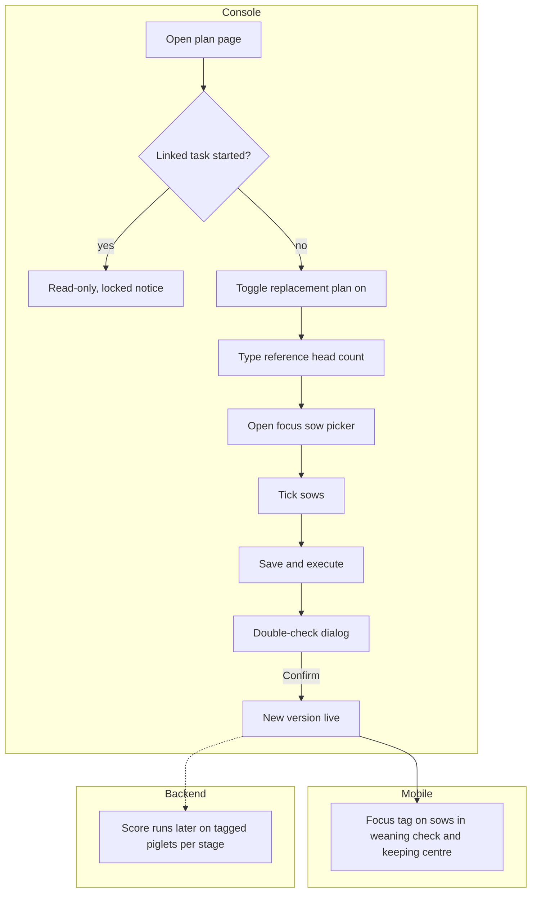

# Replacement plan (后备留种计划)

| | |
|---|---|
| Area | [Culling, replacement and semen](../culling-replacement-semen.md) |
| Platforms | Console (plan), back end (piglet scoring); Mobile only reads the focus tag |
| Maturity | specified + built in prototype (plan card built; save-and-execute and locking specified only) |
| Newest sources | `Vaccine/prds/culling&replacement/02-console-后备留种计划.md` (2026-08-04); `Vaccine/prds/culling&replacement/05-console-淘汰&留种计划编辑与生效规则补充说明.md` (2026-05-04); `Vaccine/prds/culling&replacement/仔猪留种评分规则-修订版-2026-08-06/` (rc.7, 2026-08-06) |
| Related flows | [keep-for-breeding](keep-for-breeding.md), [culling-plan](culling-plan.md) |

## Job
A manager, before a batch starts, sets a head-count reference for how many replacement breeders the batch might supply and names the sows whose offspring deserve a closer look. When done, those sows carry a 重点留种来源 (focus source for keeping) tag on Mobile. No piglet list is fixed in advance.

## Trigger and actors
- Console user opens the same batch plan page as the culling plan, second card 后备留种计划.
- Mobile users see the tag in the weaning check and in the keeping centre.
- Back end: the piglet scoring engine, which does not run at planning time but explains what "worth a look" later means.

## Flow

## Steps
1. Open the plan page (sidebar 淘汰&留种, item 母猪淘汰&后备留种). Card 2 is 后备留种计划 with its own toggle.
2. Switch it on. The config opens and the page becomes "edited, not saved", button 保存并执行.
3. Type the 储备参考 (reserve reference). Head count only; there is no percent mode. The page says in words that this is a planning reference and that the final list will keep changing with field identity and production data.
4. Open 指定留种母猪. The modal is the same as the culling picker (ear tag, parity, litter size, born alive, teats, return-to-heat, disease tags). The target is sows, not piglets. The outer button shows "已选 N 头".
5. Press 保存并执行 and confirm in the double-check dialog. It lists whether the plan is on, the reference head count, the picked sow count and the not-yet-started tasks it will affect, together with the culling plan's changes.
6. Mobile now shows 重点留种来源 on those sows in the weaning-check list and sow page. The tag never changes with task progress; it always means "this sow's offspring are worth attention".
7. From here the work moves to [keep-for-breeding](keep-for-breeding.md): the plan does not run an approval step.

## States
| Object | State | How it gets there | What it allows next |
|---|---|---|---|
| Plan | Off | default | switch on |
| Plan | Edited, unsaved | any change to toggle, reference or sow list | save, or leave and discard |
| Plan | Live | confirmed in the double-check | edit while no task has started |
| Plan | Locked | linked task started | read-only |
| Sow tag | 重点留种来源 | picked in a live plan | none; informational |

## Rules
1. The reference is not a goal, completion rate, cap or submit gate. It never enables or disables a button, never shows a percent, a gap or an "exceeded".
2. The tag is a plan label, not a result. A sow may also be 建议淘汰; there is no automatic conflict resolution because one concerns the sow's place in the herd and the other her offspring.
3. Reference 0 with picked sows is allowed: it sends attention only.
4. Same edit rules as the culling plan: toggle, reference and sow list changes are formal; 保存并执行 plus 确认修改 is required; tasks already started keep the old version; unsaved edits trigger a leave guard; off keeps the stored values.
5. A batch with no selectable sows still allows editing the reference; the modal shows an empty state.
6. Scoring behind "worth a look" (inputs only, rule set rc.7 candidate, not a production-published version). Three production states: suckling, nursery and finishing. Suckling scores the whole source litter once, shown on the sow. Nursery and finishing score each ear-tagged piglet, compared within the same batch and sex; each stage restarts. Inputs: family background (mother's last completed litters, and the sire's offspring record), current-litter birth quality (born alive, weak, deformed, stillborn and mummified shares), individual weaning weight, daily gain and feed conversion, backfat corrected to a reference weight, health record, common structure, and sex-specific structure (teat line for gilts, testis and genital form for boars). Red lines (notifiable disease, hernia, congenital or hereditary defect, lameness, too few functional teats, genital faults) set the score to zero and mark the pig "not recommended". A teat count between 12 and 13 is "observe" and stays out of the normal recommendation pool. The front ends never recompute the score. Missing data follows one separate rule document, never a page's own default.

## Data
| Field | Where | Required? |
|---|---|---|
| Plan on/off | plan card | yes |
| Reference head count | plan card | when on |
| Focus source sows | picker modal | optional |

## Edge cases
- Reference 0 with sows: saved, attention only.
- Sow left before saving: cannot be added.
- Unsaved edit then leave: guard.
- Plan switched off: new tasks stop reading the tag; history kept.

## Versions
- 2026-04-16: "keeping" read as refilling a batch from eligible gilts (补入); later dropped.
- 2026-07-01: Mobile candidate plus Console second approval.
- 2026-07-28: approval dropped; one shared list; progress, percent and targets removed from the keeping screens; reference stays a plan-only number.
- 2026-08-05/06: gilt-only scoring rebuilt as piglet rules for both sexes (rc.1 to rc.7).

## Figma and repo
Not in Figma. No `features/` entry. The related Mobile marking is in repo `keep-breeding` (see [keep-for-breeding](keep-for-breeding.md)).

## Open questions
1. Reference-only (`02`) versus executable (`05` treats it like a target to execute): which wording governs.
2. Gilts only or both sexes: the card is still called 后备留种 and the reserve is "gilts", while the rules and the list mix boars and gilts.
3. PRD 00's module table still describes `02` as "candidate second approval" and `04` as a Toolbox module; both are stale after 2026-07-28.
4. The prototype's weaning-check reminder still shows 预计留种 / 目标留种 / 还剩 (old target logic).
5. Piglet rule file links in PRDs 00 and 02 point to the folder root; the files moved into the 2026-08-06 folder.
6. Open backend review items are in `后端评审待确认问题清单-2026-08-06.md`.
