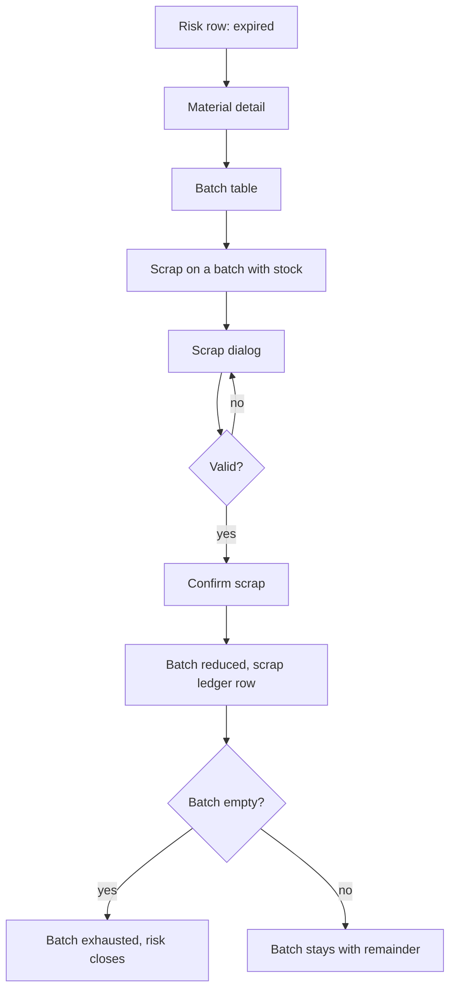

# Scrap a batch (报废)

| | |
|---|---|
| Area | [Inventory (库存)](../inventory.md) |
| Platforms | Console (material detail batch table); back end (scrap confirmation) |
| Maturity | specified + built in prototype (Console); back-end rules specified only |
| Newest sources | `Inventory management/Inventory PRD/01-Console库存管理PRD.md` s8.13, s9, s10.3 (header 2026-08-11); `Inventory management/Inventory PRD/06-库存出库后端逻辑.md` s3 (2026-08-19); `Vaccine/prds/inventory/修改日志/修改日志-2026-06-26-移除过期报废独立页面与自动冻结.md`, `…-2026-06-29-过期批次恢复使用移除.md`, `…-2026-08-14-饲料详情移除批次库存.md` |
| Related flows | [stock-overview](stock-overview.md), [task-stock-deduction](task-stock-deduction.md), [stocktake](stocktake.md), [material-master](material-master.md) |

## Job
The storekeeper removes stock that can no longer be used (expired, spoiled, damp, torn pack, normal loss) from a specific batch, with a reason and handling method. Done means the batch is reduced, a scrap ledger row exists, and an expired risk closes if the batch is empty.

## Trigger and actors
- Console only. From a risk row of an expired batch, open the material detail, then use "scrap" on a batch row in the batch table.
- Available on any batch with stock, not only expired ones (spoiled, damp, torn pack, loss).
- Actor: storekeeper / manager. No second approver.

## Flow

## Steps
1. On home, an expired risk row opens the material detail (no scrap button on home).
2. In the detail "batch stock" table, rows with remaining stock show "scrap" next to "edit".
3. The scrap dialog ("scrap handling") always opens; scrap never succeeds directly from the row. It shows material, batch, supplier batch no., current batch stock and expiry.
4. The user sets quantity (default all remaining; partial allowed), reason, handling method, and optionally attaches photo notes.
5. "Confirm scrap" reduces the batch, writes a scrap ledger row, and if stock reaches zero the batch becomes exhausted and drops out of the expired risk.

## States
| Object | State | How it gets there | What it allows next |
|---|---|---|---|
| Batch | expired (not frozen) | expiry date passed | still used by FEFO and loss deduction until scrapped; can be scrapped |
| Batch | normal / near-expiry with stock | by date | can also be scrapped |
| Batch | exhausted | stock reaches zero | no further action |
| Scrap order (back end) | draft / pending confirmation / processing / completed / rejected | request, confirm, failure | stock changes only at completed |

## Rules
1. Reason required; options: expired or spoiled, damp or mouldy, outer pack damaged or leaking, daily loss or error correction. The back-end doc adds contamination.
2. Quantity > 0 and <= the batch's current stock.
3. Batch materials need a specific batch; scrap never guesses by FEFO. Non-batch materials deduct from the total.
4. A scrap request alone changes nothing; only confirmation does. Repeating a confirmation must not deduct twice.
5. Expired batches are never auto-frozen and there is no "restore use" action (both removed 2026-06-26/29).
6. A completed scrap cannot be edited.
7. Feed detail has no batch table (2026-08-14), so feed has no scrap entry in the Console.
8. Scrap is a stock-out in the back end, not business consumption in usage statistics.

## Data
| Field | Where | Required? |
|---|---|---|
| Material, batch, supplier batch no., stock, expiry | dialog, read-only | system |
| Scrap quantity | dialog | yes |
| Reason | dialog | yes |
| Handling method | dialog | yes (back end) |
| Photo / note | dialog | no |
| Operator, time | ledger row | system |

## Edge cases
- Partial scrap leaves the batch with the rest and the risk stays if still expired.
- Scrap quantity above stock is refused (back-end `REJECTED`).
- Everything fails together: stock, batch, ledger and scrap state commit in one transaction.
- Scrap cost basis is undecided (see open questions).

## Versions
- 2026-06-24: closed loop with auto-freeze, scrap and "restore use"; separate scrap page and records.
- 2026-06-26/29: separate page and auto-freeze removed; restore removed; scrap only from material detail.
- 2026-08-14: feed detail drops batches, so no scrap for feed.
- 2026-08-19: back-end scrap rules written (request vs confirm).

## Figma and repo
Not in Figma; no `features/` entry. The "scrap records" navigation item (2026-06-24) was removed with the dedicated page; scrap rows now only appear in the ledger.

## Open questions
1. Cost basis of a scrap (`03-库存模块决策记录.md`, open since 2026-06-17).
2. `03` D-003 ("scrap / keep using / partial") is replaced by D-012 and the 06-29 changelog; confirm keep-using needs no approval step.
3. The request-then-confirm states in `06` s3.5 do not exist in the Console UI, which confirms in one dialog.
4. Handling method options are not enumerated in any source read.
