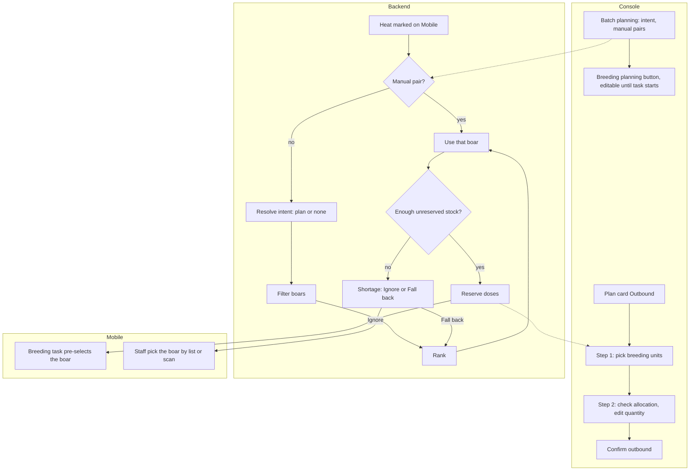

# Semen matching and picking (精液匹配 / 预留)

| | |
|---|---|
| Area | [Culling, replacement and semen](../culling-replacement-semen.md) |
| Platforms | Console (batch planning, picking), back end (matching engine, reservation), Mobile breeding task (consumes the boar) |
| Maturity | specified only for matching, reservation and boar pre-selection (design notes, not in the prototype); picking and outbound are built in the migrated Console module |
| Newest sources | `Vaccine/docs/semen/zh-精液模块文档/精液匹配与预留说明.md`, `精液备选匹配.md`, `精液资质过滤与近交评估.md`, `当前模块所需变更.md` (all 2026-05-04, Chinese translations of English originals not in the handover); `Vaccine/prds/semen/00-Console精液管理-PRD.md` §6 (2026-08-17) |
| Related flows | [semen-production](semen-production.md), [task-stock-deduction](task-stock-deduction.md) |

## Job
For each sow that comes into heat, the system proposes a boar whose semen she should get; breeding staff pick the matching stock out so it can be used. When done, the sow has a boar, the doses are reserved or picked from that boar's stock, and the choice and its reason are on record.

## Trigger and actors
- Batch planning (Console), up to 7 days before the batch starts: manager sets intent.
- Heat check (Mobile task) marks a sow in heat: this is what starts matching per sow. The back end may run the whole batch once at the first heat.
- Console breeding staff: today's plan card 出库, sidebar 配种领用 or business-centre 精液出库.
- Mobile breeding task: uses the boar chosen here.

## Flow

## Steps
**Planning (Console, specified)**
1. In batch details a separate 配种规划 (breeding planning) button opens a dialog; it is editable until the batch's breeding task starts.
2. Switch planning on or off. If on, choose batch purpose 肉猪生产 (terminal line semen), 种猪扩繁 (sow-line semen) or 混合 (a split, with a share to the sow line). Optionally set breed allocation by hand, overriding the purpose.
3. Optionally lock manual sow-to-boar pairs for sows already in the batch. Planning cannot finish the match because the sow set is incomplete.
4. In the batch's sow list each sow shows her match result: matched or not, which boar, and whether the source is manual, plan or fallback.

**Matching (back end, specified)**
5. A heat mark triggers matching for that sow. Order: manual pair; then intent (plan purpose, else none); then filters; then ranking; then capacity and reservation on the chosen boar's unreserved stock.
6. Result goes to the breeding task, which pre-selects the boar. Exception: if reservation failed and the user chose Ignore, nothing is pre-selected.
7. If staff must pick a boar themselves: choose from boars on site, or scan the straw code. A Sentri code resolves to the boar. A code from outside must be registered once (boar ID and breed required; source farm and expiry also asked) and creates a manual-entry log row so later scans are recognised.

**Picking and outbound (Console, built)**
8. Page title 出库. Step 1: breeding-unit table with row selection, or 手动选择精液; 下一步 stays disabled until a unit is picked.
9. Step 2: system allocation check with quantities you can edit and a sow detail. Manual mode: select or type a batch (barcode typed or scanned), with checks for duplicates and unavailable batches.
10. If units need more doses than stock holds, a dialog states required, in stock and gap. The prototype offers Ignore (carry on, add semen by hand later); "use another boar's semen" is shown but disabled.
11. 确认出库 opens a dialog; it warns when the quantity is over or under the need.

## States
| Object | State | How it gets there | What it allows next |
|---|---|---|---|
| Plan | Off / on, editable | planning dialog | change until breeding task starts |
| Sow match | none | sow not in heat | wait |
| Sow match | manual / plan / fallback | pair, or engine result | task pre-selection |
| Reservation | reserved | enough unreserved stock | pick, use, release |
| Reservation | shortage | not enough | Ignore or Fall back |
| Stock | picked then used | scan at pick, use at insemination | log |

## Rules
1. Matching only for sows in heat; reservation only after a boar is chosen.
2. Plan intent only sets direction; manual pairs are locked and kept.
3. Boar filters: not marked off production; breed or line fits the intent (only when a plan exists); unit maps to the sow's line through the supply relation; pedigree inbreeding checked when pedigree exists; stock in the service window.
4. Ranking (deterministic, no AI), in this order: stock covering the whole insemination course, fewer health tags, lower inbreeding, cooldown readiness since last collection, earliest-expiry fit, fewer assignments in this batch, boar ID.
5. Inbreeding at or under 10 percent is safe; over 10 percent stays pairable, ranks lower and shows "High COI" with the percentage. Missing pedigree skips the check and lowers confidence, which the user is told.
6. Results are tagged `deterministic_fallback` (or manual) and never shown as AI. Output carries sow, boar, doses, source, engine and a plain justification; excluded higher-ranked boars carry a rejection reason.
7. No qualified boar: show a warning and the first blocking reason. Only boars in cooldown: pick the nearest to ready, needing an exception reason in the audit.
8. Reservation shortage: Ignore (staff cope) or Fall back (next ranked boar).
9. Inventory log types written: reserved, picked, used, manual entry.

## Data
| Field | Where | Required? |
|---|---|---|
| Sow, unit, planned time, line | engine input | yes |
| Boar availability, health tags, last collection | engine input | yes |
| Stock by boar, earliest expiry first | engine input | yes |
| Batch purpose, split, breed allocation | planning dialog | optional |
| Manual pairs | planning dialog | optional |
| Match source, engine, justification, COI percent | match result | yes |
| Foreign straw: boar ID, breed, source farm, expiry | register dialog | boar ID, breed required |

## Edge cases
- Sows that join the batch after planning get matched at their own heat.
- Planning off: purpose is ignored; only filters that need no intent apply.
- Pedigree missing: no COI, a note says so.
- Reservation fails with Fall back: cascade to the next boar or report shortage.
- Today's-plan filters and paging misbehave on the live dev system (bugs 033 to 036).

## Versions
- 2026-05-04: design notes: matching starts at heat, planning is an intent layer, deterministic fallback, inbreeding soft rule, needed changes list.
- 2026-08-17: Console picking flow copied from the earlier module; none of the matching notes were built into it.
- 2026-09-11 and 09-15: live tests of the plan cards and filters.

## Figma and repo
Not in Figma. Repo `breeding` has the mating task and takes the semen batch from the previous mating; the handover's boar pre-selection is not reflected there.

## Open questions
1. Is high inbreeding a hard block or a soft rank? The eligibility note says the system tries to block high-risk pairs, yet over 10 percent is still allowed (`精液资质过滤与近交评估.md` §5.1, §4.5, §6.1; `精液备选匹配.md` §6.4).
2. Is matching run per sow at heat or once for the batch at the first heat? Both are allowed in the notes.
3. The picking flow is built, the matching and planning dialog are not; the English originals are outside the handover.
4. Whether foreign scans always write manual-entry and how a batch ID is found inside a breeding task (`精液库存日志说明.md` §6).
5. How reservation interacts with the task's stock deduction ([task-stock-deduction](task-stock-deduction.md)).
