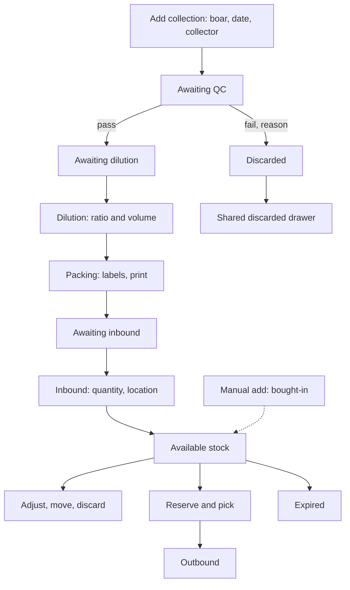

# Semen production and stock (精液管理)

| | |
|---|---|
| Area | [Culling, replacement and semen](../culling-replacement-semen.md) |
| Platforms | Console only; back end owns status checks, stock, audit log and settings |
| Maturity | built only (no product-logic PRD: the PRD describes a copied module); tested on the live dev environment, not on the prototype |
| Newest sources | `Vaccine/prds/semen/00-Console精液管理-PRD.md` (2026-08-17); `Vaccine/docs/semen/zh-精液模块文档/精液库存日志说明.md` (2026-05-04); `精液管理/测试报告/精液管理全流程测试Bug单-2026-09-11.md`; `精液管理/测试报告/精液管理展示与组件功能专项测试Bug单-2026-09-15.md` |
| Related flows | [semen-matching](semen-matching.md), [stock-overview](stock-overview.md) |

## Job
Boar-stud staff turn a collection from a boar into packed, labelled, stored doses with a trace, and keep the stock and its log true. When done, a batch is "available" in stock with quantity, location and expiry, and every step has an operator and time.

## Trigger and actors
- Staff open the Console: original home sidebar group 精液 (精液管理, 配种领用, 采精历史, 出库记录, 精液历史, 精液设置) or, in the revamped home, 业务中心 / 精液: 查看配种计划, 精液处理, 精液设置, 精液出库 (first version of the revamp had five items).
- Roles in the PRD: semen manager (collect, QC, dilute, pack, stock), breeding staff (pick; see [semen-matching](semen-matching.md)), supervisor (history and settings).
- Inside the app these entries are a source-level copy of an earlier module (`console-dev`); Sentri adds only entries, routes and demo data.

## Flow

## Steps
All on the Console, page 精液管理 (tabs 精液管理 home, 公猪列表, 库存).
1. 添加采精 opens a dialog: boar, collection date, collector. Required fields block confirm. A new batch is created with a batch number and enters 待质检.
2. 质检 (quality check) dialog. Quantitative inputs: volume, density, motility, normal-morphology rate, survival rate. Qualitative: colour and odour (normal or abnormal), remark. Pass moves the batch to 待稀释; "fail, discard" asks for a reason and moves it to 已废弃.
3. 稀释 (dilution) dialog. Pick a recommended, a farm default or a custom ratio. The dialog shows diluent added, total volume, final density and estimated number of doses; confirm moves to the packing stage.
4. 分装入库 (packing and inbound), two steps. Labels: number of labels, print. Inventory: system quantity, storage location (new location can be added inline), confirm. The batch becomes available stock and the audit log gets its entries. Expiry follows the shelf life set in settings.
5. The three processing stages (QC, dilution, inbound) share one 废弃精液列表 drawer for discarded batches.
6. Boar list tab: boar information, collection status (needs collection, recovering, normal), stall, last collection; table-header filter and sort; an action menu updates collection status.
7. Inventory tab: filter by batch, status; row detail; add stock (manual, "external purchase" or "own farm", skipping the process stages); adjust quantity; move to another location; discard; per-batch and global log drawers.
8. 配种计划 view (today and the next seven days): cards per breeding unit with 精液充足 / 精液不足 against supply; the 出库 button enters picking ([semen-matching](semen-matching.md)).
9. Pages 采精历史, 出库记录 and 精液历史 are read views with search, breed and status filters, sort and a detail dialog.
10. 精液设置: dilution defaults, QC thresholds, inventory settings (shelf life, expiry warning), boar-unit to production-line supply relation, storage locations. Save returns to the main page.

## States
| Object | State | How it gets there | What it allows next |
|---|---|---|---|
| Batch | 待质检 | collection added | QC pass or discard |
| Batch | 待稀释 | QC passed | dilution |
| Batch | 待贴标 / 待入库 | dilution done | label, inbound |
| Batch | 可用 (available) | inbound | reserve, adjust, move, discard, pick |
| Batch | 已预留 (reserved) | reservation on a pick | outbound, release |
| Batch | 临期 (expiring) | within warning window of expiry | use first, discard |
| Batch | 已废弃 | QC fail or manual discard | none; listed in the shared drawer |
| Batch | 耗尽 (depleted) | all doses out | none |

## Rules
1. The intended order is collection, QC, dilution, packing and inbound. The prototype lets manual add skip QC, dilution and packing even for own-farm semen (bug 009).
2. QC thresholds, dilution defaults, shelf life and warning days are farm settings; the QC dialog and settings must read one source (bug 003 found two values).
3. Failing QC allows only recheck or discard; a discard must keep the measured results and a QC event (bug 032 found they were lost).
4. Expired stock must leave available stock, allocation, reservation and pick lists, and be counted separately (bug 001: still counted).
5. Every stock change writes an event with time, user and batch ID. Log types: created, lab tested, diluted, reserved, picked, used, moved, adjusted, discarded, manual entry, expired. The live filter lists collection, QC, discard, dilution, print, label, inbound, transfer, modify, reserve, cancel reserve, outbound.
6. Log "details" are readable text, not raw data. User column shows a person or System.
7. Dose counts must agree across card, label step, inbound and stock (bug 026 lost 11 of 12 doses); a changed physical count needs a stated reason (proposal).

## Data
| Field | Where | Required? |
|---|---|---|
| Boar, collection date, collector | add collection | yes |
| Volume, density, motility, morphology, survival | QC | yes (percent fields 0 to 100) |
| Colour, odour, remark | QC | colour and odour yes |
| Ratio, diluent, total, doses | dilution | yes |
| Label count, quantity, location | inbound | yes |
| Expiry | inbound (from shelf life) | derived |
| Discard reason | discard | yes |

## Edge cases
- No data: source empty-state components, nothing invented around them.
- Failed mutation: source error and current state kept; no fake success page.
- Reload: demo data resets; persistence belongs to the real back end.
- Live test findings (dev environment): 36 bugs in two reports (3 P0, 23 P1, 10 P2); verdict not ready. Themes: expiry, QC thresholds, dilution maths, status chain gaps, manual bypass, collector saved as the logged-in user, list and detail disagreeing on the same batch, empty batch column in the global log, today's-plan filters and paging untrustworthy.

## Versions
- 2026-05-04: design notes added (inventory log, matching and reservation, fallback matching, eligibility and inbreeding, needed changes).
- 2026-08-17: self-written Ant Design UI deleted; `console-dev` source copied in; revamped business centre gets 4 entries.
- 2026-08-25: IA preview moves 精液管理 under 生产管理 > 繁育资源.
- 2026-09-11 and 09-15: two live test reports; nine product proposals (strict state machine, split bought-in versus own stock, per-metric QC verdicts, dilution safety, count differences, expiry grouping, merged history pages, unique plan labels, versioned settings).

## Figma and repo
Not in Figma. No `features/` entry. The breeding task's semen batch is in repo `breeding` (confirm uses the previous mating's batch).

## Open questions
1. Strict state machine or manual skip: bug 009 versus proposal OPT-001.
2. Whether foreign scans always log `manual entry`, when the log row is written, how a batch ID is found inside a breeding task (`精液库存日志说明.md` §6).
3. The bug reports describe the live dev system, not the prototype; no mapping of bugs to code.
4. Three overlapping history and log pages (discarded list, collection history, semen history) with unclear roles (OPT-007).
5. Whether semen stock shares the material ledger ([stock-overview](stock-overview.md)) or stays separate: not stated.
6. Two bug reports are independent; the second does not merge the first.
