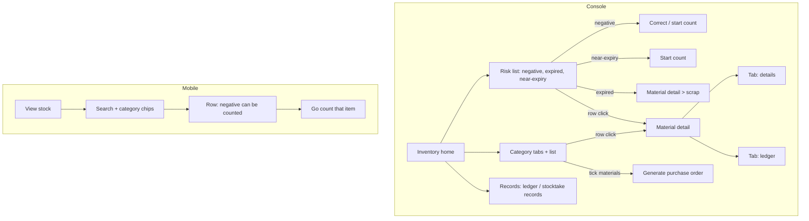

# Stock overview (库存管理 / 查看库存)

| | |
|---|---|
| Area | [Inventory (库存)](../inventory.md) |
| Platforms | Console (inventory home, material detail, ledger and records); Mobile (read-only stock list) |
| Maturity | specified + built in prototype (no Figma, no repo feature) |
| Newest sources | `Inventory management/Inventory PRD/02-Mobile库存管理PRD.md` (2026-09-09); `Vaccine/prds/inventory/修改日志/修改日志-2026-08-14-库存流水移除批次字段.md`, `…-2026-08-14-饲料详情移除批次库存.md`; `Inventory management/Inventory PRD/01-Console库存管理PRD.md` s8.1-8.3, 8.8, 8.10 (header 2026-08-11); `Vaccine/prds/inventory/03-饲料预计可用天数.md` (2026-08-14) |
| Related flows | [receive-stock](receive-stock.md), [stocktake](stocktake.md), [scrap-expired-batch](scrap-expired-batch.md), [negative-stock-correction](negative-stock-correction.md), [purchase-order](purchase-order.md), [material-master](material-master.md), [task-stock-deduction](task-stock-deduction.md), [feed-stock-reconciliation](feed-stock-reconciliation.md) |

## Job
Storekeeper or manager sees what is at risk and how much of each material is left, drills into one material and its history, and starts the action that fixes a risk. On Mobile, field staff only look up how much is left. Nothing here changes stock by itself.

## Trigger and actors
- Console: sidebar inventory > inventory management; business-centre inventory group lists inventory management, ledger, stocktake records, receipts, receive, stocktake (2026-08-14).
- Mobile: toolbox inventory group > "view stock" (查看库存); also reached from a stocktake context and returns there.
- Actors: storekeeper, manager (Console); field staff (Mobile).

## Flow

## Steps
**Console, inventory home**
1. Top: a risk list across all categories with filter chips (expired / near-expiry / negative) and counts; shows the top five by priority (negative > expired > near-expiry), chip shows all. Search, tabs and list filters never change this list.
2. Row actions by risk: negative -> correct or start count; near-expiry -> start count (medicine and semen only); expired -> open the detail and scrap. Feed rows have no count entry. Row click opens the detail.
3. Below: tabs feed / medicine / semen / other, a toolbar (search, status active / stopped / all, default active, a confirm button; Enter also confirms), then the list.
4. List columns by category:
   - Medicine, other: name, brand, status, medicine class, current stock with health bar, 30-day trend (hover shows daily use plus total / average / peak), nearest expiry.
   - Feed: "expected stock" (预计库存), estimated days of use = stock divided by 30-day average daily use, rounded down, colour bands (<=3 red, 4-7 orange, 8-15 yellow, >15 green, a dash with no use); no batch module.
   - Semen: one row per batch (boar ID, breed, available = stock minus reserved, storage place, expiry).
5. Top-right shortcuts: records (ledger and stocktake records), receive, start count. No issue and no differences button here.

**Console, material detail** (breadcrumb only; no local back button)
1. Header: edit material, stop / enable (see [material-master](material-master.md)). Tabs: details, ledger (this material, same columns as the global ledger).
2. Details: basic info (including unit conversions, shown as "1 bag = 40 kg; 1 box = 10 bags"), stock summary (feed adds days of use), trend (7 / 30 / 90 days), batch table for medicine, semen, other (not for feed), risks, consumption analysis.
3. Batch table: sorted expired > near-expiry > nearest expiry > has stock > exhausted; "edit" (expiry, supplier batch no., remark only) and "scrap" on rows with stock.

**Console, records page** — tabs ledger and stocktake records. Ledger filters: date, material / brand / batch search, type; default newest first; the list view has no batch column (the detail ledger does). Stocktake records: one row per count, expand to see book vs actual and a link to the ledger prefiltered to the last 30 days.

**Mobile, view stock**
1. Enabled materials in the four open categories; search by name or brand (case-insensitive, clear button); chips all / feed / medicine / semen / other, horizontally scrollable.
2. Row: name, brand, category, current stock (package unit first, accounting quantity in brackets, e.g. 20.3 bags (20300 kg)); tag only when stock is negative.
3. Order: negative first, then category order, then name. No batches, no detail page.
4. A negative item that can be counted shows "go count and correct", opening that item's count page and returning to the same list state. Empty result: empty state with "clear filters".

## States
| Object | State | How it gets there | What it allows next |
|---|---|---|---|
| Batch | normal / near-expiry / expired / exhausted | by expiry date vs today and remaining stock | scrap (when stock > 0); expired is not auto-frozen |
| Material risk | negative > expired > near-expiry > none | derived from stock and batches (not stored) | correct, count, scrap per risk |
| Material | active / stopped | [material-master](material-master.md) | stopped hidden by default (filter default is active) |

## Rules
1. Risks are computed, not stored; priority negative > expired > near-expiry. No low-stock risk (removed 2026-07-08).
2. Risk list is global and independent of tabs, search and filters.
3. Health bar, days-of-use colour bands and near-expiry window use configured thresholds (exact days not stated in the sources read).
4. Stock value = sum over batches of remaining quantity times unit purchase price.
5. Daily end stock in the trend = yesterday + today's receipts - issues + count adjustment - scrap.
6. Stock cannot be edited from list or detail; reductions only come from scrap, stocktake or task consumption.
7. Feed is shown per material total; no scrap or batch edit on feed.
8. Mobile never shows the ledger or batches (listed as optional in the Mobile PRD).

## Data
| Field | Where | Required? |
|---|---|---|
| Current stock (accounting unit; last receive unit shown in some views) | list, detail, Mobile | shown |
| 30-day use and trend | Console list, count page | shown |
| Nearest expiry | Console list (not feed) | shown |
| Ledger row: change with up/down icon, balance, type tag, date | ledger | shown (detail date only to the day; operator/time added 2026-08-14) |
| Ledger types: purchase receipt, business consumption, consumption reversal, receipt correction, count surplus, count loss, count adjustment, scrap | ledger | shown |

## Edge cases
- No match in search: empty state; no risks: "no stock risk" light text.
- Negative stock stays on the material level with no fake batch.
- A surplus count creates a "surplus adjustment batch" shown with dashes for expiry and supplier and an estimated value.
- Semen is one row per batch, not per material.

## Versions
- 2026-06-24..29: first dashboard, ledger moved from sidebar to a button on home.
- 2026-07-08: safety stock and low-stock risk removed; detail redesigned (overview, trend, consumption).
- 2026-07-29: KPI-card home built then reverted the same day to the risk list.
- 2026-08-07: risks pinned above tabs, independent of them; four open categories.
- 2026-08-11..14: feed became reference-only, was restored, then lost its batch module; ledger list lost the batch column.
- 2026-08-26 / 09-09: Mobile "view stock" settled as read-only.

## Figma and repo
Not in Figma: `[Web] 库存管理 · inventory` (`CIPVXjxWEGV3egSoNS7qMH`) is an empty cover page. The mobile Figma index has no stock screen. No `features/` entry; the runnable prototype is `Vaccine/src/components/inventory/ConsoleInventoryPage.tsx`.

## Open questions
1. Feed: measured stock or calculated reference? 2026-08-11 reference only, 08-12 full stock, 08-14 no batch module (`…-2026-08-12-恢复饲料库存属性与详情.md` vs `Vaccine/prds/inventory/03-饲料预计可用天数.md`).
2. Feed detail trend: removed 2026-08-10, restored 08-11, and `01` s8.3 says all categories show it.
3. "Current stock" vs "expected stock" label for feed (08-12 changelogs disagree).
4. `01` s8.1 still documents the per-category business-centre entries removed on 2026-08-14.
5. Semen has its own stock tab in `Vaccine/prds/semen/00-Console精液管理-PRD.md`; which is the source of truth ([semen-production](semen-production.md))?
6. Whether Mobile should get a batch or ledger view (marked optional).
