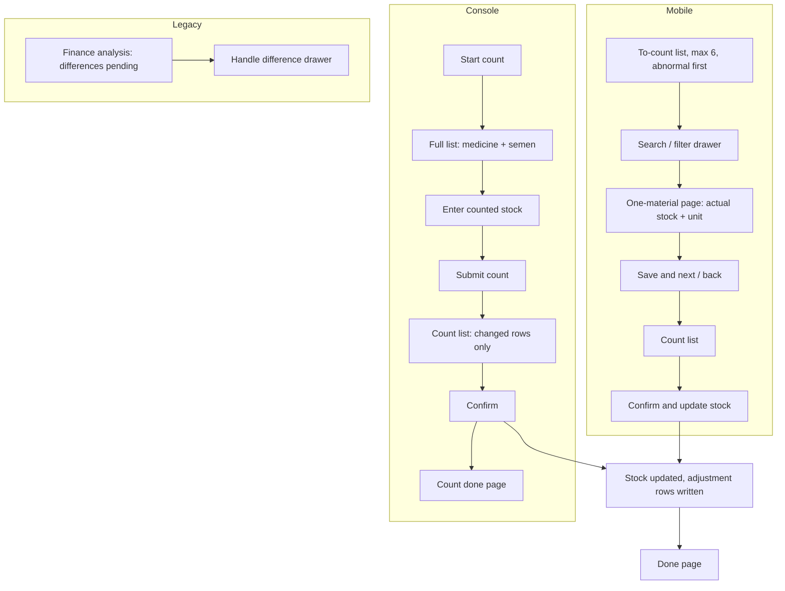

# Stocktake (盘点)

| | |
|---|---|
| Area | [Inventory (库存)](../inventory.md) |
| Platforms | Console and Mobile (direct-adjustment count); Console finance analysis (legacy difference handling) |
| Maturity | specified + built in prototype (direct adjustment); the difference-handling branch is legacy, kept only for seeded data |
| Newest sources | `Inventory management/Inventory PRD/02-Mobile库存管理PRD.md` s8.4-8.5 (2026-09-09); `Inventory management/Inventory PRD/修改日志/修改日志-2026-09-09-Mobile盘点筛选抽屉与列表规范.md`; `Vaccine/prds/inventory/修改日志/修改日志-2026-08-25-Mobile盘点对齐Console.md`, `…-2026-08-07-盘点限定药品与精液.md`; `Inventory management/Inventory PRD/05-库存系统重整版PRD.md` s9.5 (2026-08-26) |
| Related flows | [stock-overview](stock-overview.md), [negative-stock-correction](negative-stock-correction.md), [receive-stock](receive-stock.md), [task-stock-deduction](task-stock-deduction.md), [scrap-expired-batch](scrap-expired-batch.md) |

## Job
Storekeeper or field staff count what is physically on hand for medicine and semen and enter the real total per material. Done means: stock equals the entered count, one count-adjustment ledger row exists per changed material, and the person was never asked to explain the difference.

## Trigger and actors
- Console: "start count" on inventory home, sidebar > stocktake, or from a risk row (negative / near-expiry) which opens the same page filtered to that material.
- Mobile: toolbox inventory group > "count"; also "go count and correct" on a negative item in view stock.
- Actors: storekeeper, field staff. No approval step.

## Flow

## Steps
**Console**
1. "Start count" opens the stocktake page directly: no scope dialog and no modes. Only medicine and semen rows; counting is by material total, never by batch (an expired batch is not its own row).
2. Table: name, category, brand, current stock (in the last receive unit, accounting quantity in brackets; an anomaly line under it such as "near-expiry 850 ml (46%)"; hover shows recent stock changes), 30-day use (sparkline and total), counted stock (empty = no change). Search, category and anomaly filters, sorting.
3. Counted-stock unit defaults to the last receive unit and can be switched among convertible units.
4. "Submit count" -> "count difference confirm" list with only changed rows; summary shows counted, no difference, "actual more" and "actual less" (neutral wording; the count surplus/loss terms are not used while counting).
5. Confirm -> stock changes at once, a count-adjustment ledger row per changed material, "count done" page. A count with no change can still be finished with no ledger rows.
6. Count records (a tab of records): one row per count, expand to a material table (system stock, actual stock, difference with colour and arrow) and a link to the ledger for that material, prefiltered to the last 30 days. No count number is shown on Console.

**Mobile**
1. "To count" list: at most 6 items, ordered negative > expired > near-expiry > none, then 30-day use, then name. One search box and one funnel button. The funnel opens a bottom drawer (category all / medicine / semen; risk all / negative / near-expiry / expired); choices apply only after "apply filters"; reset clears the draft only; page-level "clear" clears applied filters; a badge and summary line show active filters. Searching or filtering shows all matches.
2. Tap a material -> one-material page: current stock, 30-day use, risk, actual-stock input with unit switch, "item X/Y". Buttons: save and back, save and next (last item: save and view list). Empty or invalid input disables both. Unsaved draft + back asks to confirm.
3. Entry equal to current stock is marked checked but not listed as a change.
4. Bottom bar shows filled and changed counts -> count list (changed only; tap to edit again) -> "confirm and update stock".
5. Done page: count number, checked, adjusted, actual more, actual less; actions back to workbench / count again. All equal: "books match, no adjustment" with "finish check" and no ledger rows.

## States
| Object | State | How it gets there | What it allows next |
|---|---|---|---|
| Count entry | empty / filled-equal (checked) / filled-changed | input | changed entries reach the count list |
| Count | in progress / done | confirm | ledger rows written; records row appears |
| Difference (legacy only) | pending / handled | seeded data | handled in finance analysis |

## Rules
1. Scope: medicine and semen only; feed and other are not counted (2026-08-07).
2. Counted by material total; the person enters only the real count; no reason, no method, no location.
3. Confirm adjusts stock immediately. Shortage first reduces existing positive stock; any remainder becomes material-level negative stock. Surplus first offsets material-level negative stock, the rest goes to a surplus-adjustment batch (Mobile PRD s8.4).
4. Effective book stock = count snapshot plus changes confirmed during the count; later movements are never overwritten (`06-库存出库后端逻辑.md` s2).
5. Count loss is not business consumption in consumption statistics.
6. Empty input = not counted, not adjusted; the user need not fill every candidate.
7. Ledger type for every adjusted row is count adjustment (older ledger types count surplus / count loss still exist in the vocabulary).
8. Surplus receipt (a receipt type) carries no amount.

## Data
| Field | Where | Required? |
|---|---|---|
| Counted total + unit | per material | one per counted row |
| Current stock, 30-day use, risk | read-only | shown |
| Count number | Mobile done page | system |
| System stock, actual stock, difference | count records | shown |

## Edge cases
- Material with negative stock: count entry from stock overview or a risk row returns to the same list.
- Count while receipts or tasks continue: handled by the effective-book rule above; exact UI not specified.
- No changes: finish without ledger rows.
- Offline: not stated.

## Legacy branch: difference handling (盘点差异处理) — not current
Reached from finance analysis (button with a pending count). In the prototype a new count no longer produces differences; the page only works on seeded or earlier pending ones. Pending / handled tabs; a handle drawer shows stock changes in the last 30 days first, then a method and reason, no batch picker. Six methods:
| Direction | Method | Ledger type |
|---|---|---|
| surplus | return to original consumption | consumption reversal (+) |
| surplus | correct receipt quantity, amount unchanged | receipt correction (+) |
| surplus | add receipt quantity and amount | receipt correction (+) |
| shortage | add missing consumption / issue | business consumption (-) |
| shortage | correct over-entered receipt | receipt correction (-) |
| shortage | scrap / loss | scrap (-) |
Tolerance auto-handling (`Vaccine/prds/inventory/02-盘点差异自动处理规则.md`, 2026-07-06): within tolerance a small shortage is deducted FEFO and a small surplus returns to the latest-used batch, never a new batch; outside it goes to manual with no suggestion. Tolerances are a few percent (about 2% for vaccine / drug, 5% for the other groups) with a one-pack-unit floor. This doc still names consumables and tools, which can no longer be counted.

## Versions
- 2026-06-24: count built as a modal with four modes, differences with reasons, then direct adjustment.
- 2026-06-26: submit no longer adjusts; differences go to a dedicated page; 06-29..07-01 tolerance rules and six methods.
- 2026-07-06: "start count" goes straight to the full list; modes dropped; differences and issue moved to finance analysis.
- 2026-08-07: scope limited to medicine and semen.
- 2026-08-25: Mobile aligned to Console direct adjustment; 2026-09-09 funnel drawer and ledger-style list.

## Figma and repo
Not in Figma; no `features/` entry. Prototype: `Vaccine/src/components/inventory/` (`confirmStocktakeAdjustment`).

## Open questions
1. Is the legacy difference page still a requirement? `01-Console库存管理PRD.md` s8.11-8.12 describe submit -> auto-handle -> pending; `05` s9.5, the Mobile PRD and the prototype adjust directly.
2. Method list: nine in `01` s8.12, six in the 2026-07-01 changelog and `02-盘点差异`.
3. Mobile PRD s11 excludes semen stock while s8.4 allows counting semen.
4. Console "count surplus / count loss" receipt types and the "surplus adjustment batch" vs 2026-06-30 "never create a surplus batch" for small surpluses.
5. Cost basis of surplus (flagged "finance to confirm", estimated value) is undecided.
