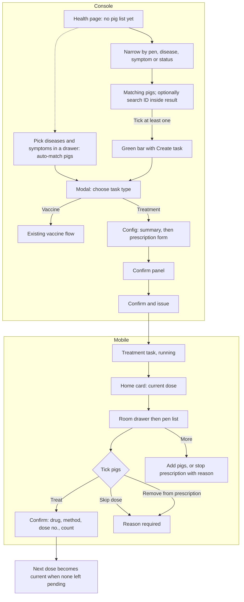

# Treatment task and medical-task entry (治疗任务 / 医疗任务)

| | |
|---|---|
| Area | [Vaccination and medical tasks](../vaccination-and-treatment.md) |
| Platforms | Console (find pigs, create, confirm); Mobile (execute dose by dose); back end (task or prescription, dose expansion: undecided) |
| Maturity | Console entry: specified + built in prototype. Mobile execution: built only (no PRD) |
| Newest sources | `Vaccine/prds/medical-task/00-疫苗任务与治疗任务统一入口方案.md` (2026-06-20, edited 06-29); `Vaccine/prds/medical-task/修改日志/` (six logs, 2026-06-17 to 06-29); `Vaccine/src/components/MedicalTaskSchemePage.tsx`; `Vaccine/src/mobileTreatmentTaskUtils.ts` and `MobileVaccinationPage.tsx` |
| Related flows | [vaccine-task](vaccine-task.md), [mobile-vaccination](mobile-vaccination.md), [material-master](material-master.md), [task-stock-deduction](task-stock-deduction.md), [mobile-home-toolbox](mobile-home-toolbox.md) |

## Job
A sick or at-risk group of pigs gets a planned course of medication. A Console user finds the pigs on the health page, creates the task, and the worker on Mobile gives each dose in turn, with room to skip, remove pigs, add pigs or stop the whole course. One entry button serves both vaccine and treatment tasks; the two flows stay separate behind it.

## Trigger and actors
- Console: health page (健康诊疗) selection bar > create task; the prototype menu 治疗 shows two wirings of the same entry (scheme A, pick task type first; scheme B, pick drug first).
- Actors: dispatcher or vet staff on Console; farm worker on Mobile; back end (turns the task into doses; undecided how).
- The treatment card sits on Mobile home beside the vaccination card.

## Flow

## Steps
**Console, find pigs (health page)**
1. Opens with no list, only filters and an empty state. Filters: pen or house, disease tag, symptom tag, diagnosis status (tabs or select: all, urgent, priority, routine watch). Reset sits next to the filters.
2. A pig-ID search narrows only within an existing filtered result. ID alone shows nothing. The design assumes up to 100 000 pigs.
3. The green selection bar (count, create task) appears only after at least one pig is ticked, and hides again at zero.
4. Alternative: a disease-and-symptom drawer. Choosing diseases and symptoms shows the matching tags and pig count live; confirm is disabled at zero matches. The task then starts as "create by disease" instead of "manual ticking".

**Console, create**
5. Choose task type (modal, scheme A): vaccine or treatment, then next. Scheme B instead asks for a cascading drug pick (category > drug) on the config page and lets the drug category decide the form. Step bar: pigs, task type, task info, confirm (scheme B drops task type).
6. Config page. Top summary has three blocks only: how created, number of target pigs, source (for example "health diagnosis, manual ticking" or the disease and symptom tags). Never ear tags. No explanatory card between summary and form.
7. Prescription form (treatment): a prescription holds one or more drug blocks; add drug appends a block, delete is disabled with one. A history-prescription button is shown. Per drug: drug, brand or form, administration method (intramuscular, drinking water, in feed in the mock), dose (min 0.5), dose unit (mL, mg or g in the mock), start date, multi-dose switch (off). Off means one dose and no dose-count field. On adds dose count (min 2, default 2), interval and interval unit (hours, days, weeks). Notes field per the PRD table.
8. Confirm panel (one panel, not three cards): task info (content, time, target count), execution object (how created, source, disease and symptom tags if any). Back and "confirm and issue" sit at its foot, with a line that tasks will be generated and synced to Mobile.

**Mobile, execute**
9. Home card "treatment task": drug name, "dose N of M" pending, done, pending and total pigs. Shown only while the task is not terminated. Tap opens a room drawer, then the room page with two tabs, treatment and prescription detail.
10. Treatment tab: current-dose card (drug, form, method, dose per pig, dose number), search by identity or pen, a "selected N" strip with select-all, pigs grouped by pen with a status per row (done, skipped, removed rows cannot be ticked).
11. Bottom bar: remove from prescription, skip dose, treat. Each needs a selection. Treat opens a confirm with drug, method, dose number and pig count; confirm marks the pigs done for that dose. Skip and remove open a dialog that requires a reason.
12. More (header): add pigs (pick from candidates, reason required, added pigs become pending in all doses) and stop prescription (reason required, "later treatment will stop").
13. Prescription detail tab: prescription ID, state, pig count, houses, target diseases and symptoms, creator and time, notes, and one card per dose labelled executed, executable or waiting, with the interval for doses after the first.

## States
| Object | State | How it gets there | Allows next |
|---|---|---|---|
| Treatment task | running (执行中) | Issued | Treat, skip, remove, add pigs, stop |
| Treatment task | stopped (已终止) | Stop prescription with reason | Card disappears from home |
| Treatment task | done (已完成) | Named in the model; no code path sets it | Not defined |
| Pig in a dose | pending, done, skipped, removed | Created pending; actions above | Only pending can be acted on |
| Dose | executable / waiting / executed | Current dose is the first with any pending pig; executed when none pending | Later dose becomes current |

## Rules
1. Phase one is "unify the door, keep the flows apart": no one big form, no drug-type switching, no history migration, no multi-dose or interval fields on vaccines, no reuse of vaccine review for treatment.
2. Treatment and vaccine are separate business objects. Suggested tags on each: category medical, type vaccination or treatment, source vaccine task, health diagnosis or unified create.
3. Pig list rule: never an unfiltered list; ID search cannot be the only criterion; the green bar needs a tick.
4. Config layout is the same for vaccine, veterinary drug, health product and (planned) disinfectant: summary, form, footer; only fields change. Health products use the treatment flow but must show their category.
5. Multi-dose is off by default. Turned on, dose count is at least 2.
6. Skip, remove, add and stop each require a written reason on Mobile.
7. Removing pigs and skipping act on the dose currently shown (implied by the code; see Open questions).
8. A pig's cell can be acted on only while pending.
9. No withdrawal period, contraindication check or approval is specified (listed as questions in PRD 00).
10. Stock handling for the drug given is not described here; see [task-stock-deduction](task-stock-deduction.md).

## Data
| Field | Where | Required |
|---|---|---|
| Target pigs (ticked or by disease and symptom), source | Console | Yes |
| Disease and symptom tags | Console, shown on Mobile detail | By entry |
| Drug (category, drug, brand or form), method, dose, unit, start date | Prescription form | Yes |
| Multi-dose flag, dose count, interval, interval unit | Prescription form | Only if on |
| Notes | Prescription | No |
| Prescription ID, creator, time, state | System | System |
| Per-dose per-pig status, reasons for skip, remove, add, stop | Mobile | Reason yes |

## Edge cases
- Health page with filters but nothing ticked: no create button. Zero pigs matching a disease selection: confirm disabled.
- Selection of very many pigs: the summary never lists tags.
- Wrong task type chosen: the modal can be cancelled or reversed before the form; context after closing is not specified.
- The prototype's form fields and confirm text are static mock values, not validated inputs.
- Mobile mock has two pigs without an ear tag, shown with a placeholder label.

## Versions
- 2026-06-17 health page must filter first; configuration skeleton shared by drug types.
- 2026-06-19 explanation card dropped; summary shows no ear tags; green bar only after a tick; multi-dose hidden by default.
- 2026-06-20 unified entry plan: scheme A chosen for phase one, scheme B kept as long-term.
- 2026-06-29 confirm page becomes one panel.
- Mobile treatment has no change log; the Figma health-and-treatment mobile file is dated 2025-09-04.

## Figma and repo
Console treatment creation and the unified modal are not in Figma. Mobile Figma file 健康与治疗 (`pvx1wum54VYOsIjep7haoZ`, node `6003:11580`, 28 screens in 9 groups) matches the repo placeholder `features/prescriptions` ("a planned or prescribed course, dose by dose"). Repo `features/treat` is the ad-hoc, per-pig treatment (decided 2026-10-19 to be separate); related health pages are `triage`, `disease`, `health-record`.

## Open questions
1. Is a treatment a task, or a prescription that generates dose tasks? Who expands multiple doses, at creation or by a scheduler (backend questions 4 and 5 in PRD 00)? The mock labels later doses as generated after the previous one finishes.
2. Where does the unified entry live: vaccine page, health page, or a new page (frontend question 1)? The prototype uses a separate 治疗 menu; the entry button name (create task vs create medical task) is unresolved.
3. Is removal from the prescription per dose or for the whole course? The code marks only the current dose as removed.
4. What marks a treatment task done? The model has the state, but only the stop action changes it.
5. Which drug taxonomy applies (five material classes in the handover, the five categories in this prototype, or the repo `treat` catalogue)? See the area doc.
6. Dose units: PRD 00 lists mg and mL; the prototype also offers g.
