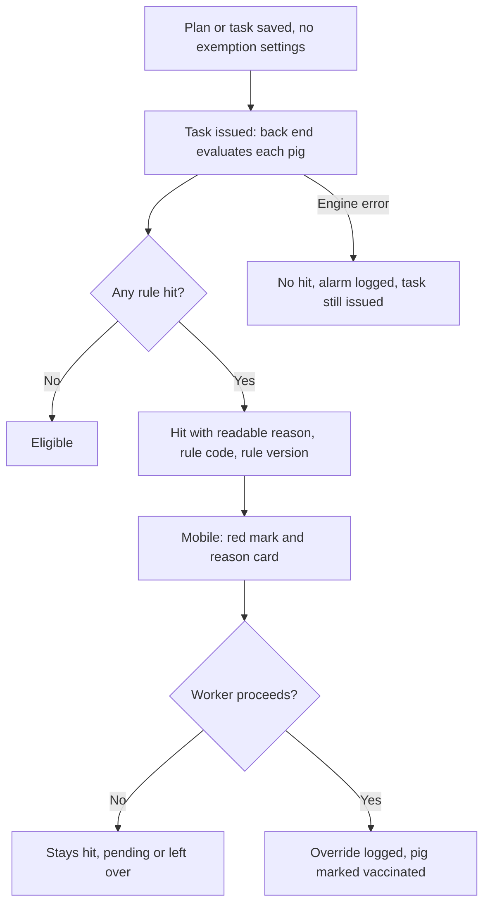

# Backend forced exemption (后端强制豁免)

| | |
|---|---|
| Area | [Vaccination and medical tasks](../vaccination-and-treatment.md) |
| Platforms | Back end (rule engine); Mobile and Console only display the result |
| Maturity | specified + built in prototype (display only; the rule engine itself is not in the handover) |
| Newest sources | `Vaccine/prds/vaccine prd/06-后端强制豁免规则.md` (2026-04-29, thin); `Vaccine/vaccine prds/06-后端强制豁免规则-PRD.md` (2026-04-23, the only copy of the rule list); `Vaccine/prds/vaccine prd/09-疫苗计划与疫苗任务测试用例.md` (2026-07-06); `Vaccine/docs/测试报告-2026-08-18-免疫计划-多角色.md` (2026-08-18) |
| Related flows | [mobile-vaccination](mobile-vaccination.md), [vaccine-task](vaccine-task.md), [vaccination-plan](vaccination-plan.md) |

## Job
Decide, pig by pig, whether vaccinating today is a bad idea (moved recently, about to farrow, sick, vaccinated too recently, and so on), and show the worker that warning with a readable reason. The rules live only in the back end so every farm and every task uses the same ones. The worker can still go ahead; if so the system keeps a record.

## Trigger and actors
- Evaluated by the back end when a task is issued, and again when Mobile or Console asks for the pig list.
- Actors: rule engine (decides), vaccinator on Mobile (sees, may override), Console user (sees the hit count and per-pig flag in task detail). Nobody configures exemptions in the UI.

## Flow

## Steps
1. **Console, plan and task forms:** no exemption field, list column or preview line. The plan request sends an empty list.
2. **Back end, at issue time:** for each pig in scope, run the fixed rules and return `exemptionHit` (true or false), a readable reason, a rule code, the rule version and the evaluation time.
3. **Mobile pig list:** a red exclamation mark on hit pigs. Tapping it opens a floating card with the reason.
4. **Mobile pig drawer:** shows the same reason; the vaccinate button changes to "vaccinate anyway".
5. **Override:** pressing it vaccinates the pig and records the completion as forced; the back end stores a manual-override log with the state OVERRIDDEN_AND_VACCINATED.
6. **Console task detail:** shows the exemption hit count in task info and an exemption column per pig.

## States
| Object | State | How it gets there | Allows next |
|---|---|---|---|
| Pig in task | ELIGIBLE | No rule hit | Normal vaccination |
| Pig in task | EXEMPT_HIT | At least one rule hit | Worker leaves it, or overrides |
| Pig in task | OVERRIDDEN_AND_VACCINATED | Hit, then vaccinated anyway | Final |

## Rules
1. Rules are fixed in the back end, versioned, with an effective time, so history can be traced. Console has no way to edit them.
2. A hit is advisory. It never blocks Mobile work.
3. Any single rule hit is a hit. If several hit, return a main reason and, if possible, the list.
4. Fixed rule set (from the old PRD; windows are days):
   - Movement and entry: after a move or regroup 0-5; after entry or purchase 0-7.
   - Reproduction: before farrowing 5; after farrowing 5; before mating 3; after mating 7; perinatal window around farrowing 7 on both sides.
   - Health: pig currently diseased or abnormal; less than 7 days since the last vaccination (see the brand interval in [material-master](material-master.md)); after castration, tail docking or teeth clipping 0-3.
   - Management: after weaning 0-5; after transport 0-3; after a feed change 0-3.
   - Age: 0-3 days after birth; maternal-antibody window, usually 21-35 days of age, taken from the vaccine configuration.
5. A pig whose key date is missing: that rule is "cannot compute", logged as an evaluation error, and the other rules still run. Never swallow the error silently.
6. Engine failure falls back to "no hit", writes an alarm and does not stop the task from being issued.
7. An override must leave a trace; changing the status without a log is not allowed.
8. The immune-interval warning on Mobile (last vaccine, date, suggested date) is a separate message built from the brand interval and the pig's last vaccination; the old PRD counts "less than 7 days since last vaccine" as a rule, doc 09 treats the interval warning on its own.

## Data
| Field | Where | Required |
|---|---|---|
| exemptionHit | Back end to Mobile and Console | Yes |
| Reason text, rule code | Same | Only on hit |
| Rule version, evaluated-at time | Back end | Yes |
| Override flag and log | Back end | On override |
| `exemptions` in plan request | Console to back end | Always empty |

## Edge cases
- No hits in a task: no red marks, count 0.
- The Console summary says 5 hits but per-pig rows all read "miss" (live defects ST-07, ST-26, 2026-08-18; also 08-04). The count and the flag come from different sources, and the "hit / miss" wording confuses.
- Rule list changes mid-task: tasks keep the version they were evaluated under (implied by "versioned").
- Re-evaluation on query may change a pig's flag between issue and execution; the PRD does not say which wins (see Open questions).

## Versions
- 2026-04-14 learning note: warn first, then forced vaccination with a reason, or defer.
- 2026-04-23 old PRD: front-end configuration dropped; fixed 15-rule list, state machine, rule fields.
- 2026-04-29 new PRD 06: the rule list and the state machine are no longer written, only the principle.
- 2026-05-21 Mobile PRD: red mark opens a reason card.
- 2026-07-06 doc 09: forced completion recorded as a subtype (VMOB-018).

## Figma and repo
Not specifically in Figma; the red mark appears in the Mobile frames listed in [mobile-vaccination](mobile-vaccination.md). No matching `features/` folder. The prototype's `Vaccine/src/components/VaccinePlanPage.tsx` still contains a full rule builder (pre-start, post-end, post-transfer, post-entry, status, disease, symptom) that saves an empty list: dead or half-removed code.

## Open questions
1. Which document owns the rule list now? The new PRD dropped it; the old PRD is the only copy.
2. Warn or skip? PRD 06 says advisory with override. Text still in `VaccinePlanPage.tsx` says that pigs in an exemption window are skipped automatically and rescheduled later.
3. Does the system reschedule exempt pigs automatically, or does a person do a top-up (see [vaccine-task](vaccine-task.md))?
4. Is a reason required when overriding? The learning note says yes; the PRD and doc 09 do not say.
5. Should the main reason and the full hit list both be returned (PRD says "if conditions allow")?
6. Who may change rule windows, and how is a new version rolled out?
