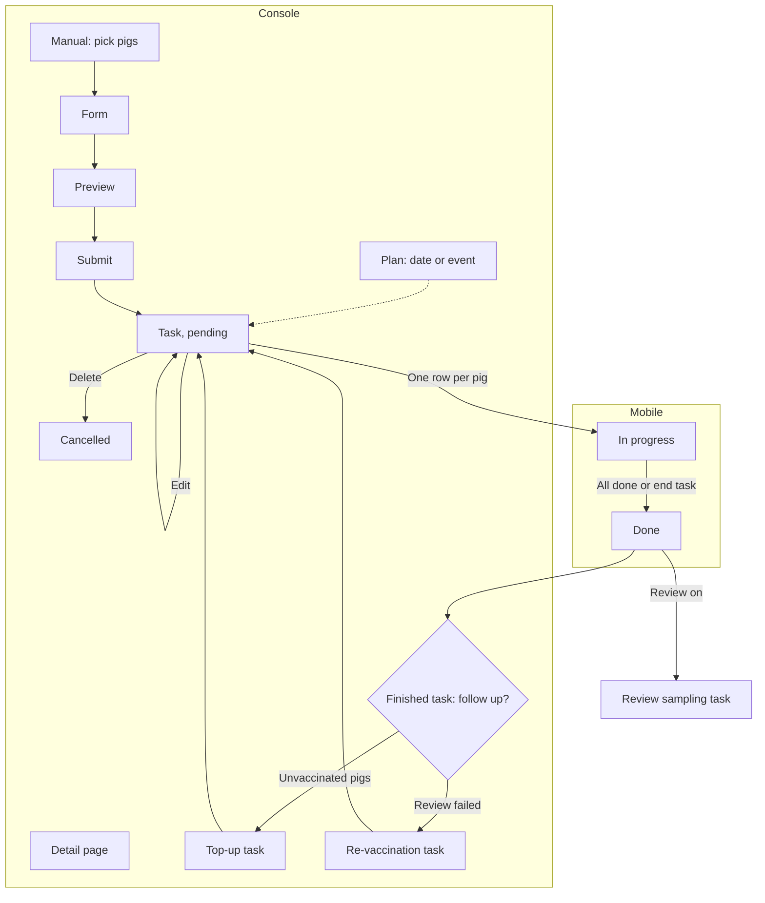

# Vaccine task (疫苗任务)

| | |
|---|---|
| Area | [Vaccination and medical tasks](../vaccination-and-treatment.md) |
| Platforms | Console (list, create, detail, follow-ups); back end (generation, state sync); Mobile receives the work (see [mobile-vaccination](mobile-vaccination.md)) |
| Maturity | specified + built in prototype for the whole flow; Figma and the live dev product drop manual creation and the task list (see Open questions) |
| Newest sources | `Vaccine/prds/vaccine prd/04-疫苗任务.md` (2026-05-22); `.../07-Console接种任务详情.md` (2026-05-22, old state words); `.../09-疫苗计划与疫苗任务测试用例.md` (2026-07-06); `Vaccine/src/components/VaccineTaskWizard.tsx`, `VaccineTaskDetailPage.tsx` |
| Related flows | [vaccination-plan](vaccination-plan.md), [mobile-vaccination](mobile-vaccination.md), [immune-effect-review](immune-effect-review.md), [vaccination-exemption](vaccination-exemption.md), [treatment-task](treatment-task.md), [material-master](material-master.md) |

## Job
A vaccine task binds a set of pigs to one vaccine, method, dose and date, and sends it to Mobile as work. Console users watch it from "to do" to "done", fix it while it is still pending, and, once it is finished, open follow-up tasks for pigs that were missed or for a failed immune review.

## Trigger and actors
- Automatic: a plan date or event creates the task (see [vaccination-plan](vaccination-plan.md)); creator shown as "auto".
- Manual: dispatcher (调度员) uses 疫苗任务 > 创建疫苗任务 in the prototype, or the unified create entry (see [treatment-task](treatment-task.md)).
- Follow-up: from the detail page of a finished task.
- Other actors: vaccinators on Mobile change progress; laboratory staff write review results back.

## Flow

## Steps
**Generation (back end)**
1. On the plan date or when the event fires, the back end evaluates the pig filter at that moment, freezes a snapshot (vaccine, brand, method, dose, date, review config) and creates the task as pending. For batch plans it also stores production line and batch. Creator is "auto".
2. The task is pushed to Mobile as one row per pig. Exemption hits are computed per pig ([vaccination-exemption](vaccination-exemption.md)).

**Console, manual creation (prototype; see Open questions)**
3. Step 1, choose pigs: table with search by pig ID, Zone/Unit filter and column sorting; next is disabled with nothing selected. Selection survives filtering.
4. Step 2, form: vaccine, brand, method (fills from the brand's first method; method cannot be chosen before a brand), dose (min 0.5), unit, vaccination date, optional review switch (off by default). A vaccine missing from the list can be added in a small add-medicine dialog that selects the new item afterwards. Multi-dose, interval and interval unit are gone.
5. Step 3, preview: date, vaccine, brand, method, dose, number of pigs and review config. No task ID yet. Back keeps entries. Finish submits.
6. The system assigns the ID, sets creator type to manual, status pending, creates the Mobile rows and returns to the task list.

**Console, list and detail**
7. List (prototype, by status tabs: pending, in progress, done): task ID, vaccine over method, date, target pigs, creator (auto tag, or creator and time). The done tab adds "actual / planned" counts. Brand, dose, operator are detail only. Only pending rows show a delete icon; every row has an eye icon.
8. Detail is one vertical stack: plan info (manual tasks fall back to the vaccine name), task info with a progress bar, review settings (only if review was on), review result (only after lab results arrive), pig list, related-task bar. Pig list columns: pig ID, batch-line (a dash if empty), room, pen, exemption hit; done rows add operator and time. Pigs are split into vaccinated and not vaccinated.
9. Pending task: Edit opens the pig step with the original pigs; saving overwrites the snapshot, keeps the ID and regenerates Mobile rows. Delete asks to confirm, sets status cancelled, removes Mobile rows and keeps the Console row for audit.
10. Top-up (补充接种): see Rules 7 and 8. Re-vaccination (重新接种): see Rule 9.

## States
| Object | State | How it gets there | Allows next |
|---|---|---|---|
| Task | pending (待接种) | Generated or created | Edit, delete, Mobile execution |
| Task | in progress (接种中) | First pig vaccinated on Mobile | Read only |
| Task | done (已完成) | All pigs done, or vaccinator ends the task on Mobile | Top-up, re-vaccination, review chain |
| Task | cancelled (已取消) | Pending task deleted | Audit only |
| Task type | plan / manual / top-up / re-vaccination | Source of the task (test doc 09) | Shown as label |
| Done task | follow-up flag: needs redo / redo arranged | Unvaccinated pigs, or review failed; arranged once a follow-up task exists | Which buttons show |
| Follow-up reason | not vaccinated, review failed | Set when the task finishes or the result is written back | Button choice |

## Rules
1. Status words are fixed to pending, in progress, done, cancelled (test doc 09). Older documents use other words; see Open questions.
2. Task type (plan, manual, top-up, re-vaccination) and creator type (auto or manual) are different dimensions. Top-up and re-vaccination count as manual.
3. A task is a snapshot. Master-data and plan edits never change it; Mobile reads the snapshot, not live data.
4. Only pending tasks can be edited or deleted. In progress and done are read only, so Console cannot change the numbers under a worker.
5. Empty pig selection and a missing vaccine or method block submission; a missing brand may show a dash but whether that is allowed is not decided.
6. A finished task with review on creates one review sampling task automatically. No review, no sampling task.
7. Top-up button: visible only when the task is done, unvaccinated pigs exist, the follow-up flag is "needs redo", and only on the not-vaccinated tab. All unvaccinated pigs start ticked; the user may untick some, and none ticked disables the button. Only rows in the not-vaccinated group can be ticked (test VT-SUP-003). Step 2 opens with vaccine, brand, method, dose and unit prefilled and locked; only the date is entered, empty and required. The last button reads "finish top-up". Result: a new pending task, manual, linked to the source; the source flag becomes "redo arranged".
8. If a whole-batch re-vaccination already exists the top-up button is greyed out with a question-mark hint that no top-up is needed.
9. Re-vaccination button: on the review result card, only when the review result is failed and the flag is "needs redo". Target is the original target pigs, minus any pigs that already have a top-up task: in that case a confirmation says those pigs will not be included, and if they cover the whole range no task is created. Page title "re-vaccination", locked fields, empty date, final button "confirm vaccination". If the new task has review on, finishing it creates a new sampling task; earlier rounds stay.
10. Unvaccinated pigs after the task ends stay for Console to top up later; the vaccinator ending a task on Mobile never deletes them.
11. Related-task bar links source and children both ways (top-up, re-vaccination).
12. New tasks never show multi-dose or interval fields; historical tasks may keep them (VX-002).

## Data
| Field | Where | Required |
|---|---|---|
| Task ID (system), status, task type, creator type, creator and time | List, detail | System |
| Vaccine, brand, method, dose, unit, date | Form, snapshot | Brand optional per business setting |
| Target pigs | Pig step | Yes |
| Production line and batch | Batch-plan tasks | System |
| Review config (antibody, method, container, interval, ratio, threshold) | Form | Only if on |
| Vaccinated / target counts, operator and time (first start), per-pig operator and time | Mobile write-back | System |
| Follow-up flag and reason, source and child task links | Detail | System |

## Edge cases
- Pending task with no pigs: detail shows an empty state asking to go back and add pigs. In-progress task with no write-back yet: progress 0 with a note that the floor has not reported.
- Brand empty or a dash in history: show a dash or "no brand", never null.
- Delete of a pending task also clears it from Mobile home and room lists (VX-005); Mobile progress and Console status stay in sync (VX-006, VX-007).
- Failed submit keeps the draft (VX-008). Cancelling an edit returns to detail without saving.
- Live product shows 10 of 74 pigs in one task without pig ID or batch (ST-08) and, for the top-up, empty fields instead of the locked ones (ST-21).

## Versions
- 2026-05-03 first task PRD: dose count and interval fields, only "not started" tasks deletable.
- 2026-05-04 to 05-22 numbered PRDs: multi-dose removed, edit and delete for pending, cancelled state, auto/manual creator, detail by state.
- 2026-05-19 to 05-22 top-up and re-vaccination built around the follow-up flag and reason.
- 2026-07-06 test doc 09 fixes the four status words and four task types.
- Undated: Figma marks manual creation as "not now" and the list pages as "gone".

## Figma and repo
Figma 🖥 📱 免疫: detail by state `11019:3284`, `11536:12508`, `11081:5660`, `11536:13025`, `11081:6410`, `11536:13810`; related tasks `11684:16663`; top-up and re-vaccination `11169:10470`; manual create `11019:3521`, `11022:6658`, `11022:8027`, `11024:3562` (marked not now); list `11017:2647`, `11019:2803`, `11017:2699`, `11019:2122` (marked gone). Repo `features/`: only `pig-profile` has a single-pig "record vaccination" card, a different task grain.

## Open questions
1. Is manual creation and the task list in or out? PRD 04, doc 09 and the prototype say in; Figma and the live dev product (reports 07-14, 08-18) say out or deferred.
2. Status words: `07-Console接种任务详情.md` uses 进行中 and 已检测; `04` and doc 09 use 接种中 and 已完成. Doc 09 settles it, but 07 and `Vaccine/AGENTS.md` were not updated.
3. Are the follow-up flag and reason shown in the list? PRD 04 says no; doc 09 says detail only.
4. Does the live product pre-fill top-up fields (PRD) or leave them empty (ST-21)?
5. Are brand-less tasks allowed (PRD 04 leaves it open)?
6. Vet confirmation and plan archiving after a pass appear only in the old notes `Vaccine/docs/GLOBAL_IMMUNITY_DATA_FLOW.md`; no PRD kept them.
