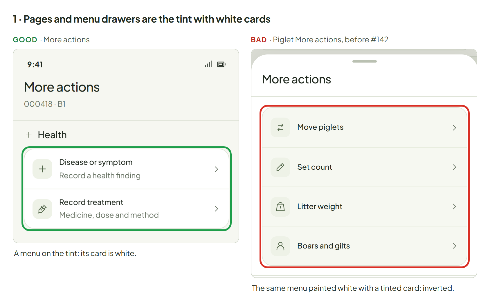
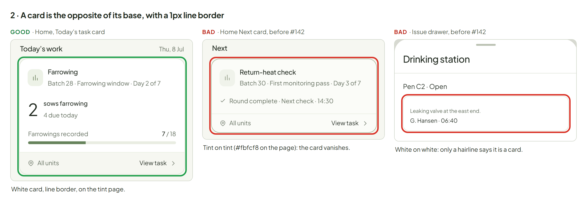
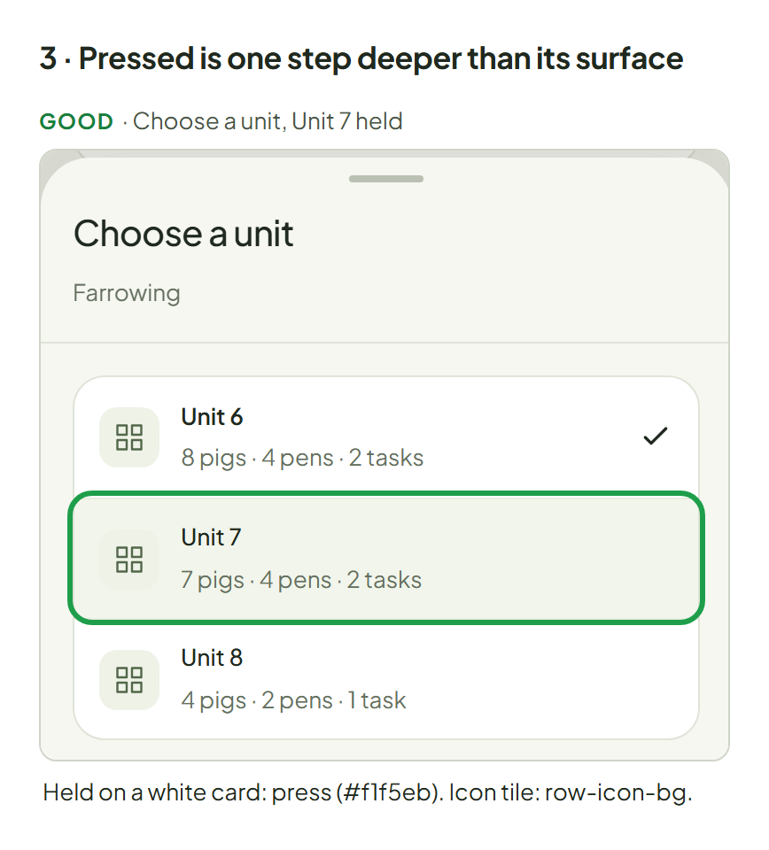
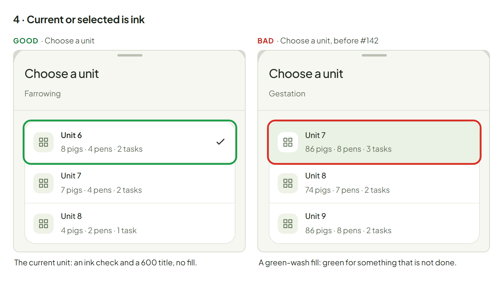
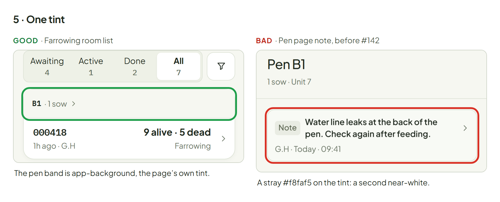
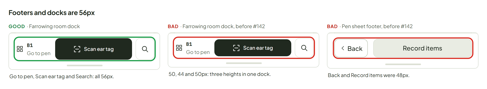

# Surfaces: bases, cards and colour

Owner ruling, 2026-11-03 (replaces 2026-10-12; [canvas](https://claude.ai/artifact/BugjQscz9ZjPy9hm8kMggg)). **Read this before you build or change any screen, sheet or component.** The rule is mechanical, so most of it can be checked without taste: every base is the tint, every card is white, and colour appears only where this page says it does. A guard test (`ux/system/surfaces.test.cjs`) fails the regressions most likely to come back: a card in any colour but white, a drawer or dialog that is not the tint, a green current or selected fill, a multi-select box in any colour but `select-mark` or its row tinted, and a footer or dock button under 56px.

## The rule

1. **Every page, drawer and dialog is the tint (`app-background`).** No white drawers, whatever the drawer holds: a menu, a form, a record, a filter, a search. Medicines is the reference.
2. **Nothing sits loose on the tint: every group is a white card with a 1px `line` border.** A row list is one white card; a control (a range, a Segment, a set of chips) sits in a card; a tile stands alone; a heading sits on the tint above its card; a field is its own white box. Nothing is flat (white on white) and nothing is tint on tint.
3. **Docks, footers and bottom navs are white with a `line` on top;** footer buttons are 56px. A dialog's footer sits on the dialog's tint.
4. **Read-only or tappable, a card is the same white.** This retires 2026-10-12's "tint is for reading, white is for tapping". Icon tiles are `row-icon-bg`; pressed is `press`.
5. **Current or selected is ink:** a ✓ or an ink ring. No green fill and no inset marker bar, anywhere. **The one exception is the multi-select box** (owner, 2026-11-03): a ticked checkbox is `select-mark` (the green of Counting's + Born alive key) with a white tick, and its row stays white, with no fill behind it.
6. **One tint.** `inset`, `surface` and `ground` are aliases of `app-background`; there is no second or third near-white. A stray hex tint (`#f6f7f2`, `#fbfcf8`, `#f8f9f3`, `#f8faf5`…) is a bug.

The test is structure, not subject: a container is the tint, a card or tile is white, a row list is one white card, a footer is white.

Green means done, recorded or synced, and a ticked multi-select box; nothing else. Amber and red washes mean status and are never a card's resting colour.

**Fills and washes (owner, 2026-10-14).** Fills colour a status that covers a whole area (a pen tile); washes stay text backgrounds; a fill is never a card's resting colour. The washes measure ΔE 2.8 from the tint and read grey at tile size, so an area takes a fill: `amber-fill` and `progress-fill`, each with its own dark ink, at 85% strength.

### Which context is my screen?

| Screen | `data-st-context` | Base | Cards | Pressed |
|---|---|---|---|---|
| An app page (Home, a pen page, a record page, the pig profile) | `page` | tint | white | `press` |
| A drawer: a menu, a form, a record, a filter, Find | `drawer` (the default) or `menu` | tint | white | `press` |
| A dialog | (`.dialog`) | tint | white | `press` |
| A dock, footer or bottom nav | (inside any of the above) | white, `line` top | | |

`drawer` and `menu` paint the same; the name only picks a sheet's sizing rules in some prototypes. `skeleton` (the task skeletons nobody has designed yet: Piglet processing, the production task, Maintenance) keeps the old white drawer with tinted cards until each is designed (owner, 2026-11-03). Screens choose a context and never paint a panel colour. The context sets `--st-panel-bg` (a card's colour, always paper) and `--st-press` (a press); components read them. `.st-panel.st-panel.st-panel` beats any page rule on purpose, so a screen that sets `background` on a panel loses and looks "almost right by accident".

**Status colours (owner, 2026-11-02).** A status takes one hue on every base: a light fill with same-hue ink when the shape holds a number, the mid-tone mark for a bar segment or dot, the dark ink for a word; waiting is the empty track or an outline. The table and its rules are in [README.md](README.md) › Colour.

## Colour

| Part | On the tint (every base) |
|---|---|
| Card | `paper`, 1px `line`, `radius-panel` |
| Group head band (inside a card) | the card's own white, set off by its divider. Kept for now: the piglet-processing pen sheet's Day card keeps its tinted band (Piglet processing is not designed yet, owner 2026-10-20) |
| Row divider | `rule` |
| Icon tile | `row-icon-bg` |
| Pressed row | `press` (`#f1f5eb`) |
| Current row (`aria-current`) | ink ✓ in the right rail, 600 title, no fill |
| Ticked or multi-selected row | `select-mark` checkbox with a white tick; no fill |
| Ticked task item (Row · Task item) | ink disc; `well` fill (unchanged: Piglet processing, its one user, is not designed yet, owner 2026-11-03) |
| Selected tile (a choice tile, a pen cell) | 2px `ink` ring on `paper`, no fill |
| Field | a white box with `field-border` |
| A Segment | a `line` grey track, no border; the chosen option a white thumb with `shadow-handle` (owner, 2026-11-03: the iOS segmented control). It stands alone on the tint, never in a card |
| A filter (FilterSheet section) | its title on the tint; the chips or the range (histogram, rail, ends) in one white card; a Segment or a picker field stands alone |
| An empty optional row | a quiet `well`, borderless; once it holds something (Photos with photos) a white card with its contents inside |
| Footer, dock, bottom nav | `paper`, `line` top border; a dialog's footer sits on its tint |
| Status wash (amber, red) | only for a status, never a card's resting colour |
| Status fill (a pen tile) | `amber-fill` / `progress-fill` with `amber-fill-ink` / `progress-fill-ink` text and no border, only for a status that covers a whole area; never a card's resting colour |

## Examples

An example is good only when the whole screen is approved, not just its colours. Good examples come from screens with an owner approval record (`features/*/approvals.json`) or from parts the owner endorsed: More actions, Your sections, Home's Today task card, Choose a unit, the piglet-processing pen sheet's Day card, the Farrowing room list and its dock, and the Inspection walk roster. Bad examples are `main` before #142 (`dd78778`), where the defect was real. Each board has at most three crops; the outline marks the part the caption is about: green is good, red is bad.

### 1. Pages and drawers are the tint with white cards

Green: More actions on the tint with a white card. Red: the same menu in piglet processing before #142, white with a tinted card (inverted). Since 2026-11-03 every drawer follows the green one, whatever it holds.

### 2. A card is the opposite of its base

Green: Home's Today task card, white with a line border on the tint. Red: the old Next card, `#fbfcf8` on the tint, and the old evidence card, white on a white drawer; neither reads as a card.

### 3. Pressed

Green: Unit 7 held in Choose a unit: `press` on a white card, with the icon tile on `row-icon-bg`.

### 4. Current is ink

Green: the current unit is an ink ✓ and a 600 title, no fill. Red: the same picker before #142 filled the current unit `green-wash`, green for something that is not done.

### 5. One tint

Green: the room list's pen band is `app-background`, the page's own tint. Red: the old pen note card, a stray `#f8faf5` on the tint, a second near-white nobody can see.

### Footers and docks are 56px

Green: the Farrowing room dock, all three buttons 56px. Red: the same dock before #142 (50, 44 and 50px) and the old pen sheet footer (48px).

Footer and dock buttons (sheet footers, task docks, the room dock, bottom bars) are `--footer-height` (56px). Every other button and target is at least 44px. Do not raise `--control-height` for this: steppers, banner actions and row buttons read it.

## How to build with it

- Open any drawer with `SentriUI.sheet({ … })` (`K.drawer({ … })` in a task); it is the tint with white cards. `surface: 'menu'` paints the same.
- Put every group in a white card: a row list, a control, read-only text. A heading sits on the tint above its card.
- Put a list of rows in a card: `rowGroup(...)` or `
`. A single card per list; no card inside a card.
- Show the current row with `attrs: { 'aria-current': 'location' }`; Row draws the ✓. Do not add a fill, a bar or a green colour.
- Read `var(--st-panel-bg)` for a card's colour and `var(--st-press)` for a press in screen CSS. Never write a tint hex.
- A dock or footer button uses `var(--footer-height)`.
