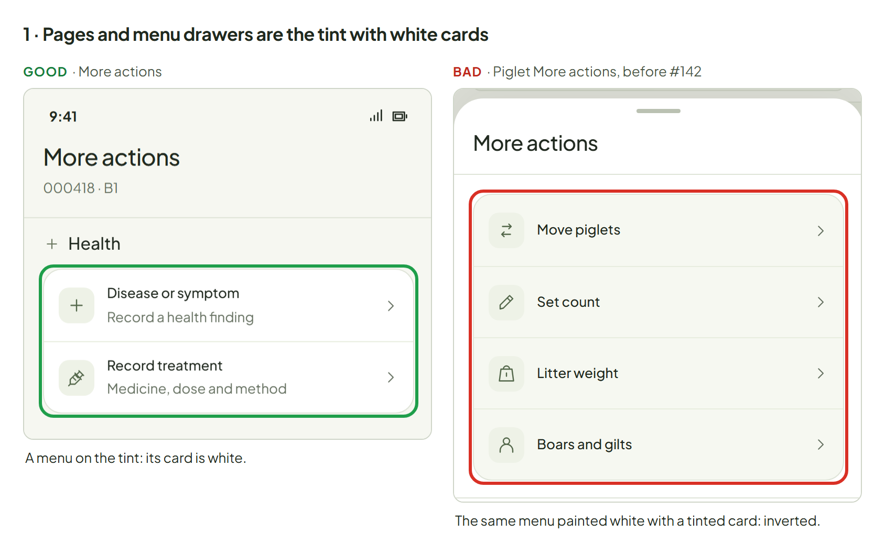
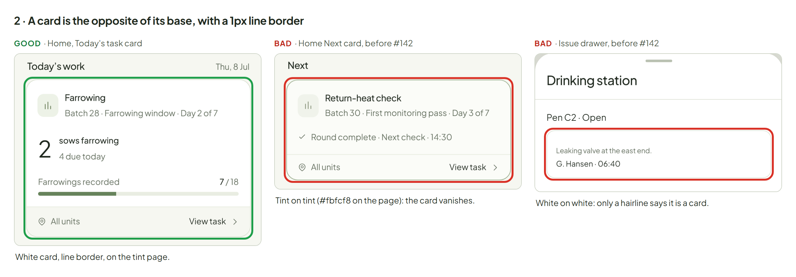
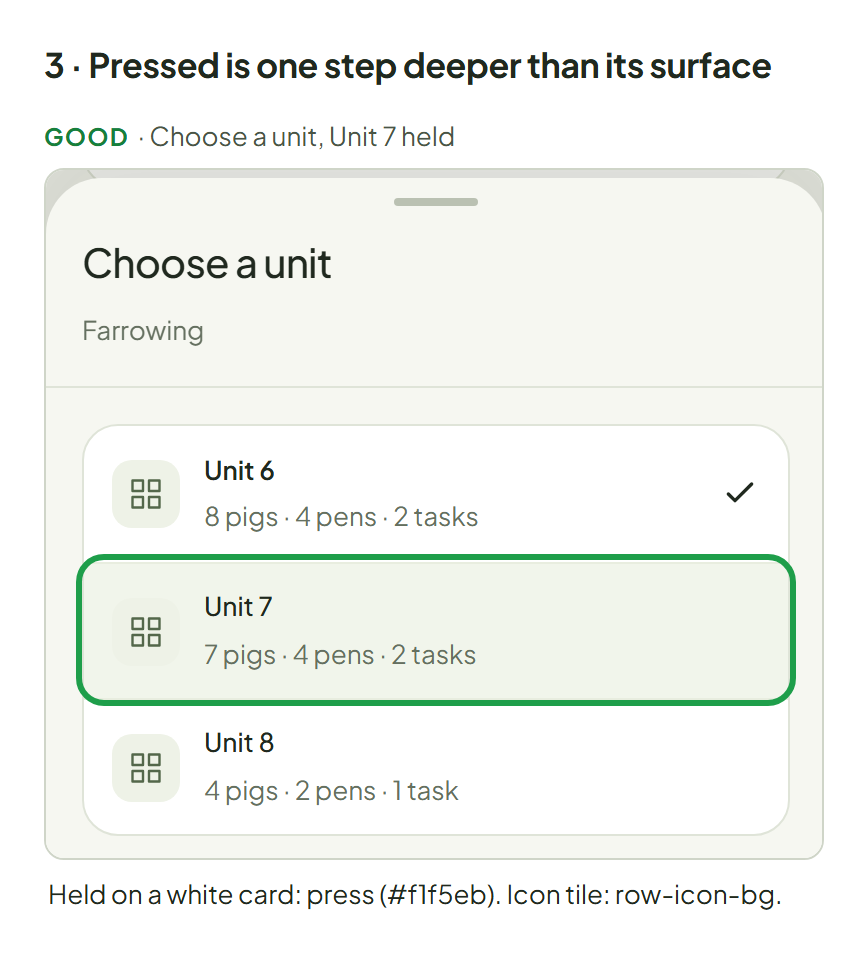
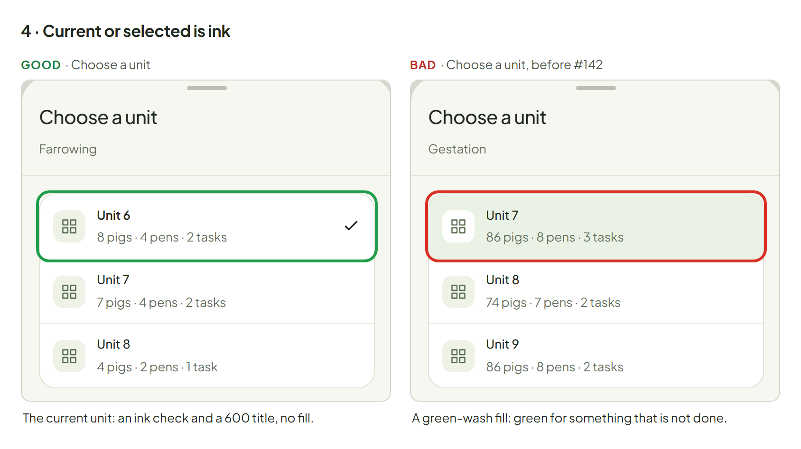
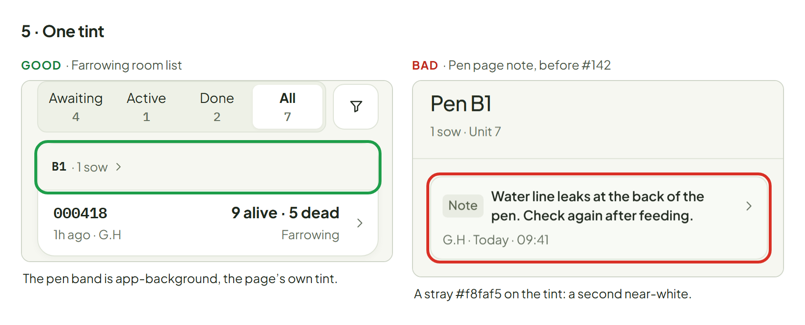
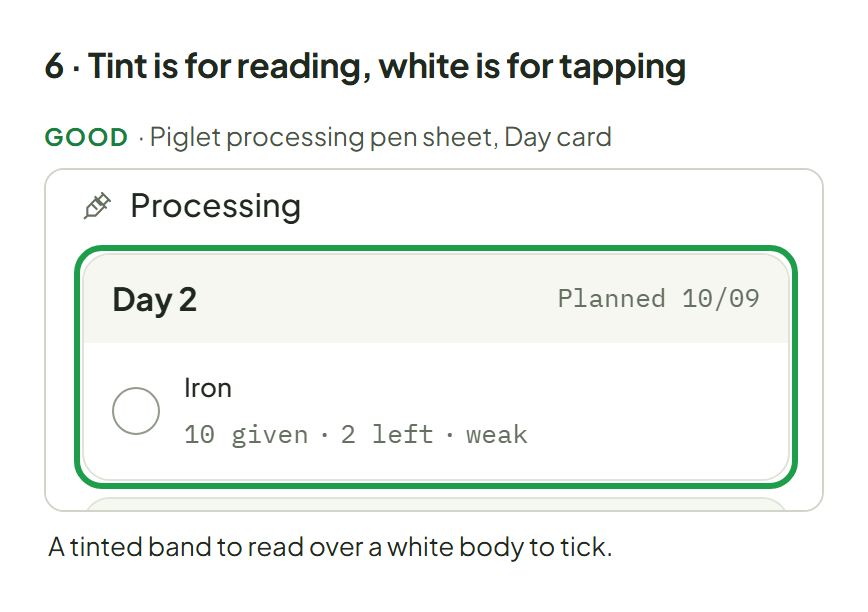
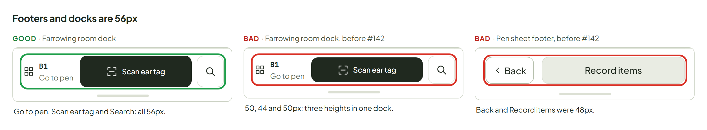

# Surfaces: bases, cards and colour

Owner ruling, 2026-10-12. **Read this before you build or change any screen, sheet or component.** The rule is mechanical, so most of it can be checked without taste: pick the base, the card is the opposite, and colour appears only where this page says it does. A guard test (`ux/system/surfaces.test.cjs`) fails the two regressions most likely to come back: a green current or selected fill, and a footer or dock button under 56px.

## The rule

1. **Pages and menu drawers are the tint (`app-background`) with white cards.** A menu drawer is one where every row is an option or a verb (Choose a unit, More actions, Allocate piglets, Go to pen, Measurements & condition). **Content and input drawers are white with tinted cards**: search, forms, records, filters, pen sheets, and **Today**, which stays white.
2. **A card is always the opposite of its base, with a 1px `line` border.** Nothing is flat (white on white), nothing is tint on tint, and no row list sits on a base without a card. **Docks and footers are white.**
3. **Icon tiles are `row-icon-bg`. Pressed is one step deeper than its surface:** `press` on white, `choice-press` on the tint.
4. **Current or selected is ink:** a ✓, a checkbox, or an ink ring. No green fill and no inset marker bar, anywhere.
5. **One tint.** `inset`, `surface` and `ground` are aliases of `app-background`; there is no second or third near-white. A stray hex tint (`#f6f7f2`, `#fbfcf8`, `#f8f9f3`, `#f8faf5`…) is a bug.
6. **Tint is for reading, white is for tapping.** Inside a white content drawer, a card you only read (facts, evidence, a batch) is the tint. A card that holds items you tap (a day's checklist) keeps a **white body** with a 1px `line` border and a **tinted head band** for its title, so the label and the work sit on two levels (owner, 2026-10-12, after an all-tint Day card read as dull). Never make a card of tappable items all tint.

Open question (owner to decide): lists of tappable rows in input drawers (Find a sow results, picker lists, the allocation choices) are a tinted card today. Rule 6 suggests white; both versions will be mocked before this changes.

Green means done, recorded or synced, nothing else. Amber and red washes mean status and are never a card's resting colour.

**Fills and washes (owner, 2026-10-14).** Fills colour a status that covers a whole area (a pen tile); washes stay text backgrounds; a fill is never a card's resting colour. The washes measure ΔE 2.8 from the tint and read grey at tile size, so an area takes a fill: `amber-fill` and `progress-fill`, each with its own dark ink, at 85% strength.

### Which context is my screen?

| Screen | `data-st-context` | Base | Cards | Pressed |
|---|---|---|---|---|
| An app page (Home, a pen page, a record page, the pig profile) | `page` | tint | white | `press` |
| A menu drawer: every row is an option or a verb | `menu` (`Sheet({surface:'menu'})`) | tint | white | `press` |
| A content or input drawer: search, forms, records, pen sheets, filters, Today | `drawer` (the default) | white | tint | `choice-press` |
| A dock, footer or bottom nav | (inside any of the above) | white, `line` top | | |

The test for menu or content: *is each row a thing with live state (content), or an option or a verb (menu)?* Today lists tasks, each with its own state, so it is content and stays white. Choose a unit lists options, so it is a menu.

Screens choose a context and never paint a panel colour. The context sets `--st-panel-bg` (a card's colour) and `--st-press` (a press); components read them. `.st-panel.st-panel.st-panel` beats any page rule on purpose, so a screen that sets `background` on a panel loses and looks "almost right by accident".

## Colour on each base

| Part | Page and menu drawer (tint base) | Content or input drawer (white base) |
|---|---|---|
| Card | `paper`, 1px `line`, `radius-panel` | `app-background`, 1px `line`, `radius-panel` |
| Group head band (inside a card) | the card's own colour | a card of tappable items (TaskDay): tinted band (`app-background`) over a white body; a read-only card: its own colour |
| Row divider | `rule` | `rule` |
| Icon tile | `row-icon-bg` | `row-icon-bg` |
| Pressed row | `press` (`#f1f5eb`) | `choice-press` (`#eaf0e2`) |
| Current row (`aria-current`) | ink ✓ in the right rail, 600 title, no fill | the same |
| Ticked or multi-selected row | ink checkbox or ink disc; at most `well` fill | the same |
| Selected tile (a choice tile, a pen cell) | 2px `ink` ring on `paper`, no fill | the same |
| Field | bare on the base, `field-border` | bare on the base |
| Footer, dock, bottom nav | `paper`, `line` top border | `paper`, `line` top border |
| Status wash (amber, red) | only for a status, never a card's resting colour | the same |
| Status fill (a pen tile) | `amber-fill` / `progress-fill` with `amber-fill-ink` / `progress-fill-ink` text and no border, only for a status that covers a whole area; never a card's resting colour | the same |

## Examples

An example is good only when the whole screen is approved, not just its colours. Good examples come from screens with an owner approval record (`features/*/approvals.json`) or from parts the owner endorsed: More actions, Your sections, Home's Today task card, Choose a unit, the piglet-processing pen sheet's Day card, the Farrowing room list and its dock, and the Inspection walk roster. Bad examples are `main` before #142 (`dd78778`), where the defect was real. Each board has at most three crops; the outline marks the part the caption is about: green is good, red is bad.

### 1. Pages and menu drawers are the tint with white cards

Green: More actions, a menu on the tint with a white card. Red: the same menu in piglet processing before #142, white with a tinted card (inverted).

### 2. A card is the opposite of its base

Green: Home's Today task card, white with a line border on the tint. Red: the old Next card, `#fbfcf8` on the tint, and the old evidence card, white on a white drawer; neither reads as a card.

### 3. Pressed is one step deeper

Green: Unit 7 held in Choose a unit: `press` on a white card, with the icon tile on `row-icon-bg`. On a tinted card the press is `choice-press`.

### 4. Current is ink

Green: the current unit is an ink ✓ and a 600 title, no fill. Red: the same picker before #142 filled the current unit `green-wash`, green for something that is not done.

### 5. One tint

Green: the room list's pen band is `app-background`, the page's own tint. Red: the old pen note card, a stray `#f8faf5` on the tint, a second near-white nobody can see.

### 6. Tint is for reading, white is for tapping

Green: the pen sheet's Day card, a tinted band you read over a white body of items you tick, with a 1px border. An all-tint version was tried and rejected (owner, 2026-10-12): it flattened the label and the work into one level.

### Footers and docks are 56px

Green: the Farrowing room dock, all three buttons 56px. Red: the same dock before #142 (50, 44 and 50px) and the old pen sheet footer (48px).

Footer and dock buttons (sheet footers, task docks, the room dock, bottom bars) are `--footer-height` (56px). Every other button and target is at least 44px. Do not raise `--control-height` for this: steppers, banner actions and row buttons read it.

## How to build with it

- Open a menu drawer with `SentriUI.sheet({ surface: 'menu', … })` (`K.drawer({ surface: 'menu' })` in a task). Every other drawer is a content drawer.
- Put a list of rows in a card: `rowGroup(...)` or `
`. A single card per list; no card inside a card.
- Show the current row with `attrs: { 'aria-current': 'location' }`; Row draws the ✓. Do not add a fill, a bar or a green colour.
- Read `var(--st-panel-bg)` for a card's colour and `var(--st-press)` for a press in screen CSS. Never write a tint hex.
- A dock or footer button uses `var(--footer-height)`.
