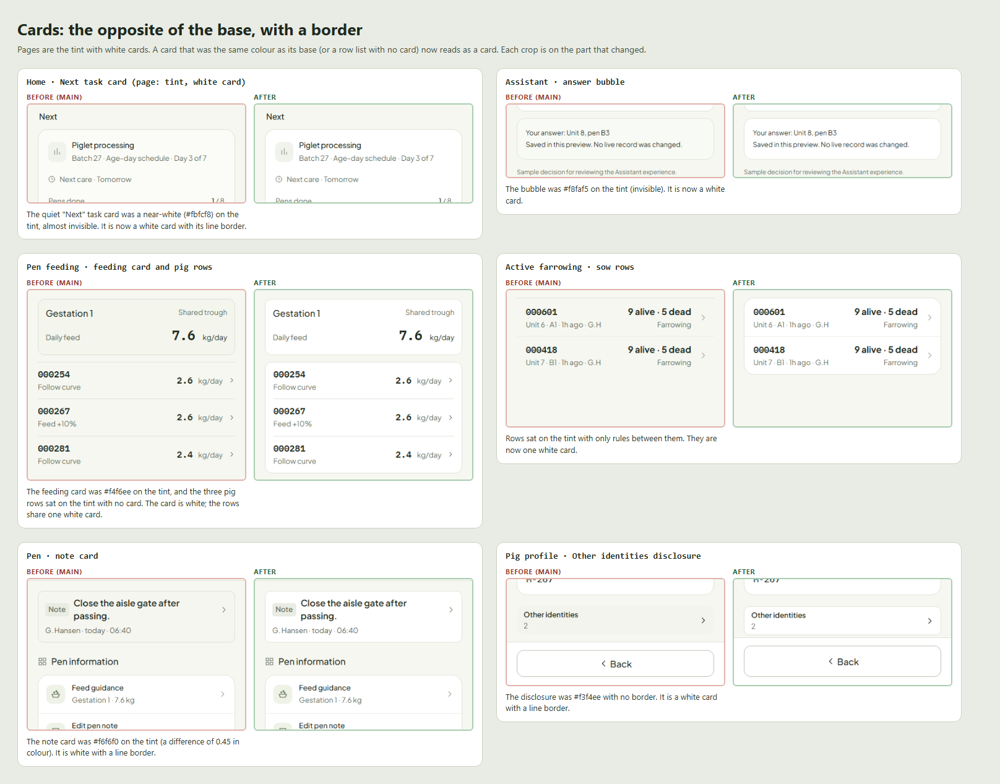
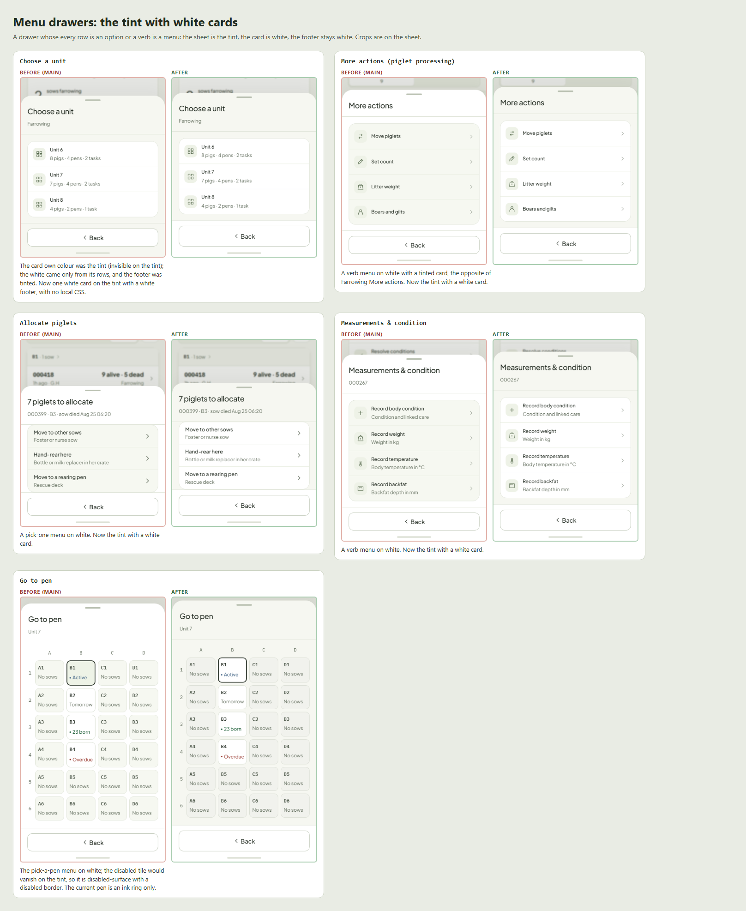
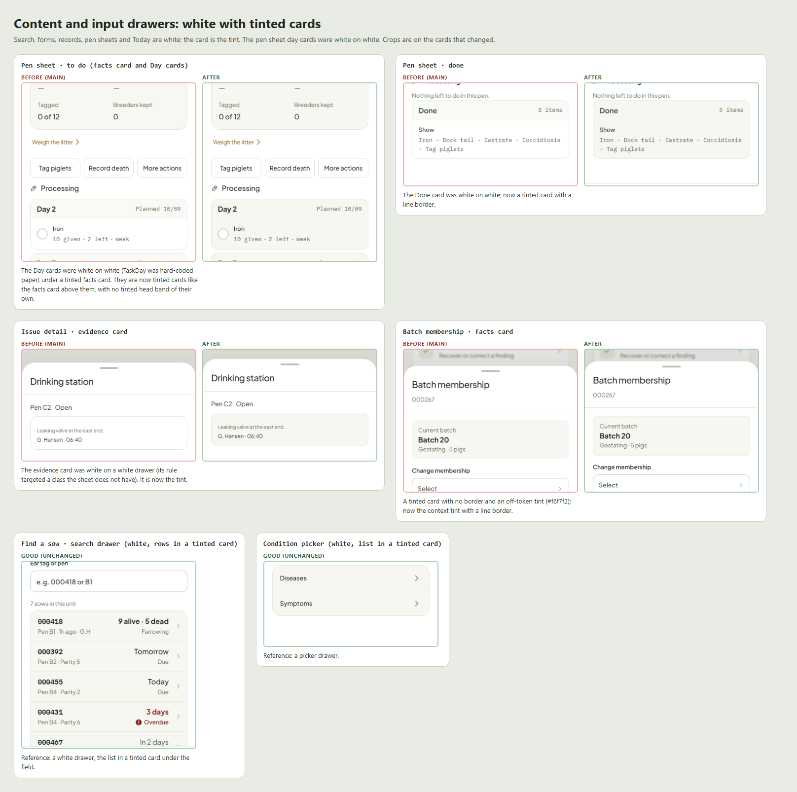
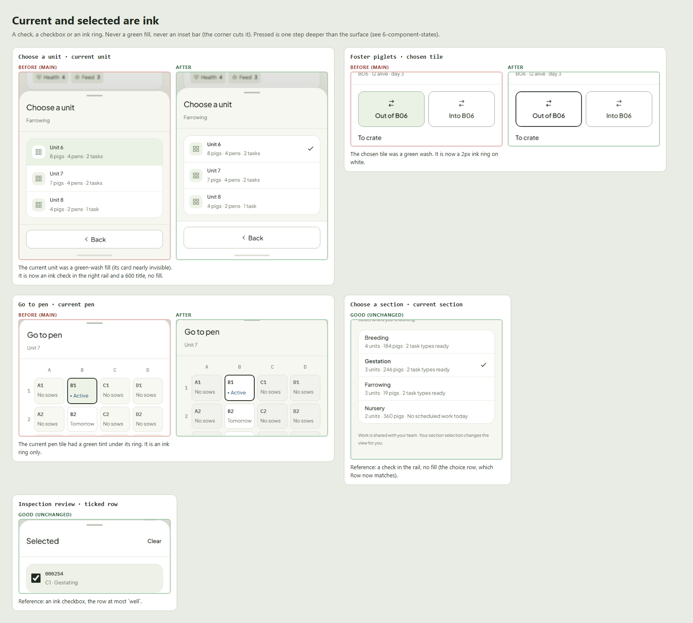
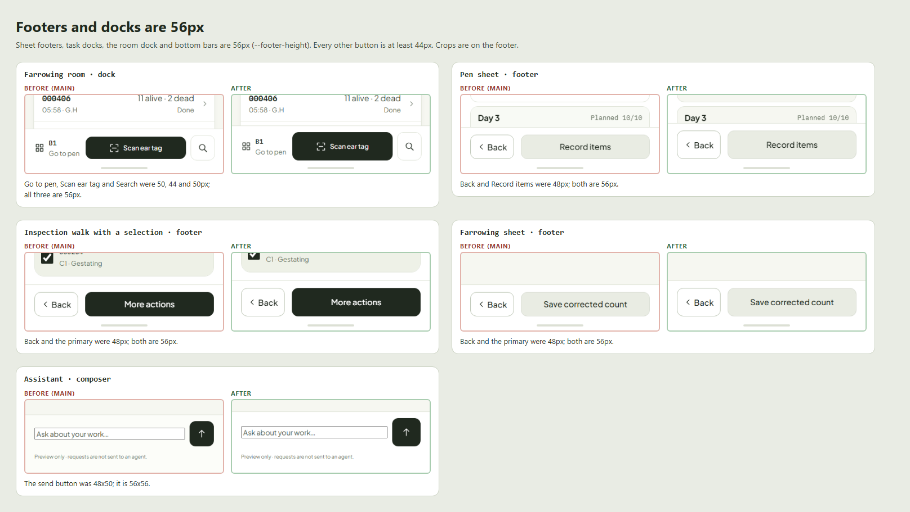
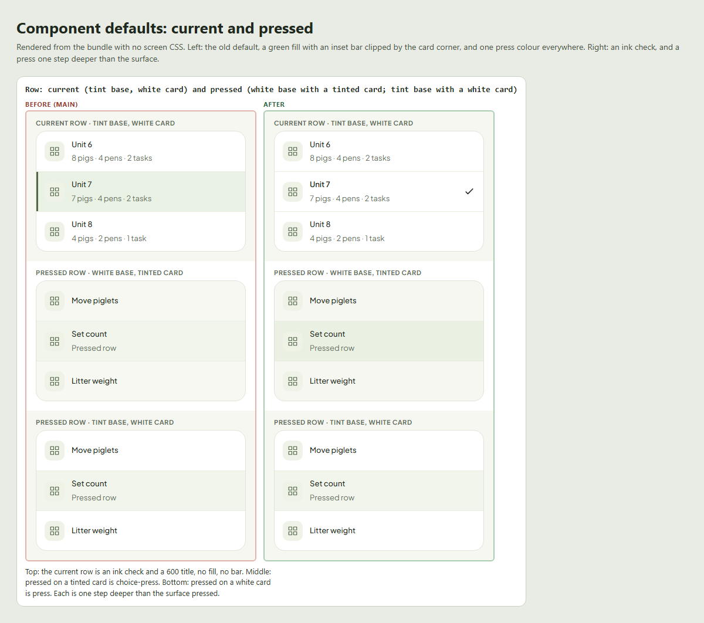

# Surfaces: bases, cards and colour

Owner ruling, 2026-10-12. **Read this before you build or change any screen, sheet or component.** The rule is mechanical, so most of it can be checked without taste: pick the base, the card is the opposite, and colour appears only where this page says it does. A guard test (`ux/system/surfaces.test.cjs`) fails the two regressions most likely to come back: a green current or selected fill, and a footer or dock button under 56px.

## The rule

1. **Pages and menu drawers are the tint (`app-background`) with white cards.** A menu drawer is one where every row is an option or a verb (Choose a unit, More actions, Allocate piglets, Go to pen, Measurements & condition). **Content and input drawers are white with tinted cards**: search, forms, records, filters, pen sheets, and **Today**, which stays white.
2. **A card is always the opposite of its base, with a 1px `line` border.** Nothing is flat (white on white), nothing is tint on tint, and no row list sits on a base without a card. **Docks and footers are white.**
3. **Icon tiles are `row-icon-bg`. Pressed is one step deeper than its surface:** `press` on white, `choice-press` on the tint.
4. **Current or selected is ink:** a ✓, a checkbox, or an ink ring. No green fill and no inset marker bar, anywhere.
5. **One tint.** `inset`, `surface` and `ground` are aliases of `app-background`; there is no second or third near-white. A stray hex tint (`#f6f7f2`, `#fbfcf8`, `#f8f9f3`…) is a bug.

Green means done, recorded or synced, nothing else. Amber and red washes mean status and are never a card's resting colour.

### Which context is my screen?

| Screen | `data-st-context` | Base | Cards | Pressed |
|---|---|---|---|---|
| An app page (Home, a pen page, a record page, the pig profile) | `page` | tint | white | `press` |
| A menu drawer: every row is an option or a verb | `menu` (`Sheet({surface:'menu'})`) | tint | white | `press` |
| A content or input drawer: search, forms, records, pen sheets, filters, Today | `drawer` (the default) | white | tint | `choice-press` |
| A dock, footer or bottom nav | (inside any of the above) | white, `line` top | | |

The test for menu or content: *is each row a thing with live state (content), or an option or a verb (menu)?* Today lists tasks, each with its own state, so it is content and stays white. Choose a unit lists options, so it is a menu.

Screens choose a context and never paint a panel colour. The context sets `--st-panel-bg` (a card's colour) and `--st-press` (a press); components read them. `.st-panel.st-panel.st-panel` beats any page rule on purpose, so a screen that sets `background` on a panel loses and looks "almost right by accident".

## Colour on each base

| Part | Page and menu drawer (tint base) | Content or input drawer (white base) |
|---|---|---|
| Card | `paper`, 1px `line`, `radius-panel` | `app-background`, 1px `line`, `radius-panel` |
| Group head band (inside a card) | the card's own colour, no tint of its own (TaskDay head) | the card's own colour |
| Row divider | `rule` | `rule` |
| Icon tile | `row-icon-bg` | `row-icon-bg` |
| Pressed row | `press` (`#f1f5eb`) | `choice-press` (`#eaf0e2`) |
| Current row (`aria-current`) | ink ✓ in the right rail, 600 title, no fill | the same |
| Ticked or multi-selected row | ink checkbox or ink disc; at most `well` fill | the same |
| Selected tile (a choice tile, a pen cell) | 2px `ink` ring on `paper`, no fill | the same |
| Field | bare on the base, `field-border` | bare on the base |
| Footer, dock, bottom nav | `paper`, `line` top border | `paper`, `line` top border |
| Status wash (amber, red) | only for a status, never a card's resting colour | the same |

### Cards, and nothing flat

Each pair is before (red) and after (green), cropped on the part that changed. The invisible cards that were fixed: the quiet Home task card, the Assistant bubble, the feeding card and its pig rows, the note card, the "Other identities" disclosure.

### Menu drawers

### Content drawers: the card is the tint, and a day card is a card

The pen sheet's Day cards were white on white (TaskDay was hard-coded `paper`). They now follow the context: tinted in a content drawer, white on a page. The cropped pairs here are on the Day cards, the part that changed.

### Current, selected and pressed

The old current row was a `green-wash` fill with a 3px inset bar, and the bar was cut by the card's rounded corner. The old chosen tile was green. Both were green for something that is not done.

### Footers and docks are 56px

Footer and dock buttons (sheet footers, task docks, the room dock, bottom bars) are `--footer-height` (56px). Every other button and target is at least 44px. Do not raise `--control-height` for this: steppers, banner actions and row buttons read it.

## Component defaults

Rendered from the bundle with no screen CSS. The left side is the old default, the right the new one.

## How to build with it

- Open a menu drawer with `SentriUI.sheet({ surface: 'menu', … })` (`K.drawer({ surface: 'menu' })` in a task). Every other drawer is a content drawer.
- Put a list of rows in a card: `rowGroup(...)` or `
`. A single card per list; no card inside a card.
- Show the current row with `attrs: { 'aria-current': 'location' }`; Row draws the ✓. Do not add a fill, a bar or a green colour.
- Read `var(--st-panel-bg)` for a card's colour and `var(--st-press)` for a press in screen CSS. Never write a tint hex.
- A dock or footer button uses `var(--footer-height)`.

## Examples that failed (before this change)

The audit that produced this rule, `surfaces/audit/`, has the original boards. Their "Bad" sides are the state of `main` before this change and are now fixed; their "Good" sides are still the references. The pen sheet's Day-card pair on that board cropped the changed cards out, so it showed no difference; use `surfaces/3-content-drawers.png` instead.

| Audit board | Shows |
|---|---|
| `audit/1-white-base-tinted-card.png` | Good: white drawers with tinted cards. Bad: the same pairing in menu drawers |
| `audit/2-tinted-base-white-card.png` | Good: pages with white cards. Bad: naked rows, quiet cards, a transparent card |
| `audit/3-flat-same-colour.png` | Flat cards (the Day-card crop on this board hides the change) |
| `audit/4-invisible-or-inverted.png` | Invisible tint-on-tint cards and the inverted menu drawer |
| `audit/5-current-selected-pressed.png` | Ink current and selected against green current and a green tile |
| `audit/5b-component-states-specimen.png` | The component defaults |
